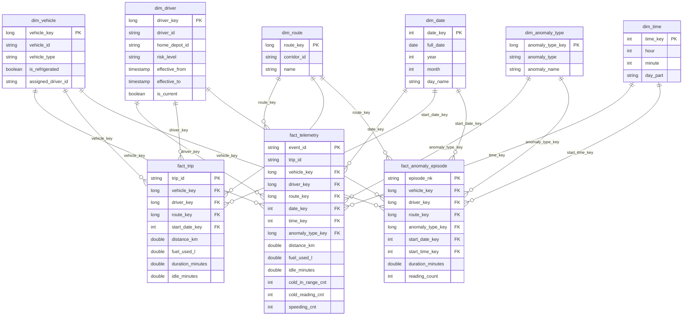

# Gold Warehouse (Person 3): Modeling, Schema, KPIs and Metadata

This document describes the gold layer of the fleet telemetry pipeline on Microsoft Fabric (Lakehouse + Delta). It explains **what we built, why it is shaped this way, how to run it, and what to know before using the data**. It is written for the whole team so that questions can be answered from one place.

## Contents

1. [Scope and ownership](#1-scope-and-ownership)
2. [KPIs the model was built around](#2-kpis-the-model-was-built-around)
3. [Data model](#3-data-model)
4. [Table reference (data dictionary)](#4-table-reference-data-dictionary)
5. [Business rules and design decisions](#5-business-rules-and-design-decisions)
6. [Source metadata (silver and reference data)](#6-source-metadata-silver-and-reference-data)
7. [Known data findings](#7-known-data-findings)
8. [Quality checks](#8-quality-checks)
9. [Notebooks, run order and orchestration](#9-notebooks-run-order-and-orchestration)
10. [Querying the gold layer](#10-querying-the-gold-layer)
11. [Open items and questions for teammates](#11-open-items-and-questions-for-teammates)
12. [Conventions and glossary](#12-conventions-and-glossary)

---

## 1. Scope and ownership

The pipeline chain is: Person 1 produces **bronze**, Person 2 turns bronze into **silver**, Person 3 (this layer) turns silver into **gold**, Person 4 connects, automates and builds the dashboard.

| | Person 3 receives | Person 3 delivers |
|---|---|---|
| **From Person 2** | `silver_telemetry`, `silver_telemetry_anomalies`, `silver_anomaly_episodes`, `silver_rejected`, `evaluation_metrics` | |
| **From Person 1** | `ref_vehicles`, `ref_corridors`, `ref_trips`, `ref_depots`, `ref_drivers_v1`, `ref_drivers_v2` | |
| **To Person 4** | | The gold tables, the three KPI tables (and T-SQL views), `gold_quality_results`, `gold_reconciliation_results`, `gold_job_run_times`, the table relationships (section 3), and the run order (section 9) |

All table names in the notebooks are unqualified: they resolve in the **default Lakehouse** attached to each notebook.

---

## 2. KPIs the model was built around

The work plan defines three KPIs. Every modelling choice below exists to make these three correct at any grouping (route, day, driver, vehicle).

| # | KPI (definition from the work plan) | Numerator / measures stored | Where it lives | Dimensions available for slicing |
|---|---|---|---|---|
| 1 | **Fuel efficiency per route** = total km driven / total litres of fuel used on that route | `distance_km`, `fuel_used_l` (both additive) | Fact: `gold_fact_telemetry`, `gold_fact_trip`. KPI table: `gold_kpi_fuel_efficiency_route` | route, date, vehicle, driver |
| 2 | **Cold-chain compliance %** = refrigerated readings inside 2 to 8 C / all refrigerated readings; plus the number of cold-chain breach episodes | `cold_in_range_cnt`, `cold_reading_cnt` (additive counters); breach episodes from `gold_fact_anomaly_episode` | KPI table: `gold_kpi_cold_chain` | route, date, vehicle, driver |
| 3 | **Driver safety / idling scorecard** = per driver and period: idling minutes, number of excessive-idling episodes, number of readings above 90 km/h, number of route deviations | `idle_minutes`, `speeding_cnt` (readings); episode counts by type from `gold_fact_anomaly_episode` | KPI table: `gold_kpi_driver_scorecard` | driver (version valid at the time), date |

**Why ratios are never stored.** Fuel efficiency and compliance % are non-additive: the average of two ratios is not the ratio of the totals. We store the numerator and denominator (km and litres; readings in range and total readings) and divide only after summing. Any grouping therefore gives the right answer. The KPI tables contain the ratio column for convenience, but dashboards should re-divide the summed numerator and denominator (see the views in section 10).

**Dashboard pages these tables support** (from the work plan): route efficiency, cold chain, driver scorecards, and the fleet overview (which can be derived from the facts). The pipeline-health and detection-quality pages use other sources (`bronze_ingestion_log`, `dlq_telemetry`, `silver_rejected`, `evaluation_metrics`) and are outside the gold model.

---

## 3. Data model

### 3.1 Star schema



All tables carry the `gold_` prefix in the Lakehouse (for example `gold_fact_telemetry`). The diagram omits the prefix and shows only the key columns and the main measures; section 4 lists every column.

`trip_id` in `fact_telemetry` is a **degenerate key**: it identifies the trip but has no dimension table. Use it to join `fact_telemetry` to `fact_trip`.

### 3.2 Grain statements

| Table | One row is... |
|---|---|
| `gold_fact_telemetry` | one vehicle reading (one `event_id`) |
| `gold_fact_trip` | one trip (one `trip_id`) |
| `gold_fact_anomaly_episode` | one detected anomaly episode (vehicle + anomaly type + `episode_id`) |
| `gold_dim_vehicle` | one vehicle |
| `gold_dim_route` | one corridor (route) |
| `gold_dim_driver` | one **version** of one driver |
| `gold_dim_date` | one calendar day |
| `gold_dim_time` | one minute of the day |
| `gold_dim_anomaly_type` | one anomaly type (plus the member `none`, key 0) |
| `gold_kpi_fuel_efficiency_route` | one route x one day |
| `gold_kpi_cold_chain` | one route x one day |
| `gold_kpi_driver_scorecard` | one driver version x one day |

### 3.3 Keys

| Dimension | Surrogate key | Natural key | Notes |
|---|---|---|---|
| `gold_dim_vehicle` | `vehicle_key` | `vehicle_id` | Type 1 |
| `gold_dim_route` | `route_key` | `corridor_id` | Type 1. "Route" and "corridor" mean the same thing |
| `gold_dim_driver` | `driver_key` | `driver_id` + `effective_from` | Type 2. One driver can have several rows |
| `gold_dim_anomaly_type` | `anomaly_type_key` | `anomaly_type` | `none` has key 0 |
| `gold_dim_date` | `date_key` = `yyyyMMdd` (for example `20261103`) | `full_date` | Smart key, computed straight from a timestamp |
| `gold_dim_time` | `time_key` = `hour * 100 + minute` (for example `1230`) | `time_label` | Smart key, grain is one minute |

Fact natural keys used for MERGE: `event_id` (telemetry), `trip_id` (trip), `episode_nk` = `vehicle_id|anomaly_type|episode_id` (episode). `episode_id` alone is **not** unique because it restarts for each vehicle.

**Why surrogate keys exist.** After history tracking one driver has several rows, so `driver_id` is no longer unique. Each version gets its own `driver_key`, and a fact row points to the exact version that was valid at its time. For vehicle and route a surrogate key is not strictly needed (one row each) and is used for a uniform join pattern.

### 3.4 Metric classification

| Type | Metrics |
|---|---|
| **Additive** (can be summed in any direction) | `distance_km`, `fuel_used_l`, `idle_minutes`, `interval_sec`, `cold_reading_cnt`, `cold_in_range_cnt`, `speeding_cnt`, all `*_flag` columns, `reading_count`, episode counts, `duration_*` |
| **Semi-additive** (sum across vehicles at one moment, never across time) | `odometer_km` |
| **Non-additive** (never summed; store numerator and denominator) | fuel efficiency, compliance %, `speed_kmh`, `rpm`, temperatures, `max_calculated_speed` |

### 3.5 Slowly changing dimensions

| Dimension | Type | Tracked attributes |
|---|---|---|
| `gold_dim_driver` | **Type 2** (history kept) | `home_depot_id`, `risk_level`, `license_class` |
| `gold_dim_vehicle` | Type 1 (overwrite) | all attributes |
| `gold_dim_route` | Type 1 (overwrite) | all attributes |

**How Type 2 works here.** Each driver row has `effective_from`, `effective_to` and `is_current`. The current row has `effective_to = 9999-12-31 23:59:59`, so a range condition works without special NULL handling. When a tracked attribute changes, one MERGE closes the old row (`is_current = false`, `effective_to` = start of the new version) and inserts the new row.

Example (illustrative values):

| driver_key | driver_id | home_depot_id | risk_level | effective_from | effective_to | is_current |
|---|---|---|---|---|---|---|
| 1 | DRV-00001 | DEP-PSD | medium | 2026-01-01 00:00 | 2026-11-03 12:00 | false |
| 5201 | DRV-00001 | DEP-CAI | high | 2026-11-03 12:00 | 9999-12-31 23:59 | true |

**Point-in-time join.** A fact row takes the driver version that was valid at its event time:

```
driver_id = assigned_driver_id
AND event_time >= effective_from
AND event_time <  effective_to
```

The upper bound is exclusive, so a reading exactly at the change time belongs to the new version only.

**The change date is an assumption.** `ref_drivers_v1` and `ref_drivers_v2` carry no real change date (the rows inspected show `effective_from = 2026-01-01` in both files). We apply v2 at `2026-11-03 12:00:00` (`V2_EFFECTIVE` in `NB00_setup`), which is inside the simulated period (2026-11-02 06:00 to 2026-11-04 15:05), so readings before and after the change point to different versions. If Person 1 provides a real date, change `V2_EFFECTIVE`, delete `gold_dim_driver` and re-run the notebooks.

---

## 4. Table reference (data dictionary)

### 4.1 Dimensions

**`gold_dim_date`**

| Column | Type | Description |
|---|---|---|
| `date_key` | int | `yyyyMMdd`, primary key |
| `full_date` | date | Calendar date |
| `year`, `quarter`, `month`, `day` | int | Date parts |
| `month_name`, `day_name` | string | English names |
| `day_of_week` | int | Spark convention: Sunday = 1 ... Saturday = 7 |
| `week_of_year` | int | Week number |
| `is_weekend` | boolean | True for Friday and Saturday |

Initial range is 2026-01-01 to 2026-12-31. `NB02` extends it automatically if the data falls outside.

**`gold_dim_time`**

| Column | Type | Description |
|---|---|---|
| `time_key` | int | `hour * 100 + minute`, primary key |
| `hour`, `minute`, `minute_of_day` | int | Time parts (0 to 1439 for `minute_of_day`) |
| `time_label` | string | `HH:mm` |
| `day_part` | string | `night` (00-05), `morning` (06-11), `afternoon` (12-17), `evening` (18-23) |

**`gold_dim_anomaly_type`**

| Column | Type | Description |
|---|---|---|
| `anomaly_type_key` | long | Primary key. `0` = `none` |
| `anomaly_type` | string | Technical name, matches silver |
| `anomaly_name` | string | Display name |
| `definition` | string | Rule in plain words |
| `source` | string | `work plan`, `added by Person 2`, `gold load` or `discovered in silver` |

Members: `none` (0), `cold_chain_breach` (1), `excessive_idling` (2), `route_deviation` (3), `engine_overheating` (4, added by Person 2; not in the work plan). Any other type found in silver is added automatically by `NB02`.

**`gold_dim_vehicle`** (Type 1)

| Column | Type | Description |
|---|---|---|
| `vehicle_key` | long | Primary key |
| `vehicle_id` | string | Natural key, for example `VEH-00001` |
| `vehicle_type` | string | For example `dry_van`, `refrigerated_truck` |
| `make`, `model` | string | Vehicle make and model |
| `model_year` | int | Model year |
| `home_depot_id` | string | Home depot (`ref_depots.depot_id`) |
| `assigned_driver_id` | string | Driver assigned to the vehicle |
| `start_odometer_km` | double | Odometer at the start of the simulation |
| `is_refrigerated` | boolean | `vehicle_type = 'refrigerated_truck'` |

**`gold_dim_route`** (Type 1)

| Column | Type | Description |
|---|---|---|
| `route_key` | long | Primary key |
| `corridor_id` | string | Natural key, for example `COR-001` |
| `name` | string | For example `Alexandria - Hurghada` |
| `origin_depot_id`, `dest_depot_id` | string | End points |
| `planned_distance_km` | double | Planned distance |
| `point_count` | int | Number of GPS points describing the corridor |
| `reefer_temp_min_c`, `reefer_temp_max_c` | double | Allowed cargo temperature range |

**`gold_dim_driver`** (Type 2)

| Column | Type | Description |
|---|---|---|
| `driver_key` | long | Primary key (one per version) |
| `driver_id` | string | Natural key, repeated across versions |
| `full_name` | string | Driver name |
| `home_depot_id` | string | Tracked attribute |
| `risk_level` | string | Tracked attribute (`low`, `medium`, `high`) |
| `license_class` | string | Tracked attribute |
| `hire_date` | date | Not tracked |
| `effective_from` | timestamp | Version start (inclusive) |
| `effective_to` | timestamp | Version end (exclusive); `9999-12-31 23:59:59` for the current version |
| `is_current` | boolean | True for the latest version; exactly one per driver |

### 4.2 Facts

**`gold_fact_telemetry`** (partitioned by `date_key`)

| Column | Type | Description |
|---|---|---|
| `event_id` | string | Natural key (unique reading id) |
| `trip_id` | string | Degenerate key |
| `vehicle_key`, `driver_key`, `route_key`, `anomaly_type_key` | long | Foreign keys |
| `date_key`, `time_key` | int | Foreign keys, computed from `event_time` |
| `event_time` | timestamp | Reading time (UTC) |
| `latitude`, `longitude` | double | GPS position (raw) |
| `speed_kmh`, `rpm`, `engine_temp_c`, `fuel_rate_lph`, `cargo_temp_c` | double / int | Raw sensor values (not additive) |
| `odometer_km` | double | Semi-additive |
| `interval_sec` | long | Seconds since the previous reading when the interval is valid (1 to 300), otherwise 0 |
| `distance_km` | double | Distance for the interval (0 when the interval is invalid or the GPS jumped) |
| `fuel_used_l` | double | `fuel_rate_lph * interval_sec / 3600`; 0 when the rate is negative |
| `idle_minutes` | double | Idling minutes for the interval |
| `cold_reading_cnt` | int | 1 when a refrigerated vehicle reported a cargo temperature (denominator) |
| `cold_in_range_cnt` | int | 1 when that temperature is within 2 to 8 C (numerator) |
| `speeding_cnt` | int | 1 when `speed_kmh > 90` |
| `idling_flag`, `cold_violation_flag`, `gps_teleport_flag`, `overheating_flag`, `rpm_spike_flag`, `cold_breach_flag`, `excessive_idling_flag`, `anomaly_flag` | int | 0/1 flags copied from silver |

**`gold_fact_trip`**

| Column | Type | Description |
|---|---|---|
| `trip_id` | string | Primary key |
| `vehicle_key`, `driver_key`, `route_key` | long | Taken from the **first** reading of the trip (driver version at trip start) |
| `start_date_key` | int | Foreign key to `gold_dim_date` |
| `trip_start`, `trip_end` | timestamp | First and last reading |
| `duration_minutes` | double | `(trip_end - trip_start)` in minutes |
| `reading_count` | long | Readings in the trip |
| `distance_km`, `fuel_used_l`, `idle_minutes` | double | Sums from `gold_fact_telemetry` |
| `refrigerated_readings_total`, `refrigerated_readings_in_range` | long | Cold-chain denominator and numerator |
| `speeding_readings`, `anomaly_readings` | long | Counts |

**`gold_fact_anomaly_episode`**

| Column | Type | Description |
|---|---|---|
| `episode_nk` | string | Primary key: `vehicle_id|anomaly_type|episode_id` |
| `episode_id` | long | Silver episode number (restarts per vehicle) |
| `vehicle_key`, `driver_key`, `route_key`, `anomaly_type_key` | long | Foreign keys (driver version at `start_time`; route is the vehicle's main corridor) |
| `start_date_key`, `start_time_key` | int | Foreign keys |
| `start_time`, `end_time` | timestamp | Episode boundaries |
| `duration_seconds`, `duration_minutes` | long / double | Duration |
| `reading_count` | long | Readings in the episode |
| `max_calculated_speed` | double | Non-additive; useful for GPS-jump episodes |

### 4.3 KPI tables (recomputed with overwrite on every run)

**`gold_kpi_fuel_efficiency_route`**: `route_key`, `corridor_id`, `route_name`, `date_key`, `total_km`, `total_litres`, `km_per_litre`, `readings`.

**`gold_kpi_cold_chain`**: `route_key`, `corridor_id`, `route_name`, `date_key`, `readings_in_range`, `readings_total`, `compliance_pct`, `breach_episodes`.

**`gold_kpi_driver_scorecard`**: `driver_key`, `driver_id`, `full_name`, `home_depot_id`, `risk_level`, `date_key`, `idling_minutes`, `excessive_idling_episodes`, `speeding_readings`, `route_deviations`. Attributes come from the driver version valid at that time.

### 4.4 Operational tables

| Table | Columns | Purpose |
|---|---|---|
| `gold_quality_results` | `run_id`, `run_ts`, `run_type` (`real` or `demo`), `check_name`, `table_name`, `failed_rows`, `status` (`PASS`, `WARN`, `FAIL`), `detail` | Every quality check result, appended per run |
| `gold_reconciliation_results` | `kpi`, `metric`, `groups_compared`, `groups_mismatched`, `gold_total`, `silver_total`, `max_abs_diff`, `status` (`MATCH` or `MISMATCH`), `run_ts` | Gold KPIs compared with the same KPIs recomputed from silver |
| `gold_job_run_times` | `job`, `finished_at`, `seconds`, `rows` | Measured run time of each notebook step (input for the performance record) |

---

## 5. Business rules and design decisions

| # | Decision | Reason |
|---|---|---|
| 1 | **Source of the telemetry fact is `silver_telemetry_anomalies`.** | It has the same rows as `silver_telemetry` plus vehicle attributes, the previous-reading gap, the distance and the flags, so nothing is recomputed. Row counts are checked against `silver_telemetry`. |
| 2 | **One row per `event_id`** (`dedupe_telemetry`): keep the copy with the largest time gap. | Silver contains repeated `event_id` values (section 7). A random pick could keep the copy whose gap is 0 and lose its distance and fuel. |
| 3 | **Driver of a reading = `assigned_driver_id` of the vehicle**, resolved to the version valid at `event_time`. | Silver has no per-reading driver. |
| 4 | **Route (corridor)**: from `ref_trips` by `trip_id`; when the trip is not found, the corridor the vehicle uses most often in `ref_trips`. Episodes use the vehicle's main corridor. | Silver has no corridor column. All 5,000 vehicles have exactly one corridor in `ref_trips`, so the fallback gives the same route a trip match would. No silver `trip_id` matches `ref_trips` (see section 11). The assumption is that the planned corridor is the corridor actually driven. |
| 5 | **Valid interval**: the gap to the previous reading must be between 1 and 300 seconds (`MAX_GAP_SEC`). | Readings arrive every 30 seconds. A longer gap means a stop or a new trip; multiplying a fuel rate by hours of gap produces fake litres. |
| 6 | **Distance** = silver `distance_km` when the interval is valid, the reading is not flagged as a GPS jump and the calculated speed is at most 200 km/h; otherwise 0. | Some calculated speeds are in the millions of km/h (GPS jumps) and would destroy fuel efficiency. |
| 7 | **Fuel used** = `fuel_rate_lph * interval_sec / 3600`; 0 when `fuel_rate_lph < 0`. | A negative rate (for example `-5.0`) is an impossible sensor value. Effect: about 0.03% of rows. |
| 8 | **Idle minutes** = interval seconds / 60 when `is_idling` is true and the interval is valid. | Uses Person 2's idling flag. |
| 9 | **Cold chain**: a reading counts when the vehicle is `refrigerated_truck` and `cargo_temp_c` is not empty; it is in range when `cargo_temp_c` is between 2 and 8 inclusive. | Dry vans have an empty cargo temperature by design. |
| 10 | **Speeding** = `speed_kmh > 90`. | Work plan. Impossible speeds are counted too (known limit, below 0.1% of rows). |
| 11 | **`none` member (key 0)** in `gold_dim_anomaly_type`. | Most readings have no anomaly; a NULL key would break the "no empty keys" check. |
| 12 | **`engine_overheating`** added to the anomaly dimension. | It exists in silver but not in the work plan; without it the foreign key would break. |
| 13 | **Loads use MERGE on the natural key**; the telemetry MERGE updates a row only when a key or a measure changed. | Re-running a load never duplicates rows and does not rewrite millions of unchanged rows. |
| 14 | **Telemetry fact is partitioned by `date_key`.** | Day filters read one folder. Partitioning by vehicle would create thousands of small folders. |
| 15 | **KPI tables are rebuilt with overwrite.** | They are fully derived and deterministic; Delta still keeps their history for time travel. |
| 16 | **KPIs are Delta tables, not Spark views.** | Spark views do not appear in the Lakehouse SQL analytics endpoint. T-SQL views are created on top (section 10). |
| 17 | **Quality gate runs after the facts are loaded and before the KPI tables are built.** | A failure stops everything that publishes numbers. The work plan says "before gold data is saved"; doing that literally would mean computing 8 million rows twice. This is a known deviation. |
| 18 | **Out-of-range raw sensor values are kept and reported as `WARN`** (`SENSOR_RANGE_BLOCKING = False`). | The work plan says sensor errors stay visible, not hidden. Set the flag to `True` to make them block the run. |
| 19 | **Reconciliation applies the same measure definitions to silver.** | It proves that joins, keys, MERGE and aggregation are correct. It does not independently prove the business definitions themselves. |

---

## 6. Source metadata (silver and reference data)

### 6.1 Observed period and scale

| Item | Value |
|---|---|
| First reading | 2026-11-02 06:00:00 |
| Last reading | 2026-11-04 15:05:03 |
| Vehicles | 5,000 |
| Reading interval | about 30 seconds per vehicle |

### 6.2 Event fields (from the work plan, shared by every layer)

| Field | Meaning |
|---|---|
| `event_id` | Unique id of the reading; used to find duplicates |
| `vehicle_id` | One of the 5,000 vehicles |
| `trip_id` | Trip the vehicle is currently on |
| `event_time` | When the reading was taken (UTC) |
| `latitude`, `longitude` | GPS position |
| `speed_kmh` | Speed in km/h |
| `rpm` | Engine revolutions per minute; 0 means the engine is off |
| `engine_temp_c` | Engine temperature in C |
| `fuel_rate_lph` | Fuel consumption in litres per hour |
| `odometer_km` | Total distance travelled so far |
| `cargo_temp_c` | Cargo temperature in C; empty for non-refrigerated vehicles (normal, not an error) |

### 6.3 Anomaly definitions (simulation thresholds, not legal ones)

| Anomaly | Rule |
|---|---|
| Cold-chain breach | Refrigerated vehicle, cargo temperature outside 2 to 8 C for 3 or more consecutive readings |
| Excessive idling | Speed below 2 km/h with rpm above 0 for 10 minutes or more in a row |
| Route deviation | More than 2 km from the assigned corridor for 3 or more consecutive readings |
| Engine overheating | Added by Person 2 (not in the work plan) |

### 6.4 Silver tables used by gold

| Table | Rows (observed) | Description |
|---|---|---|
| `silver_telemetry` | 8,146,714 (8,053,306 distinct `event_id`) | Cleaned readings. Columns: `db_id`, `source`, `is_valid`, `reject_reason`, `EventEnqueuedUtcTime`, `event_id`, `vehicle_id`, `trip_id`, `event_time`, `latitude`, `longitude`, `speed_kmh`, `rpm`, `engine_temp_c`, `fuel_rate_lph`, `odometer_km`, `cargo_temp_c`, `event_date` |
| `silver_telemetry_anomalies` | 8,146,714 (8,053,306 distinct `event_id`) | Same readings plus: `vehicle_type`, `make`, `model`, `model_year`, `home_depot_id`, `assigned_driver_id`, `start_odometer_km`, `prev_latitude`, `prev_longitude`, `prev_event_time`, `time_gap_sec`, `distance_km`, `calculated_speed_kmh`, and flags `is_idling`, `is_cold_chain_violation`, `is_gps_teleportation`, `is_engine_overheating`, `is_rpm_spike`, `is_cold_chain_breach`, `is_excessive_idling`, `is_anomaly`, plus `anomaly_type` |
| `silver_anomaly_episodes` | 13,681 (was 9,724 before Person 2 re-ran detection on 2026-10-27) | One row per detected episode: `vehicle_id`, `anomaly_type`, `episode_id`, `start_time`, `end_time`, `reading_count`, `max_calculated_speed`, `duration_seconds`. Counts by type: `route_deviation` 9,895, `engine_overheating` 2,640, `excessive_idling` 983, `cold_chain_breach` 163 |
| `silver_rejected` | 113,475 | Records rejected in silver, with `rejection_reason` (for example malformed JSON, null required field, wrong type, missing field). Not used by gold |
| `evaluation_metrics` | 1 | Detection quality (latest observed): precision 1.0, recall 0.8333, F1 0.9091, true positives 5, detected in scope 5, truth episodes 6. Before Person 2's re-run it was precision 0.1667 and recall 0.3333. Not used by gold |

### 6.5 Reference tables (from Person 1)

| Table | Rows (observed) | Used for |
|---|---|---|
| `ref_vehicles` | 5,000 | `gold_dim_vehicle` |
| `ref_corridors` | 30 | `gold_dim_route` |
| `ref_drivers_v1`, `ref_drivers_v2` | 5,200 each (416 rows of v1 differ from v2) | `gold_dim_driver` (Type 2) |
| `ref_trips` | 10,000 | Trip-to-corridor lookup |
| `ref_depots` | 10 | Depot names and positions (not modelled as a dimension) |
| `ref_corridor_points` | n/a | Not used by gold |

---

## 7. Known data findings

These were measured directly on the silver tables. The gold layer handles them as described; the silver tables themselves are not modified by gold.

| # | Finding | Evidence | Gold handling | Status |
|---|---|---|---|---|
| 1 | **Repeated `event_id`** | `silver_telemetry`: 8,146,714 rows, 8,053,306 distinct `event_id`, 8,053,306 distinct (`vehicle_id`, `event_time`). 93,198 ids are repeated (up to 4 copies), 93,408 extra rows. Copies share `source`, `vehicle_id` and `event_time`, and differ in `db_id` and `EventEnqueuedUtcTime` (they arrived about 1.5 hours apart in the examples). `silver_telemetry_anomalies` has the same counts. The work plan says silver removes duplicates by `vehicle_id` + `event_time` | `dedupe_telemetry` keeps one row per `event_id`; the row-count check compares against distinct `event_id` | Reported to Person 2. Still present at the last check (`silver_telemetry` last written 2026-10-26; counts unchanged) |
| 2 | **Negative fuel rate** (example `-5.0`) | 2,808 rows with `fuel_rate_lph < 0` in `silver_telemetry` | Fuel set to 0 for those intervals | Documented |
| 3 | **Sensor values outside plausible limits** | In `silver_telemetry` (limits chosen by us): speed below 0 or above 250: 2,927; rpm outside 0 to 8000: 2,625; engine temperature outside -40 to 300: 2,651; latitude outside +/-90: 2,676; longitude outside +/-180: 2,660. The work plan says these are generated on purpose (impossible values are an optional bad-data type) and must stay visible | Kept as is, reported as `WARN` by `range_sensor_values` | Expected |
| 4 | **No sensor-error marking found** | `is_valid` is `false` in 0 of 8.1 million rows even though findings 2 and 3 exist; no other marker column was found in the schema | None | Question for Person 2: where are sensor errors marked? |
| 5 | **Detection quality** (resolved) | `evaluation_metrics` was precision 0.17 and recall 0.33; after Person 2 re-ran detection on 2026-10-27 it is precision 1.0 and recall 0.83 | None (not a gold concern) | Resolved |

---

## 8. Quality checks

Implemented in `NB03_quality_checks` and saved in `gold_quality_results`. A `FAIL` raises an exception, so the pipeline stops and `NB04` (KPIs) does not run. `NB04` also re-checks the latest run before building anything.

| Check | Applies to | Rule | Severity |
|---|---|---|---|
| `fk_<key>` | all three facts | Every key value exists in its dimension | blocking |
| `no_null_keys` | all three facts | No key column is empty | blocking |
| `no_duplicate_rows` | all three facts | `event_id`, `trip_id`, `episode_nk` are unique | blocking |
| `row_count_matches_silver` | all three facts | Telemetry = distinct `event_id` in `silver_telemetry`; trips = distinct `trip_id`; episodes = rows of `silver_anomaly_episodes` | blocking |
| `range_gold_measures` | all three facts | No negative measures, in-range count not above total, valid `date_key`, interval at most 300 s, episode end not before start | blocking |
| `range_sensor_values` | telemetry | Raw sensors within plausible limits | `WARN` by default |
| `one_current_row_per_driver` | `gold_dim_driver` | Exactly one `is_current` row per driver | blocking |

**Demo of failing checks.** `NB03` first runs the same check function on a deliberately damaged copy of 2,000 telemetry rows (an orphan vehicle key, an empty date key, a negative speed, repeated `event_id` values, drivers with two current rows). These results are saved with `run_type = 'demo'` and nothing is written to the gold tables. Set `RUN_FAIL_DEMO = False` in automatic runs.

**Reconciliation** (`NB04`): fuel efficiency (km, litres, km per litre per route), cold-chain compliance (in-range, total, % per route and overall) and the scorecard (idling minutes, excessive-idling episodes, speeding readings, route deviations per driver and day) are recomputed directly from `silver_telemetry_anomalies` and `silver_anomaly_episodes` without any gold table, and compared with a small relative tolerance. Results are in `gold_reconciliation_results`.

---

## 9. Notebooks, run order and orchestration

### 9.1 Notebooks

| Order | Notebook | What it does | Main outputs |
|---|---|---|---|
| 0 | `NB00_setup` | Settings and helper functions (`merge_simple`, `merge_type1_surrogate`, `show_history`), including `V2_EFFECTIVE` | none |
| 0 | `NB00b_gold_config` | Shared constants and measure definitions, `add_corridor`, `dedupe_telemetry`, `log_run` | none |
| 1 | `NB01_dimensions` | Builds the six dimensions; loads drivers v1 then v2 (SCD Type 2) and shows before/after | `gold_dim_*` |
| 2 | `NB02_facts` | Adds `none` and unknown anomaly types, extends `dim_date` if needed, prints the `trip_id` match rate, loads the three facts with MERGE | `gold_fact_*`, `gold_job_run_times` |
| 3 | `NB03_quality_checks` | Failing-check demo, then the real quality gate | `gold_quality_results` |
| 4 | `NB04_kpis_reconciliation` | Builds the three KPI tables, reconciles with silver, shows Delta history and time travel | `gold_kpi_*`, `gold_reconciliation_results` |

`NB00` and `NB00b` are not run on their own: the others call them with `%run NB00_setup` and `%run NB00b_gold_config` (each in its own cell). A notebook must be **saved** before another notebook calls it with `%run`.

### 9.2 How to import and run in Fabric

1. In the workspace choose **Import > Notebook > From this computer** and select all files in `notebooks/`.
2. Open each notebook and attach the default Lakehouse that contains the silver and reference tables.
3. Run `NB01`, `NB02`, `NB03`, `NB04` in this order (or run the pipeline below). Do not run `NB04` if `NB03` failed.

### 9.3 Settings you may change

| Setting | Where | Default | Meaning |
|---|---|---|---|
| `V2_EFFECTIVE` | `NB00_setup` | `2026-11-03 12:00:00` | Date from which drivers v2 is valid |
| `MAX_GAP_SEC` | `NB00b_gold_config` | 300 | Longest gap that still counts as an interval |
| `MAX_PLAUSIBLE_SPEED_KMH` | `NB00b_gold_config` | 200 | Calculated speeds above this are treated as GPS jumps |
| `SPEEDING_KMH` | `NB00b_gold_config` | 90 | Speeding threshold |
| `COLD_MIN`, `COLD_MAX` | `NB00b_gold_config` | 2.0, 8.0 | Cold-chain range in C |
| `RUN_FAIL_DEMO` | `NB03_quality_checks` | `True` | Run the failing-check demo |
| `SENSOR_RANGE_BLOCKING` | `NB03_quality_checks` | `False` | Make sensor-range problems stop the run |

Changing a measure definition changes stored values. `NB02` updates a telemetry row when a key, `distance_km`, `fuel_used_l` or `idle_minutes` changed; for other columns, delete the table and reload.

### 9.4 Orchestration with a Fabric Data Pipeline

Pipeline `pl_gold_load` with four **Notebook** activities connected only by **On success**:

```
NB01_dimensions -> NB02_facts -> NB03_quality_checks -> NB04_kpis_reconciliation
```

- Retries: 2 retries (30 s interval) on `NB01` and `NB02`. No retry on `NB03`: a failed gate must stop the run.
- `NB03` raises an exception on a `FAIL`, so `NB04` never starts.
- Person 4 can call this pipeline as one task from the Airflow DAG (Fabric REST API, run pipeline), or use the pipeline directly for the gold stage.
- Re-running any step is safe: every load is a MERGE and every KPI table is rebuilt.

### 9.5 Refreshing gold after silver changes

MERGE inserts new rows and updates existing ones, but it **never deletes**. If silver is rewritten and some episodes disappear, they stay in gold and `row_count_matches_silver` will fail (the gate catches it). Refresh procedure:

1. Confirm that the silver tables are stable (they were rewritten several times on 2026-10-27).
2. Run `DELETE FROM gold_fact_anomaly_episode` (small table; `DELETE` keeps the Delta history, unlike `DROP TABLE`).
3. Run `NB02`, `NB03`, `NB04`.

`gold_fact_telemetry` keeps its `*_flag` columns from the first load: its MERGE updates keys, `distance_km`, `fuel_used_l` and `idle_minutes`, but not the flags (no KPI uses them). If the flags must match a new silver exactly, delete and reload that table.

---

## 10. Querying the gold layer

Gold tables are Delta tables in the Lakehouse, so they appear in the **SQL analytics endpoint** automatically. Views created with Spark SQL do not appear there, so create these T-SQL views in the endpoint (add your schema prefix if schemas are enabled):

```sql
CREATE VIEW dbo.vw_kpi_fuel_efficiency AS
SELECT corridor_id, route_name,
       SUM(total_km)     AS total_km,
       SUM(total_litres) AS total_litres,
       SUM(total_km) / NULLIF(SUM(total_litres), 0) AS km_per_litre
FROM dbo.gold_kpi_fuel_efficiency_route
GROUP BY corridor_id, route_name;
GO

CREATE VIEW dbo.vw_kpi_cold_chain AS
SELECT corridor_id, route_name,
       SUM(readings_in_range) AS readings_in_range,
       SUM(readings_total)    AS readings_total,
       SUM(readings_in_range) * 100.0 / NULLIF(SUM(readings_total), 0) AS compliance_pct,
       SUM(breach_episodes)   AS breach_episodes
FROM dbo.gold_kpi_cold_chain
GROUP BY corridor_id, route_name;
GO

CREATE VIEW dbo.vw_kpi_driver_scorecard AS
SELECT driver_id, full_name, home_depot_id, risk_level, date_key,
       idling_minutes, excessive_idling_episodes, speeding_readings, route_deviations
FROM dbo.gold_kpi_driver_scorecard;
GO
```

Example: telemetry by driver version (shows the Type 2 history in action):

```sql
SELECT d.driver_id, d.home_depot_id, d.risk_level, d.effective_from, d.effective_to,
       COUNT(*) AS readings, SUM(f.distance_km) AS km
FROM dbo.gold_fact_telemetry f
JOIN dbo.gold_dim_driver d ON d.driver_key = f.driver_key
WHERE d.driver_id = 'DRV-00001'
GROUP BY d.driver_id, d.home_depot_id, d.risk_level, d.effective_from, d.effective_to
ORDER BY d.effective_from;
```

Example: join a reading to its trip and route:

```sql
SELECT r.name AS route, t.trip_id, t.distance_km, t.fuel_used_l,
       t.distance_km / NULLIF(t.fuel_used_l, 0) AS km_per_litre
FROM dbo.gold_fact_trip t
JOIN dbo.gold_dim_route r ON r.route_key = t.route_key;
```

**Time travel** (run in a notebook, Spark SQL):

```sql
DESCRIBE HISTORY gold_dim_driver;
SELECT COUNT(*) FROM gold_dim_driver VERSION AS OF 1;   -- after the v1 load
SELECT COUNT(*) FROM gold_dim_driver;                    -- current
```

---

## 11. Open items and questions for teammates

| # | Item | Who | Detail |
|---|---|---|---|
| 1 | **`trip_id` match with `ref_trips`** (documented) | Person 1 / Person 2 | 0 of 23,979 silver `trip_id` values exist in `ref_trips` (the planned trips in `ref_trips` do not share ids with the simulated trips in silver). Because every vehicle has exactly one corridor in `ref_trips`, the route of every reading comes from the vehicle's corridor. Please tell us if `ref_trips` is meant to join to silver trips |
| 2 | **Repeated `event_id` in silver** | Person 2 | Finding 1 in section 7. The business-key deduplication did not remove these rows. Please confirm whether it runs over the whole table or per batch, and the number of duplicates removed (the work plan asks for clean + rejected + duplicates removed = input) |
| 3 | **Sensor-error marking** | Person 2 | Finding 4. Where are out-of-range values marked as sensor errors? |
| 4 | **Driver change date** | Person 1 | A real change date for `ref_drivers_v2` would replace the assumed `2026-11-03 12:00` |
| 5 | **Detection quality** (resolved) | Person 2 | Now precision 1.0 and recall 0.83 (5 true positives of 5 detected, 6 truth episodes) |
| 6 | **Consumption by the dashboard** | Person 4 | Tables to read: the three `gold_kpi_*` tables or the `vw_kpi_*` views; `gold_quality_results`; `gold_reconciliation_results`; `gold_job_run_times`. Re-divide numerators and denominators when grouping |
| 7 | **Quality gate position** | Reviewers | The gate runs before KPI publishing, not before the facts are saved (decision 17) |
| 8 | **Evidence to attach** | Person 3 | Schema diagram (section 3.1), grain statements (3.2), table history and time travel (`NB04`), before/after driver history (`NB01`, `NB02`), `gold_quality_results` for `real` and `demo`, `gold_reconciliation_results`, KPI query outputs, `gold_job_run_times` |

**Final run results** (quality run `20261028041154-85ea23`, 2026-10-28):

| Item | Value |
|---|---|
| `gold_fact_telemetry` rows | 8,053,306 (observed; equals distinct `event_id` in silver) |
| `gold_fact_trip` rows | 23,979 |
| `gold_fact_anomaly_episode` rows | 13,681 (equals `silver_anomaly_episodes`) |
| `gold_dim_driver` rows / current / drivers with history | 5,616 / 5,200 / 416 |
| `trip_id` match rate with `ref_trips` | 0 of 23,979 (0.0%); all 5,000 vehicles have exactly one corridor in `ref_trips` |
| Quality gate result | PASS 28, WARN 1, FAIL 0 (the only check with warning severity is `range_sensor_values`) |
| Reconciliation result | 11 of 11 metrics MATCH, 0 MISMATCH, max absolute difference 2.7e-08 |

---

## 12. Conventions and glossary

**Naming**

| Pattern | Meaning |
|---|---|
| `gold_dim_*`, `gold_fact_*`, `gold_kpi_*` | Dimension, fact and KPI tables |
| `*_key` | Surrogate key (or smart key for date and time) |
| `*_cnt` | Additive counter (0 or 1 per reading) |
| `*_flag` | 0/1 flag copied from silver |
| `*_nk` | Composite natural key stored as text |

**Glossary**

| Term | Meaning |
|---|---|
| Grain | One sentence stating what one row of a fact table represents |
| Fact / dimension | Measurable events / their descriptions (who, what, where, when) |
| Surrogate key | A meaningless sequence number that identifies one dimension row |
| Natural key | The identifier that comes from the data (for example `driver_id`) |
| SCD Type 1 / Type 2 | Overwrite the old value / keep history with start and end dates |
| MERGE | Delta operation that updates matching rows and inserts new rows in one commit |
| Idempotent | Running the same load twice gives the same result |
| Degenerate key | A key stored in a fact with no dimension table (`trip_id`) |
| Additive / non-additive | Can be summed in any direction / must be stored as numerator and denominator |
| Time travel | Reading a Delta table as it was at an earlier version |
| Reconciliation | Recomputing a KPI independently from silver and comparing |
| Corridor / route | A fixed route between two depots; the same thing in this project |
