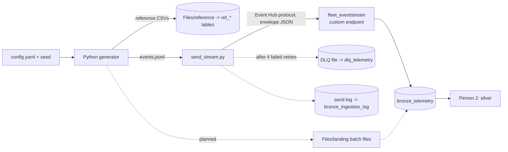
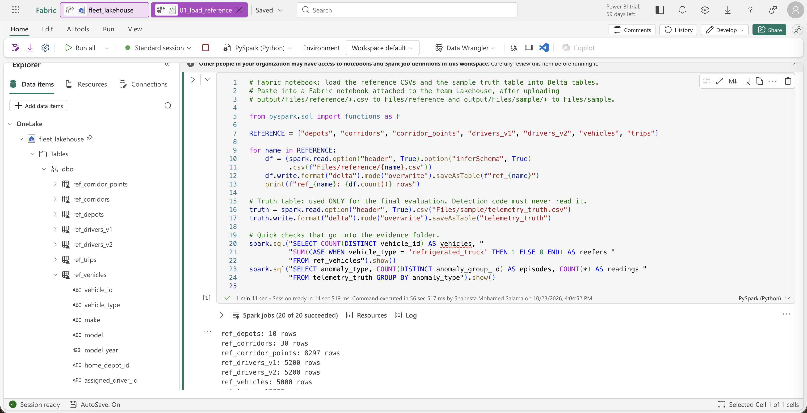
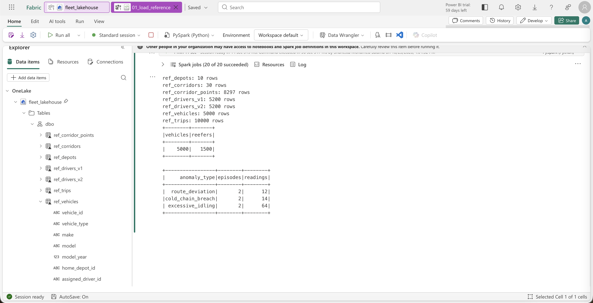
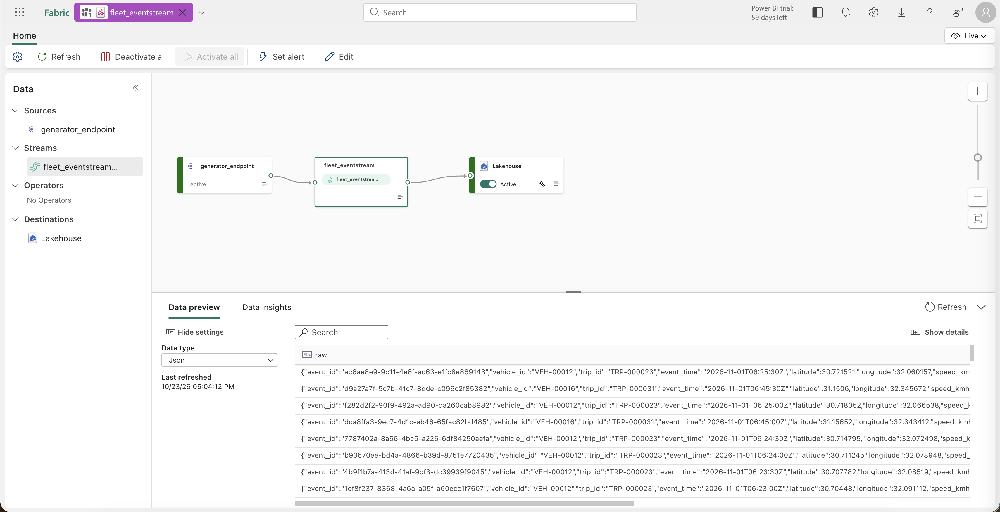
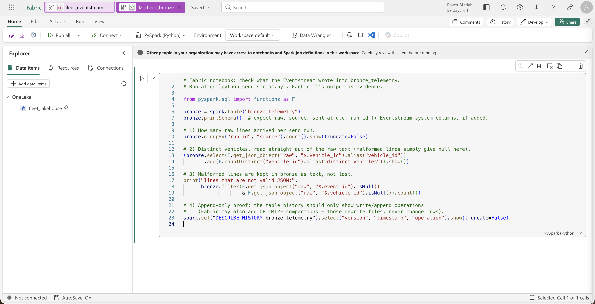
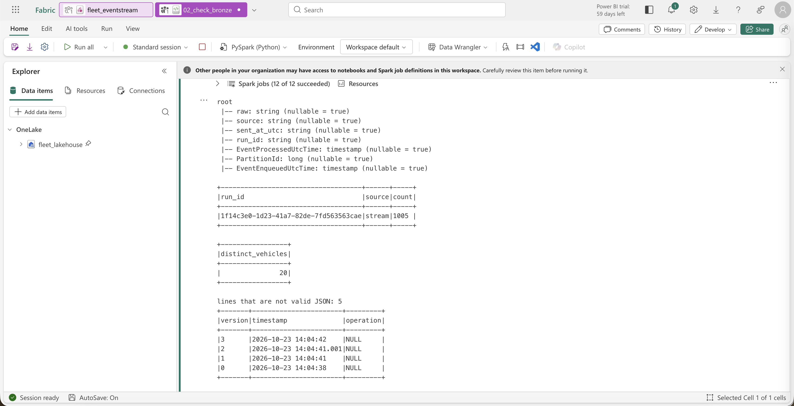

# Person 1 - Data generation and ingestion

Owner: Person 1 · Status as of 2026-10-23 · Platform: Microsoft Fabric (workspace `Fleet_Telematics_Project`)

This document explains what was built for the first stage of the pipeline (generator -> bronze),
describes every dataset (metadata / data dictionary), lists what the other stages need from it,
and records what we noticed in the data that matters for the KPIs.

---

## 1. Status at a glance

| Work plan step | Status | Where |
|---|---|---|
| 1. Config file + seed | Done | `generator/config.yaml` |
| 2. Reference data (vehicles, drivers v1/v2, depots, corridors, trips) | Done, loaded into Fabric | `Files/reference`, tables `ref_*` |
| 3. Normal readings | Done | `generator/fleet/simulate.py` |
| 4. Three anomalies + `telemetry_truth` | Done (sample) | `Files/sample/telemetry_truth.csv`, table `telemetry_truth` |
| 5. Bad data on purpose (7 types) | Done (sample) | `Files/sample/bad_data_manifest.csv` |
| Day 1-2 handoff: ~1,000-event sample | Done | `Files/sample/sample_events.jsonl` |
| 7a. Streaming to Eventstream | Done | `fleet_eventstream` -> `bronze_telemetry` |
| 8. Bronze table (raw text + arrival time + source) | Done | `bronze_telemetry` |
| 10. Retry with backoff (1, 2, 4, 8 s) | Done in sender, demo pending | `generator/fleet/stream_sender.py` |
| 6. Concurrent workers (5,000 vehicles) | Next | - |
| 7b. Batch landing (`Files/landing`) | Next | - |
| 9. `dlq_telemetry` table | Next (sender already writes a local DLQ file) | - |
| 11. `bronze_ingestion_log` table | Next (sender already writes a local log) | - |
| 12. Recovery demo | Next | - |
| 13. Speed measurement at full scale | Next (first number: 278 events/s on the sample) | - |

---

## 2. How it works



**Run it** (from `generator/`):

```bash
python3 -m venv .venv && .venv/bin/pip install pyyaml azure-eventhub
.venv/bin/python generate.py all          # reference data + sample
.venv/bin/python send_stream.py           # send sample to Eventstream (needs .env)
```

Same `seed` => byte-identical output (checked by hashing two runs).

### 2.1 Fabric items

| Item | Type | Purpose |
|---|---|---|
| `fleet_lakehouse` | Lakehouse (schemas on, everything in `dbo`) | All files and Delta tables |
| `fleet_eventstream` | Eventstream | Source `generator_endpoint` (custom endpoint) -> destination Lakehouse table `bronze_telemetry` |
| `01_load_reference` | Notebook | Loads reference CSVs and the truth table into Delta tables |
| `02_check_bronze` | Notebook | Counts, distinct vehicles, malformed lines and table history of bronze |

### 2.2 Why every event is wrapped in an envelope

The Eventstream Lakehouse writer parses JSON. A malformed event (one of our deliberate bad-data
types) would be dropped silently, which breaks the "nothing is lost" rule. So the sender wraps
each event exactly as generated inside a small JSON object:

```json
{"raw": "<event text exactly as generated>", "source": "stream", "sent_at_utc": "...", "run_id": "..."}
```

Result: malformed lines reach bronze as text (proven: 5 of 5 malformed sample lines are in bronze),
and Person 2 parses `raw` with an explicit schema.

### 2.3 Generator behaviour (what "normal" looks like)

Values follow typical heavy-truck figures and are all set in `config.yaml`:

| Signal | Rule | Typical value |
|---|---|---|
| Reading interval | Every 30 s while the vehicle is on a trip | - |
| Speed | Cruise 82 km/h ± 6 (normal noise), ramps up over the first 4 readings | median 82 km/h |
| RPM | 700 idle + 12 x speed, capped at 1,900, ± 40 noise; 0 when engine off | median ~1,690 |
| Engine temp | Warms from 30 °C to 90 °C over 12 min, ± 1 noise; cools 0.4 °C per reading when off | median 88 °C |
| Fuel rate | 2.5 L/h idle + 0.33 x speed, ± 1 noise; 0 when engine off | median ~29.5 L/h |
| Odometer | Previous value + distance travelled since last reading | starts 20,000-400,000 km |
| Cargo temp | Reefers only: 5 °C ± 0.4; empty (null) for dry vans | 4-6 °C |
| Planned stop | Last 5 min of every 2 h of trip: speed 0, **rpm 0** (engine off) | not idling |

### 2.4 Anomalies (injected, recorded in `telemetry_truth`)

| Anomaly | How it is injected | Detection threshold (Section 0) | Injected range |
|---|---|---|---|
| Cold-chain breach | Reefer cargo temp rises to a 9-14 °C peak and back, every reading > 8 °C | outside 2-8 °C for ≥ 3 readings | 4-12 readings |
| Excessive idling | Vehicle holds position, speed 0, rpm ~700, fuel ~2.5 L/h | speed < 2 and rpm > 0 for ≥ 10 min | 12-30 min |
| Route deviation | GPS pushed sideways off the corridor | > 2 km off corridor for ≥ 3 readings | 2.5-6 km, 4-10 readings |

All injected values cross their thresholds with a margin (checked: breaches 9-11 °C,
deviations 2.8-5.0 km, idling 13-18 min in the sample). Anomalies never overlap each other or a planned stop.

### 2.5 Bad data (deliberate, recorded in `bad_data_manifest.csv`)

| Type | Example | Expected handling (Person 2) |
|---|---|---|
| `malformed_json` | JSON cut off mid-way | `silver_rejected` / DLQ |
| `missing_field` | `speed_kmh` key removed | reject (required field) |
| `wrong_type` | `"speed_kmh":"fast"` | reject (schema) |
| `null_required` | `"vehicle_id":null` | reject (required field) |
| `impossible_value` | `engine_temp_c: 900` | keep, flag as sensor error |
| `duplicate` | Same line sent twice (same `event_id`) | dedup on `vehicle_id + event_time` |
| `late_event` | Real `event_time`, delivered at the end of the stream | keep, place by `event_time` |

Bad data is never applied to anomaly readings, so every truth row points at a valid event.

---

## 3. Metadata

### 3.1 Dataset-level metadata

| Property | Value |
|---|---|
| Generator version | Commit in this repo (`generator/`) |
| Seed | 42 |
| Simulation start / window | 2026-11-01 06:00:00 UTC, 24 h |
| Time zone | All timestamps UTC, ISO 8601 (`YYYY-MM-DDTHH:MM:SSZ`) |
| Coordinates | WGS84 decimal degrees, 6 decimals (~0.1 m) |
| Units | km, km/h, rpm, °C, L/h (metric only) |
| Event format | JSON, one event per line (JSON Lines) |
| Fleet | 5,000 vehicles (1,500 refrigerated trucks, 3,500 dry vans), 5,200 drivers, 10 depots, 30 corridors, 10,000 trips |
| Geography | Depots in 10 Egyptian cities (Cairo, Alexandria, Port Said, Suez, Ismailia, Tanta, Mansoura, Minya, Asyut, Hurghada) |
| Sample | 20 vehicles x 50 readings = 1,000 events + 5 duplicate lines = 1,005 lines |
| Contains personal data | No. Driver names are random combinations of common first/last names |

### 3.2 Telemetry event (`sample_events.jsonl`, and `bronze_telemetry.raw`)

| Field | Type | Unit | Nullable | Description | Example |
|---|---|---|---|---|---|
| `event_id` | string (UUID) | - | No | Unique ID of the reading; seeded, so reproducible | `410bb39e-7287-...` |
| `vehicle_id` | string | - | No | `VEH-00001` ... `VEH-05000` | `VEH-00019` |
| `trip_id` | string | - | No | Trip the vehicle is on, see `ref_trips` | `TRP-000037` |
| `event_time` | string (ISO 8601 UTC) | - | No | When the reading was taken | `2026-11-01T06:02:00Z` |
| `latitude` | double | degrees | No | GPS latitude | `30.785576` |
| `longitude` | double | degrees | No | GPS longitude | `31.001689` |
| `speed_kmh` | double | km/h | No | Vehicle speed | `82.4` |
| `rpm` | integer | rpm | No | Engine speed; 0 = engine off | `1690` |
| `engine_temp_c` | double | °C | No | Engine temperature | `90.3` |
| `fuel_rate_lph` | double | L/h | No | Fuel consumption rate | `29.61` |
| `odometer_km` | double | km | No | Total distance so far (never decreases) | `399166.66` |
| `cargo_temp_c` | double | °C | **Yes** | Reefer cargo temperature; null for dry vans (normal) | `5.1` / `null` |

Business key for deduplication: `vehicle_id + event_time`.

### 3.3 `bronze_telemetry` (Delta, append-only, written by the Eventstream)

| Column | Type | Source | Description |
|---|---|---|---|
| `raw` | string | sender | The event text exactly as generated (may be malformed on purpose) |
| `source` | string | sender | `stream` (later also `batch`) |
| `sent_at_utc` | string | sender | When the sender sent it |
| `run_id` | string | sender | One ID per sender run; links to the send log |
| `EventEnqueuedUtcTime` | timestamp | Eventstream | When Fabric received the event = **arrival time** |
| `EventProcessedUtcTime` | timestamp | Eventstream | When the Eventstream processed it |
| `PartitionId` | long | Eventstream | Eventstream partition (events are keyed by `vehicle_id`, so one vehicle stays in order) |

First load: 1,005 rows, 20 distinct vehicles, 5 lines that are not valid JSON (kept as text).

### 3.4 Reference tables (`Files/reference/*.csv` -> `ref_*`)

| Table | Rows | Key | Columns |
|---|---|---|---|
| `ref_depots` | 10 | `depot_id` | `name`, `lat`, `lon` |
| `ref_corridors` | 30 | `corridor_id` | `name`, `origin_depot_id`, `dest_depot_id`, `planned_distance_km`, `point_count`, `reefer_temp_min_c` (2), `reefer_temp_max_c` (8) |
| `ref_corridor_points` | 8,297 | `corridor_id + seq` | `latitude`, `longitude`, `km_from_start` (points ~1 km apart) |
| `ref_vehicles` | 5,000 | `vehicle_id` | `vehicle_type` (`refrigerated_truck` / `dry_van`), `make`, `model`, `model_year`, `home_depot_id`, `assigned_driver_id`, `start_odometer_km` |
| `ref_drivers_v1` | 5,200 | `driver_id` | `full_name`, `home_depot_id`, `risk_level` (low/medium/high), `license_class`, `hire_date`, `effective_from` |
| `ref_drivers_v2` | 5,200 | `driver_id` | Same columns; 416 drivers changed, `effective_from` = 2026-11-01 18:00 UTC |
| `ref_trips` | 10,000 | `trip_id` | `vehicle_id`, `driver_id`, `corridor_id`, `direction` (forward/reverse), `origin_depot_id`, `dest_depot_id`, `planned_distance_km`, `planned_start_utc`, `planned_end_utc` |

### 3.5 Evaluation and operational files

| File / table | Columns | Rule |
|---|---|---|
| `telemetry_truth` | `event_id`, `anomaly_type`, `anomaly_group_id` (one ID per injected episode, e.g. `IDL-VEH-00001-001`) | Evaluation only. **Detection code must never read it.** |
| `bad_data_manifest.csv` | `event_id`, `bad_type`, `detail` | Lets Person 2 check that every broken row was caught |
| `send_failures.jsonl` (local DLQ) | `raw`, `source`, `reason`, `failed_at_utc`, `retries`, `run_id` | Will be loaded into `dlq_telemetry` |
| `send_log.csv` (local log) | `run_id`, `source`, `started_utc`, `duration_s`, `events_read`, `events_sent`, `events_dlq`, `retries`, `events_per_s`, `dry_run` | Will be loaded into `bronze_ingestion_log` |

---

## 4. What we noticed that matters for the KPIs

Computed on the 1,005-event sample (clean, non-duplicate readings) and the reference data.

1. **Fuel efficiency baseline is 2.78 km/L (36 L/100 km)** - realistic for a heavy truck. Idling
   clearly hurts it: the two idling vehicles drop to 2.12 and 2.38 km/L vs a median of 2.82. So the
   KPI will react to the anomalies, which is good for the demo.
2. **Routes differ a lot in length**: 75 km (Ismailia - Port Said) to 579 km (Alexandria - Hurghada),
   median 274 km. Trips take 0.9 to 7.3 h. Long routes include planned stops, so per-route
   efficiency must use km and litres summed per route (non-additive ratio: divide at query time).
3. **Planned stops have rpm = 0, idling has rpm > 0.** Idle-minute calculations must keep the
   `rpm > 0` condition, otherwise every planned stop counts as idling.
4. **The "> 90 km/h" scorecard metric is mostly noise right now.** With cruise 82 ± 6 km/h, about
   9% of normal readings (89 of 975 in the sample) exceed 90 km/h, so every driver will have many.
   **Team decision needed:** lower `speed_noise_kmh` (e.g. to 3), or add a deliberate speeding
   behaviour for some drivers, or keep it and explain it.
5. **Cold-chain compliance in the sample is 95.2% (280 / 294)**, but only because the sample forces
   breaches. At the configured rate in a full run it will be above 99%. The denominator must only
   include refrigerated readings (dry vans have null cargo temperature by design).
6. **Driver history matters for the scorecard.** 416 drivers change in v2 (142 depot only, 128 risk
   only, 146 both); 398 of them drive a vehicle, and the change happens at 18:00 UTC, mid-simulation.
   Scorecards per depot/risk level will be wrong unless facts join to the driver version valid at
   `event_time` (SCD Type 2).
7. **Bad data would distort KPIs if it slipped through**: duplicates double litres, `engine_temp_c = 900`
   or `speed_kmh = 480` skew averages, `fuel_rate_lph = -5` makes efficiency jump. Recommend a
   gold quality check on value ranges.
8. Fleet is evenly spread: 457-542 vehicles per depot; every corridor gets 244-532 trips.

---

## 5. What orchestration (Person 4) needs from this stage

| Topic | Detail |
|---|---|
| What runs outside Airflow | The generator/sender and the Eventstream run continuously (work plan Step 3). Airflow does **not** start them. |
| Input to the DAG | Table `bronze_telemetry`. New-data check: `max(EventEnqueuedUtcTime)` greater than the last processed watermark. |
| Incremental reads | Person 2 should keep a watermark on `EventEnqueuedUtcTime` (arrival time), not `event_time` (late events would be missed). |
| Batch path (planned) | Files land in `Files/landing/`; a notebook appends them to bronze with `source = 'batch'`. This notebook can be the first DAG task or a separate schedule. |
| DLQ + ingestion log (planned) | A notebook loads `send_failures.jsonl` and `send_log.csv` into `dlq_telemetry` and `bronze_ingestion_log`; schedule it with the DAG so the dashboard's pipeline-health page stays current. |
| Triggering notebooks | Fabric REST API: run a notebook on demand (`POST .../workspaces/{workspaceId}/items/{notebookId}/jobs/instances?jobType=RunNotebook`), or use Fabric's own Apache Airflow job item. Needs a service principal or a user token with access to the workspace. |
| Secrets | Eventstream connection string lives only in `generator/.env` (git-ignored). Never in the repo, notebooks or DAG code; use Airflow connections / Key Vault. |
| Reference refresh | Reference tables are static per seed. Re-run `01_load_reference` only when `config.yaml` changes. |
| Evidence for the performance record | `send_log.csv` -> events/s per run (measured), machine noted separately. |

---

## 6. Evidence

| # | Screenshot | Shows |
|---|---|---|
| 1 |  | Notebook `01_load_reference` attached to `fleet_lakehouse` |
| 2 |  | 7 reference tables loaded, 5,000 vehicles / 1,500 reefers, 2 episodes of each anomaly |
| 3 |  | Eventstream live: `generator_endpoint` -> stream -> Lakehouse, raw events arriving |
| 4 |  | Notebook `02_check_bronze` |
| 5 |  | Bronze schema, 1,005 rows for the run, 20 vehicles, 5 malformed lines kept, table history |

Also in `evidence/person1/`: `config_used.yaml`, `sample_summary.json`, `send_log.csv`
(first real send: 1,005 events in 3.6 s = 278 events/s, 0 retries, 0 DLQ - measured on a MacBook,
sample only, one vehicle batch at a time).

---

## 7. Open items and next steps

1. **Append-only proof.** `DESCRIBE HISTORY bronze_telemetry` shows `operation = NULL` because the
   Eventstream writer does not set an operation name. Next: show `operationMetrics` for each version
   (only `numOutputRows` / added files, no removed rows) and confirm no `DELETE`/`UPDATE`/`MERGE`.
2. **Concurrent full run**: split 5,000 vehicles across workers (asyncio), one vehicle per worker, stream as generated.
3. **Batch path**: workers write files to `Files/landing`; ingestion notebook appends to bronze with `source = 'batch'`.
4. **`dlq_telemetry` and `bronze_ingestion_log` tables** in Fabric, plus parse-time validation into the DLQ.
5. **Retry/DLQ demo** (`send_stream.py --fail-first 6`) and **recovery demo** (fix DLQ rows, resend, show them in bronze).
6. **Speed measurement** at 5,000 vehicles, marked as measured, with machine details.
7. **Team decision** on the > 90 km/h noise (section 4, point 4).

---

## 8. Decisions and limitations

- Readings exist only while a vehicle is on a trip (telematics reports with ignition on).
- Each vehicle has its own random stream (`seed + vehicle_id`), so output does not depend on how vehicles are split across workers.
- Late events keep their real `event_time` and are delivered later in the stream.
- In the sample only, idling episodes are capped at ~20 min to fit inside 50 readings.
- Corridors are synthetic curves between real city coordinates, not real road geometry.
- The 30-second interval, behaviour rules and anomaly rates are our proposals; the handbook only asks for realistic, reproducible telemetry.
