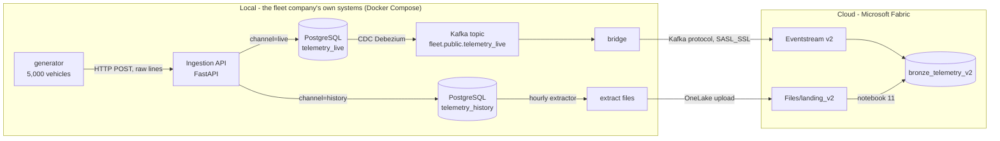

# Person 1 - v2: source system (API, PostgreSQL, Kafka) to the cloud

Owner: Person 1 · 2026-10-26 · Builds on [the pilot](person1_generation_and_ingestion.md), which stays untouched.

## 1. Why v2

The supervisor asked for three changes to the pilot:

1. **An API endpoint as the entry point** instead of notebooks doing the ingestion, in front of a
   **source database**, like a real fleet company's operational system.
2. **Connect the database to Kafka and make sure the data reaches the cloud.**
3. **Enough data volume** for the "Testing Data Volume Guide" (Fleet domain), which our pilot did not reach
   (733k streamed in 6 minutes; one 250k batch run).

## 2. Architecture (hybrid)



**Why hybrid is correct here.** The supervisor's wording ("connect the database to Kafka and make sure it
reaches the cloud") puts the database and Kafka outside the cloud. This is the usual enterprise setup:
operational systems on-premises, analytics platform in the cloud. The handbook allows both pathways and states
that infrastructure cost does not earn marks. Fabric cannot host PostgreSQL, Kafka or an API itself; a fully
cloud version would need an Azure subscription (Azure Database for PostgreSQL, Event Hubs, Container Apps) and
would reuse the same code.

| Component | What it does | Why |
|---|---|---|
| **Ingestion API** (`platform/api`) | `POST /v1/telemetry?channel=live\|history`, one raw JSON event per line. Validates every line (same rules as notebook 04) and stores **all** lines with `is_valid` and `reject_reason`; one transaction per request with a row in `api_ingest_log` | The single entry point; nothing is dropped, bad lines stay visible with the reason |
| **PostgreSQL** (`platform/postgres`) | `telemetry_live` (real-time feed), `telemetry_history` (bulk uploads, e.g. vehicles that were offline), `ingest_dlq` view, `api_ingest_log`, `extract_log`. Insert-only (UPDATE/DELETE revoked). Both tables share one id sequence, so `db_id` is unique | The "source system" the supervisor asked for |
| **Debezium CDC + Kafka** (KRaft, 4 partitions) | Every new `telemetry_live` row becomes a Kafka message, without the API knowing about Kafka | Standard way to connect a database to Kafka |
| **Bridge** (`platform/bridge`) | Kafka consumer -> Fabric Eventstream via its **Kafka endpoint**. Commits Kafka offsets **only after the cloud acknowledges**; retries 1-2-4-8 s, then a DLQ file; logs delivered/s and Kafka lag every 10 s | Kafka reaches the cloud; at-least-once, nothing lost on restart |
| **Extractor** (`platform/extractor`) | Exports `telemetry_history` **one hour slice at a time** to `Files/landing_v2/event_date=/event_hour=` (gzip JSON lines); every hour tracked in `extract_log` (started -> done) | "Scheduled extractor scripts for periodic landing" (handbook); makes incremental, re-run, crash/retry and backfill natural |
| **Loader** (notebook 11) | Inserts extract rows into `bronze_telemetry_v2` **once per `db_id`**, archives files, logs every load | Re-runs and backfills never create duplicates |
| **run_notebook.py** (`platform/fabric`) | Starts a Fabric notebook through the REST API and waits | The call an orchestrator makes; used for every batch load |

## 3. Data in v2 (simulated dates do not overlap the pilot)

| Simulated date | Purpose | Channel |
|---|---|---|
| 2026-11-01 | Pilot (unchanged, `bronze_telemetry`) | - |
| 2026-11-02 | Batch initial load (whole day) | history |
| 2026-11-03 12:00-16:00 | Batch incremental runs | history |
| 2026-11-04 | Streaming golden run | live |

The reference data now covers 4 days of trips (40,000); day 1 is byte-for-byte unchanged.

`bronze_telemetry_v2` columns: `raw`, `source` (`kafka_cdc` / `db_extract`), `sent_at_utc`, `run_id`, `db_id`,
`is_valid`, `reject_reason`, `db_received_at`, `kafka_partition`, `kafka_offset`, `EventEnqueuedUtcTime`
(arrival in the cloud), `EventProcessedUtcTime`, `PartitionId`.
**Downstream deduplication key: `db_id`** (the stream is at-least-once by design).

## 4. Batch: the five runs (guide: minimum 5)

| # | Run (guide) | What we did | Rows read | Inserted | Skipped |
|---|---|---|---|---|---|
| 1 | Initial load / backfill | Whole day 2026-11-02 into the DB via the API (4,014,197 events, 15,800/s), then 18 hourly extracts | 4,014,197 | 4,014,197 | 0 |
| 2 | Incremental #1 | New hour 2026-11-03 12:00; `--incremental` picked up only that hour | 293,897 | 293,897 | 0 |
| 3 | Incremental #2 (idempotency) | New hour 13:00 **and** hour 12:00 extracted again | 573,047 | 279,150 | **293,897** |
| 4 | Failure + retry | New hours 14:00 and 15:00; extractor killed in the middle of 15:00 (15:00 left `started`, half file never uploaded); restart redid only 15:00 | 502,818 | 502,818 | 0 |
| 5 | Backfill | Old hour 2026-11-02 10:00 reprocessed | 424,918 | **0** | **424,918** |
| | **Total in `bronze_telemetry_v2` (db_extract)** | | | **5,090,062** | = 5,090,062 distinct `db_id` |

- Rejected rows (kept, with reasons): 69,971 - every type equal to what the generator injected.
- Incremental hours: 228k-294k events each (guide 150k-600k). Total batch data 5.09M (guide 4.35-17.4M).
- **A real failure happened too:** in run 1 the upload of hour 07 (36 MB) timed out. The extractor stopped with
  the hour marked `started`; after switching uploads to 4 MB chunks, the next run redid exactly the 17 unfinished
  hours. Both attempts are visible in `extract_log`.

Evidence: `evidence/person1/v2_batch_runs/` (notebook 12 summary screenshots, console logs, `extract_log`).

## 5. Streaming: the golden run

`run_fleet.py --mode api --channel live --from-hours 72 --hours 96 --rate 700 --minutes 75`
(run `api-live-20261026T004931Z`, 2026-10-26 00:54-02:09 UTC). All 5,000 vehicles, simulated 2026-11-04
06:00-15:05 (9 simulated hours in 75 real minutes). The bridge was **restarted 35 minutes in**.

| Guide (Fleet) | Recommended level | Golden run (measured) |
|---|---|---|
| Run duration (wall-clock) | 60-90 min | **75.2 min** |
| Generation rate | 500-1,000 events/s | **700.0 events/s**, held by a shared rate limiter |
| Volume | 2-5M events | **3,157,802** |
| Time windows crossed | 4-5 (30-60 s windows) | ~75 one-minute windows |
| Optimal extras | restart + late events | bridge restart mid-run, 9,353 late events |

| Measured in the cloud (notebook 10) | Value |
|---|---|
| Rows in `bronze_telemetry_v2` / distinct `db_id` | **3,157,802 / 3,157,802** - nothing lost, nothing duplicated across the restart |
| Database -> cloud latency | **avg 1.59 s, p50 1.58 s, p95 2.36 s, max 7.34 s** |
| Arrivals per minute | median **41,989** (= 700/s) over 77 minutes |
| Kafka lag during the run | median 690 messages, max 1,427 (about 1-2 s of data) |
| Rejected at the API, by type | 9,324 malformed, 12,372 missing, 12,448 null, 9,196 wrong type = 43,340 = injected |
| Anomaly episodes injected | 171 cold-chain, 391 idling, 281 route deviation |

The restart caused no gap and no duplicates: the bridge commits Kafka offsets only after the cloud acknowledges,
so it resumed exactly where it stopped. Its own interval log is missing the ~5,000 deliveries between its last
10-second row and the restart (logging gap, now fixed: the bridge writes a final row on shutdown); Kafka and
the cloud both show every event.

Evidence: `evidence/person1/v2_stream_golden_run/`.

## 6. Reconciliation at every hop

| Hop | Smoke test | Batch total | Golden run |
|---|---|---|---|
| Generator sent | 12,325 | 5,090,062 | 3,157,802 |
| PostgreSQL (via API) | 12,325 | 5,090,062 | 3,157,802 |
| Kafka topic (via CDC) | 12,325 | - | 3,157,802 |
| Bridge committed (acknowledged by the cloud) | 12,325 | - | 3,157,802 |
| Extract files loaded (inserted) | - | 5,090,062 | - |
| Bronze v2, distinct `db_id` | 12,325 | 5,090,062 | 3,157,802 |
| Rejected with a reason (= injected) | 164 | 69,971 | 43,340 |

**In total `bronze_telemetry_v2` holds 8,260,189 distinct source rows** (stream 3,170,127 + batch 5,090,062).

## 7. Against the guide (Recommended = "Good")

| | Guide | v2 |
|---|---|---|
| Streaming | 60 min + 1-3M events + 4-5 windows (Fleet: 2-5M in 60-90 min) | 75 min, 3.16M, ~75 windows, restart, late events |
| Batch | 5 runs (initial + incrementals + failure/backfill), Fleet total 4.35-17.4M | initial 4.0M + 2 incremental (one with re-run) + crash/retry + backfill = 5.09M |

## 8. Incidents and limitations

- **Smoke-test duplicates:** while recovering from a mistyped connection string, Kafka offsets were rewound and
  the bridge rebuilt while an old container briefly ran, so the cloud received the 12,325 smoke-test rows twice
  (24,650 rows, 12,325 distinct `db_id`). Bronze keeps what it received; `db_id` deduplicates. The same incident
  exposed a bridge bug (unacknowledged sends counted as delivered), fixed before any real run.
- **Shared Fabric capacity:** the trial capacity runs only a few Spark sessions at once; an open interactive
  session blocked a loader run once (`TooManyRequestsForCapacity`). Stop notebook sessions when done.
- **Fabric trial ends in ~11 days (2026-10-26)**: the cloud tables disappear with it; code and evidence are in GitHub.
- The source system runs on one laptop (single Kafka broker, replication factor 1): fine for the project, not
  for production.

## 9. How to run everything

```bash
cd platform && docker compose up -d --build && ./connect/register.sh
docker compose --profile cloud up -d --build bridge            # needs EVENTSTREAM_V2_CONNECTION_STRING in generator/.env

# batch
cd ../generator && .venv/bin/python run_fleet.py --mode api --channel history --from-hours 24 --hours 48
cd ../platform/extractor && ../../generator/.venv/bin/python extract.py --date 2026-11-02
cd ../fabric && ../../generator/.venv/bin/python run_notebook.py 11_load_landing_v2

# streaming golden run
cd ../../generator && .venv/bin/python run_fleet.py --mode api --channel live --from-hours 72 --hours 96 --rate 700 --minutes 75
```

`generator/.env` (never committed) holds `EVENTSTREAM_V2_CONNECTION_STRING`, `FABRIC_TENANT_ID` and
`FABRIC_WORKSPACE_ID`.
