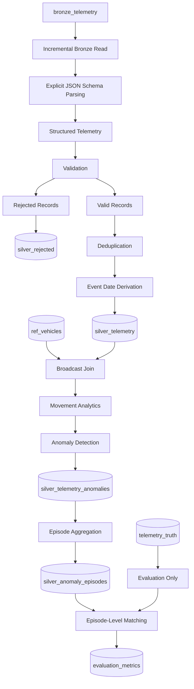

# Person 2 — Silver Layer Processing & Anomaly Detection

**Project:** Fleet Telematics Lakehouse  
**Platform:** Microsoft Fabric  
**Processing Engine:** PySpark  
**Storage Format:** Delta Lake  
**Owner:** Person 2 — Silver Processing and Anomaly Detection

---

## Table of Contents

1. [Overview](#1-overview)
2. [Responsibilities](#2-responsibilities)
3. [Architecture and Data Flow](#3-architecture-and-data-flow)
4. [Bronze Source and Schema Parsing](#4-bronze-source-and-schema-parsing)
5. [Data Validation and Rejected Records](#5-data-validation-and-rejected-records)
6. [Deduplication and Date Partitioning](#6-deduplication-and-date-partitioning)
7. [Vehicle Reference Enrichment](#7-vehicle-reference-enrichment)
8. [Vehicle Movement Analytics](#8-vehicle-movement-analytics)
9. [Rule-Based Anomaly Detection](#9-rule-based-anomaly-detection)
10. [Anomaly Episode Aggregation](#10-anomaly-episode-aggregation)
11. [Incremental Streaming Ingestion](#11-incremental-streaming-ingestion)
12. [SQL Output Verification](#12-sql-output-verification)
13. [Ground Truth and Evaluation Methodology](#13-ground-truth-and-evaluation-methodology)
14. [Evaluation Results](#14-evaluation-results)
15. [Evidence Screenshots](#15-evidence-screenshots)
16. [Data Quality and Engineering Considerations](#16-data-quality-and-engineering-considerations)
17. [Limitations and Future Improvements](#17-limitations-and-future-improvements)
18. [Conclusion](#18-conclusion)

---

## 1. Overview

Person 2 implements the Silver processing and anomaly detection stage of the Fleet Telematics Lakehouse.

The objective is to transform raw vehicle telemetry from the Bronze layer into structured, validated, deduplicated, and enriched data that can be used for operational analytics and downstream reporting.

The implementation uses PySpark in Microsoft Fabric and stores the transformed datasets as Delta tables.

The processing pipeline covers:

- Parsing raw JSON telemetry using an explicit schema.
- Validating required fields and separating invalid records.
- Preserving rejected records for investigation.
- Removing duplicate records.
- Deriving event dates and partitioning Silver data.
- Enriching telemetry with vehicle reference attributes.
- Calculating GPS distance, time gaps, and estimated vehicle speed.
- Detecting operational anomalies using predefined rules.
- Grouping related anomaly readings into episodes.
- Processing new Bronze arrivals incrementally.
- Comparing detected episodes with ground-truth anomaly groups.
- Calculating precision, recall, and F1-score.

The final outputs provide a structured foundation for investigating fleet behavior, vehicle movement anomalies, engine conditions, cold-chain compliance, and prolonged idling.

### Silver Layer objectives

The Silver Layer is responsible for improving the usability and reliability of raw telemetry data before it reaches downstream analytical workloads.

Its main goals are to:

1. Convert semi-structured payloads into typed, structured records.
2. prevent invalid records from silently entering the curated dataset.
3. Preserve rejected records for troubleshooting and data quality analysis.
4. Reduce duplicate records before performing sequential calculations.
5. Add derived attributes required for analytical processing.
6. Enrich telemetry with vehicle reference information.
7. identify suspicious telemetry patterns through rule-based detection.
8. Aggregate related anomaly readings into episode-level records.
9. Support incremental ingestion of new data.
10. Provide evaluation outputs that can be inspected through SQL.

## 2. Responsibilities

| Component | Description |
|---|---|
| Schema parsing | Converts raw JSON payloads into structured telemetry fields. |
| Data validation | Checks required fields and upstream validation status. |
| Rejected records | Preserves invalid records and their rejection reasons. |
| Deduplication | Removes repeated records using the configured identifier. |
| Silver storage | Persists cleaned telemetry in Delta format. |
| Reference enrichment | Joins telemetry with vehicle reference data. |
| Movement analytics | Calculates distance, elapsed time, and estimated speed. |
| Anomaly detection | Identifies suspicious readings using business rules. |
| Episode aggregation | Groups related anomalous readings into episodes. |
| Incremental ingestion | Processes new data while avoiding previously inserted IDs. |
| Evaluation | Compares detected episodes with ground-truth episodes. |

### Processing outputs

| Output table | Purpose |
|---|---|
| `silver_telemetry` | Stores the cleaned and structured telemetry dataset. |
| `silver_rejected` | Stores records that fail validation. |
| `silver_telemetry_anomalies` | Stores telemetry records identified as anomalous. |
| `silver_anomaly_episodes` | Stores grouped anomaly episodes and their summary attributes. |
| `evaluation_metrics` | Stores the calculated evaluation metrics. |

The tables represent different stages and levels of the pipeline. In particular, an individual anomaly reading is not equivalent to an aggregated anomaly episode.

---

## 3. Architecture and Data Flow

The Silver Layer follows a medallion-style processing architecture in which raw Bronze data is transformed into curated Silver datasets.



### Processing flow

1. Read raw telemetry from Bronze.
2. Parse JSON records using an explicit schema.
3. Validate required telemetry fields.
4. Persist rejected records separately.
5. Deduplicate accepted records.
6. Derive event dates and write the Silver table.
7. Enrich telemetry with vehicle reference attributes.
8. Calculate movement-related metrics.
9. Apply anomaly detection rules.
10. Aggregate related detections into episodes.
11. Compare detected episodes with ground truth.
12. Persist evaluation metrics for SQL inspection.

### Separation of detection and evaluation

The `telemetry_truth` dataset is used for evaluation only.

It must not be used by the anomaly detection rules to determine which records should be flagged. Otherwise, the evaluation would no longer provide an independent assessment of the detection process.

The intended flow is:

- **Detection:** uses telemetry measurements and the implemented business rules.
- **Episode aggregation:** groups related detections using the implemented grouping conditions.
- **Evaluation:** compares detected episodes with the ground-truth episode groups.

---

## 4. Bronze Source and Schema Parsing

### 4.1 Source table

The primary input table is `bronze_telemetry`.

The Bronze layer contains raw telemetry payloads and ingestion metadata. Keeping the original payload allows malformed JSON and invalid records to be investigated without modifying the source data.

Relevant source fields include:

| Field | Purpose |
|---|---|
| `raw` | Original telemetry payload as text. |
| `db_id` | Record identifier used by the implemented deduplication logic. |
| `source` | Ingestion source. |
| `is_valid` | Upstream validation status, when available. |
| `reject_reason` | Upstream rejection reason, when available. |
| `EventEnqueuedUtcTime` | Arrival timestamp used by the incremental processing logic. |
| `event_id` | Telemetry event identifier. |
| `vehicle_id` | Vehicle identifier. |
| `trip_id` | Trip identifier. |
| `event_time` | Time when the telemetry reading was recorded. |

### 4.2 Why explicit schema parsing is important

Telemetry data is received as semi-structured JSON. JSON fields are not automatically guaranteed to have the expected data types or to contain all required values.

An explicit schema describes the expected structure of the telemetry payload.

The notebook defines the expected fields using PySpark's `StructType` and `StructField`.

| Field | Data type | Description |
|---|---|---|
| `event_id` | String | Unique event identifier. |
| `vehicle_id` | String | Vehicle identifier. |
| `trip_id` | String | Associated trip. |
| `event_time` | String before conversion | Original event timestamp. |
| `latitude` | Double | GPS latitude. |
| `longitude` | Double | GPS longitude. |
| `speed_kmh` | Double | Reported speed in km/h. |
| `rpm` | Integer | Engine revolutions per minute. |
| `engine_temp_c` | Double | Engine temperature in Celsius. |
| `fuel_rate_lph` | Double | Fuel consumption rate in liters per hour. |
| `odometer_km` | Double | Odometer reading in kilometers. |
| `cargo_temp_c` | Double | Cargo temperature, when applicable. |

Using an explicit schema makes the expected types clear and avoids depending entirely on automatic schema inference.

It also allows downstream transformations to refer to known columns rather than repeatedly extracting values from raw JSON strings.

### 4.3 Parsing approach

The notebook uses `from_json()` to convert the raw payload into a structured column.

```python
df_parsed = df_bronze.withColumn(
    "parsed_data",
    from_json(col("raw"), telemetry_schema)
)
```

In this expression:

- `df_bronze` is the source DataFrame.
- `withColumn()` adds or replaces a DataFrame column.
- `from_json()` parses a JSON string using the supplied schema.
- `col("raw")` references the original JSON payload.
- `telemetry_schema` defines the expected JSON structure.
- `parsed_data` contains the resulting structured value.

After parsing, the structured fields are selected alongside the required ingestion metadata.

The event timestamp is subsequently converted to a timestamp type for time-based calculations.

**Important:** JSON parsing and data validation are separate operations. A record can be syntactically valid JSON but still contain missing or null mandatory fields.

### 4.4 Incremental source filtering

The notebook checks whether the Silver table exists and, when applicable, retrieves the latest processed arrival timestamp.

Incoming Bronze records can then be filtered to arrivals newer than the stored watermark.

Conceptually, this reduces the source records that need to be processed in each execution.

A strict timestamp comparison can skip records that share the exact same arrival timestamp as the watermark. A production implementation should use a deterministic composite watermark or an overlapping read window with idempotent deduplication.

### Evidence — Schema Parsing


*Figure 1 — Explicit schema definition, incremental source filtering, and JSON parsing.*

---

## 5. Data Validation and Rejected Records

### 5.1 Validation objective

A record being valid JSON does not guarantee that it contains the required telemetry values.

The validation stage checks mandatory fields before records are used for analytical processing.

The implemented condition checks:

- `event_id`
- `vehicle_id`
- `event_time`
- `latitude`
- `longitude`
- `speed_kmh`

These fields are used by downstream processing, including vehicle identification, time ordering, GPS calculations, and speed-related rules.

### 5.2 Validation condition

```python
validation_condition = (
    col("event_id").isNotNull()
    & col("vehicle_id").isNotNull()
    & col("event_time").isNotNull()
    & col("latitude").isNotNull()
    & col("longitude").isNotNull()
    & col("speed_kmh").isNotNull()
)
```

The condition combines individual null checks using the logical AND operator, `&`.

A record satisfies this condition only when all listed fields are non-null.

For example:

| event_id | vehicle_id | event_time | latitude | longitude | speed_kmh | Result |
|---|---|---|---:|---:|---:|---|
| Present | Present | Present | Present | Present | Present | Passes required-field condition |
| Present | Present | Present | Null | Present | Present | Fails validation |
| Present | Null | Present | Present | Present | Present | Fails validation |
| Present | Present | Null | Present | Present | Present | Fails validation |

These examples illustrate the required-field condition. The complete accepted/rejected outcome also depends on the upstream validity status used by the notebook.

### 5.3 Accepted and rejected records

Accepted records must satisfy the required-field condition and the upstream validation status used by the notebook.

Rejected records are selected when the upstream validity flag is false or the required-field condition fails.

This separates the processing paths:

- Valid records continue into deduplication and Silver processing.
- Rejected records are preserved for inspection and data quality analysis.

### 5.4 Rejection reason handling

The notebook assigns a rejection reason using the existing reason when available.

Otherwise, it supplies a fallback reason indicating that mandatory fields are missing or null.

A rejection timestamp is also recorded to support auditing and investigation.

Preserving the reason makes it easier to distinguish between upstream validation failures and records that fail the downstream mandatory-field checks.

### 5.5 Rejected records table

Invalid records are persisted to `silver_rejected`.

The table retains relevant telemetry fields and rejection metadata, including:

- Record ID.
- Source.
- Validation status.
- Rejection reason.
- Event timestamp.
- Vehicle information.
- Rejection timestamp.

This approach preserves rejected data instead of silently discarding it.

The rejected dataset can be inspected to identify recurring data quality problems and investigate why records did not enter the curated Silver dataset.

### 5.6 Validation output

The captured notebook output shows:

| Metric | Reported count |
|---|---:|
| Total parsed | 8,272,514 |
| Total rejected | 1,134,475 |
| Total valid | 8,146,714 |

**Count reconciliation note:** these values do not reconcile arithmetically. The valid and rejected counts sum to more than the reported parsed count. The counts should be rechecked against the corresponding DataFrames and filters before being presented as a reconciled data-quality summary.

### Evidence — Validation


*Figure 2 — Required-field validation, rejection reasons, and persistence of rejected records.*

---

## 6. Deduplication and Date Partitioning

### 6.1 Why deduplication matters

Duplicate telemetry records can inflate row counts and distort analytical calculations.

Duplicates may occur because of repeated delivery, retries, replay operations, or overlapping ingestion windows.

Removing duplicates before downstream analytics helps prevent repeated records from unnecessarily affecting the results.

### 6.2 Deduplication implementation

The implemented notebook removes repeated `db_id` values:

```python
df_deduplicated = df_valid.dropDuplicates(["db_id"])
```

Here:

- `df_valid` represents the valid-record DataFrame.
- `dropDuplicates(["db_id"])` removes rows with repeated values in the selected identifier column.
- `df_deduplicated` contains the result of that operation.

The operation is based on `db_id`. It does not automatically guarantee uniqueness under every other possible business key.

### 6.3 Deduplication counts

The notebook calculates the number of valid records before and after deduplication.

```python
valid_count = df_valid.count()
deduped_count = df_deduplicated.count()

duplicates_removed = valid_count - deduped_count
```

The difference between the two counts represents the number of rows removed by this deduplication operation.

The captured output reports:

| Metric | Value |
|---|---:|
| Valid records before deduplication | 8,146,714 |
| Duplicates removed | 0 |
| Clean deduplicated records | 8,146,714 |

These values are reported for the captured execution. Zero removed duplicates means that no repeated `db_id` values were removed by this operation. It does not prove that there are no duplicates under every possible business key.

### 6.4 Business-key consideration

The upstream project documentation identifies `vehicle_id + event_time` as the telemetry business key, whereas the implemented Silver notebook uses `db_id`.

These identifiers should not be treated as interchangeable without verification.

The deduplication policy should define how repeated deliveries, replayed events, and repeated business measurements are distinguished.

The chosen key affects what the pipeline considers a duplicate. Two records may have different database IDs but still represent the same vehicle measurement.

### 6.5 Event date derivation

The notebook derives a date attribute from the event timestamp:

```python
df_silver_clean = df_deduplicated.withColumn(
    "event_date",
    to_date(col("event_time"))
)
```

The expression creates an `event_date` column based on `event_time`.

This date attribute is used to organize the Silver data into date-based partitions.

### 6.6 Delta table persistence

The notebook writes the cleaned dataset to the `silver_telemetry` table:

```python
(
    df_silver_clean.write
    .format("delta")
    .mode("overwrite")
    .option("overwriteSchema", "true")
    .partitionBy("event_date")
    .saveAsTable("silver_telemetry")
)
```

The main operations are:

| Operation | Purpose |
|---|---|
| `format("delta")` | Writes the output using the Delta table format. |
| `mode("overwrite")` | Replaces the existing table data under the configured write behavior. |
| `overwriteSchema` | Allows the output schema to be overwritten. |
| `partitionBy("event_date")` | Organizes the table by event date. |
| `saveAsTable()` | Persists the result as a named table. |

The captured execution confirms that `silver_telemetry` was rewritten and updated.

The use of `overwrite` represents a full-refresh write. It is distinct from the append-based incremental streaming implementation described later.

### 6.7 Why partition by event date?

Date-based partitioning can improve queries that filter by event date and helps organize telemetry for historical analysis.

For example, a query restricted to a specific event date may be able to avoid scanning data from unrelated date partitions.

The actual performance benefit depends on:

- Data volume.
- Number of partitions.
- Partition sizes.
- File sizes.
- Query filtering patterns.
- The physical layout of the stored data.

Partitioning is not automatically faster for every query. Very small partitions or excessive numbers of partitions can introduce overhead.

### Evidence — Deduplication and Partitioning


*Figure 3 — Duplicate-count calculation, event date derivation, and Delta table persistence.*

---

## 7. Vehicle Reference Enrichment

### 7.1 Objective

The telemetry table contains vehicle measurements, while `ref_vehicles` provides additional information about each vehicle.

Enrichment combines the telemetry dataset with the vehicle reference dataset so that vehicle attributes can be available during downstream analysis.

The notebook joins the datasets using `vehicle_id`.

### 7.2 Broadcast left join

```python
df_ref_vehicle = spark.read.table("ref_vehicles")

df_enriched = df_silver.join(
    F.broadcast(df_ref_vehicle),
    on="vehicle_id",
    how="left"
)
```

The code performs the following operations:

1. Reads the vehicle reference table.
2. Applies the broadcast hint to the reference DataFrame.
3. Joins the telemetry and reference DataFrames using `vehicle_id`.
4. Uses a left join to preserve telemetry records even when no reference row matches.

### 7.3 Why use a broadcast join?

A broadcast join can reduce shuffle overhead when one side of the join is sufficiently small.

Without broadcasting, Spark may need to redistribute data across workers to perform the join. Broadcasting can make the reference data available to executors so that a large telemetry dataset does not need the same type of redistribution.

However, broadcasting is appropriate only when the reference dataset can fit comfortably in the available memory. The hint does not make an oversized dataset safe to broadcast.

### 7.4 Why use a left join?

The left join preserves records from the telemetry DataFrame.

If a telemetry record does not have a matching `vehicle_id` in `ref_vehicles`, the telemetry record can still remain in the result, with reference-side columns null.

This helps avoid silently removing telemetry observations simply because reference metadata is missing.

### 7.5 Fallback behavior

The notebook includes exception handling that falls back to the original Silver DataFrame if the reference read or join fails.

This allows processing to continue, but the output may lack reference attributes.

In production, this condition should be logged and monitored rather than treated as a fully successful enrichment.

### Evidence — Broadcast Join


*Figure 4 — Enriching Silver telemetry using a broadcast left join with vehicle reference data.*

---

## 8. Vehicle Movement Analytics

### 8.1 Objective

Vehicle movement analytics derives information from sequential telemetry readings.

The notebook compares consecutive GPS observations for each vehicle to calculate the distance traveled between readings, the elapsed time, and the estimated speed.

These derived measurements support the identification of suspicious GPS jumps and other movement-related conditions.

### 8.2 Window specification

```python
window_spec = (
    Window
    .partitionBy("vehicle_id")
    .orderBy("event_time")
)
```

The window partitions events by `vehicle_id` and orders them by `event_time`.

This establishes an event sequence for each vehicle.

The window is important because the previous reading for one vehicle must not be confused with the previous reading for another vehicle.

### 8.3 Retrieve previous reading values

```python
df_windowed = (
    df_enriched
    .withColumn(
        "prev_latitude",
        F.lag("latitude").over(window_spec)
    )
    .withColumn(
        "prev_longitude",
        F.lag("longitude").over(window_spec)
    )
    .withColumn(
        "prev_event_time",
        F.lag("event_time").over(window_spec)
    )
)
```

The `lag()` function retrieves a value from a preceding row in the ordered window.

The new columns represent:

| Column | Purpose |
|---|---|
| `prev_latitude` | Latitude of the previous reading for the vehicle. |
| `prev_longitude` | Longitude of the previous reading for the vehicle. |
| `prev_event_time` | Timestamp of the previous reading for the vehicle. |

The first reading for each vehicle does not have a previous reading, so the previous values are null.

### 8.4 Calculate the time gap

```python
df_windowed = df_windowed.withColumn(
    "time_gap_sec",
    F.unix_timestamp("event_time")
    - F.unix_timestamp("prev_event_time")
)
```

The expression converts the timestamps to Unix timestamps and subtracts the previous timestamp from the current timestamp.

The resulting `time_gap_sec` represents the elapsed time between consecutive readings in seconds.

A positive time gap is required for a meaningful speed calculation.

Zero or negative gaps can occur when timestamps are repeated or improperly ordered. These cases need to be handled explicitly to avoid invalid speed calculations.

### 8.5 Haversine distance

The Haversine formula calculates the approximate great-circle distance between two GPS coordinates on a spherical Earth.

\[
a =
\sin^2\left(\frac{\Delta\phi}{2}\right)
+
\cos(\phi_1)\cos(\phi_2)
\sin^2\left(\frac{\Delta\lambda}{2}\right)
\]

\[
d = 2R\arcsin(\sqrt{a})
\]

Where:

- \(\phi_1\) and \(\phi_2\) are latitudes in radians.
- \(\lambda_1\) and \(\lambda_2\) are longitudes in radians.
- \(\Delta\phi\) is the latitude difference in radians.
- \(\Delta\lambda\) is the longitude difference in radians.
- \(R\) is the assumed Earth radius, approximately 6,371 km.
- \(d\) is the approximate distance between consecutive GPS positions in kilometers.

The notebook uses the calculated distance to derive `distance_km`.

### 8.6 Why distance must be combined with time

Distance alone does not indicate how quickly a vehicle moved.

The elapsed time between the GPS readings is needed to calculate an average speed over that interval.

For example, the same distance can correspond to very different speeds depending on whether it was covered over a few seconds or several minutes.

### 8.7 Calculated speed

The calculated speed is expressed in kilometers per hour:

\[
\text{Speed (km/h)}
=
\frac{\text{Distance (km)}}{\text{Time Gap (seconds)}/3600}
\]

This converts the time gap from seconds to hours before dividing the distance by the elapsed time.

The implementation calculates speed when the time gap is valid and positive. Otherwise, it uses a zero fallback.

A zero fallback does not necessarily mean that the vehicle was physically stationary; it may indicate that a valid calculation was unavailable.

### 8.8 Excessive idling

The implemented idling indicator combines:

- `speed_kmh < 2`
- `rpm > 0`

This identifies a low-speed reading while the engine is running, assuming the telemetry measurements are reliable.

The two conditions are used together because low vehicle speed alone does not establish that the engine is idling. The RPM condition supplies additional context about engine activity.

The resulting flag is useful for identifying potential prolonged-idling episodes after related readings are grouped.

### 8.9 Cold-chain monitoring

For temperature-sensitive transportation, cargo temperature is compared with the configured acceptable range.

The notebook flags cargo temperatures outside the allowed range of 2°C–8°C in the movement analytics description.

The later anomaly detection description also specifies a broader -2°C–12°C range. These are different thresholds in the supplied documentation and should be verified against the actual notebook implementation before being treated as the same rule.

Null cargo temperatures must be interpreted according to vehicle type because dry vans can legitimately have no cargo-temperature reading.

### Evidence — Movement Analytics


*Figure 5 — Window functions, Haversine distance, calculated speed, idling detection, and cold-chain validation.*

---

## 9. Rule-Based Anomaly Detection

The notebook identifies suspicious readings using deterministic rules.

Each rule checks a telemetry attribute or a previously calculated flag.

| Anomaly | Implemented condition | Purpose |
|---|---|---|
| GPS teleportation | `calculated_speed_kmh > 200` | Identifies implausibly high GPS-derived speed. |
| Engine overheating | `engine_temp_c > 105` | Flags high engine temperatures. |
| RPM spike | `rpm > 4500` | Flags unusually high engine RPM. |
| Cold-chain breach | `is_cold_chain_violation` | Flags cargo temperatures outside the configured range. |
| Excessive idling | `is_idling` | Flags low speed while the engine is running. |

### 9.1 GPS teleportation

A calculated speed above 200 km/h can indicate:

- Incorrect GPS coordinates.
- Corrupted or inconsistent timestamps.
- Out-of-order readings.
- An implausible movement interval.
- A GPS-derived distance that does not reflect actual vehicle movement.

The rule uses GPS-derived speed rather than only the reported vehicle speed.

This distinction matters because the reported speed and the speed calculated from sequential GPS positions are different measurements.

A large disagreement between them can be useful for further investigation.

### 9.2 Engine overheating

The notebook flags an engine temperature above 105°C.

This is a configured detection rule. It does not independently prove mechanical failure, since the interpretation of engine temperature depends on the vehicle and operating conditions.

### 9.3 RPM spike

The notebook flags readings where RPM exceeds 4,500.

This rule identifies a high engine-speed reading according to the configured threshold.

It should be interpreted in the context of the relevant vehicle characteristics and operating conditions.

### 9.4 Cold-chain breach

The rule identifies cargo-temperature readings outside the configured range.

The supplied documentation describes both a 2°C–8°C range and a -2°C–12°C range in different sections. The precise range used by the executed code should be confirmed before reporting a single definitive threshold.

### 9.5 Excessive idling

The notebook uses the combination of reported speed below 2 km/h and positive RPM to identify an idling reading.

Individual idling readings may be grouped into a longer episode when the readings satisfy the episode aggregation conditions.

### 9.6 Combined anomaly flag

The notebook combines the individual Boolean conditions into an overall `is_anomaly` flag and assigns an `anomaly_type`.

When multiple conditions are true for the same reading, the order of the conditional branches determines which category is assigned if the output stores only one anomaly type.

This matters when a reading satisfies more than one anomaly condition. A single assigned category may not capture every condition that was true.

### 9.7 Anomaly persistence

Detected anomaly records are saved in `silver_telemetry_anomalies`.

This table provides the input for SQL inspection and the subsequent episode aggregation stage.

### Evidence — Anomaly Detection


*Figure 6 — Anomaly flags, anomaly classification, and the subsequent episode aggregation logic.*

---

## 10. Anomaly Episode Aggregation

### 10.1 Why aggregate readings into episodes?

A single operational anomaly may produce multiple consecutive readings.

For example, a vehicle may remain idling across several telemetry events. Counting every reading as an independent incident would inflate the number of operational events.

Episode aggregation groups related detections into a more meaningful event-level representation.

This is important because the ground-truth evaluation uses episode-level groups rather than treating every reading as an independent incident.

### 10.2 Episode window

```python
episodes_window = (
    Window
    .partitionBy("vehicle_id", "anomaly_type")
    .orderBy("event_time")
)
```

This window groups readings by vehicle and anomaly type, then orders each group by event time.

The purpose is to compare each anomalous reading with the preceding reading of the same type for the same vehicle.

### 10.3 Episode boundaries

The implementation calculates the gap between consecutive anomalous readings.

A new episode begins when the preceding anomaly timestamp is null or the gap exceeds five minutes.

```python
new_episode_flag = (
    gap_minutes.isNull()
    | (gap_minutes > 5)
)
```

The expression produces a Boolean indicator for whether the current reading begins a new episode.

The first reading in a window has no previous timestamp and therefore starts an episode. A reading more than five minutes after the preceding anomalous reading also starts a new episode.

### 10.4 Generating episode identifiers

A cumulative sum of the episode-start flag is then used to generate episode identifiers.

Conceptually:

1. Sort anomalous readings by event time.
2. Compare each reading with the preceding reading.
3. Mark the first reading or a reading with a gap exceeding five minutes as a new episode.
4. Accumulate the episode-start flags.
5. Use the resulting identifier to group related readings.

This approach groups nearby anomalous readings of the same type into a single episode.

The five-minute threshold directly affects the episode count. Increasing or decreasing the threshold can merge or split episodes even if the underlying anomaly flags remain unchanged.

### 10.5 Episode summary fields

| Field | Meaning |
|---|---|
| `vehicle_id` | Vehicle associated with the anomaly. |
| `anomaly_type` | Type of anomaly detected. |
| `episode_id` | Identifier assigned to the grouped episode. |
| `start_time` | First event timestamp in the episode. |
| `end_time` | Last event timestamp in the episode. |
| `reading_count` | Number of readings in the episode. |
| `max_calculated_speed` | Maximum calculated speed within the episode. |
| `duration_seconds` | Difference between the episode end and start timestamps. |

The episode duration is calculated as:

\[
\text{Duration Seconds}
=
\text{End Timestamp}
-
\text{Start Timestamp}
\]

A single-reading episode can have a calculated duration of zero seconds even if the actual real-world anomaly lasted longer. The recorded duration reflects the timestamps represented in the data, not necessarily the full physical duration of an incident.

### 10.6 Episode persistence

The episode-level output is persisted in `silver_anomaly_episodes`.

This table is used for SQL inspection and downstream evaluation.

### Evidence — Episode Aggregation


*Figure 7 — Grouping anomaly readings into episodes and generating episode-level summaries.*

---

## 11. Incremental Streaming Ingestion

### 11.1 Objective

The streaming notebook reads new Bronze records and appends only records whose identifiers do not already exist in Silver.

This processing path is separate from the full-refresh overwrite operation described earlier.

The objective is to process newly available data without unnecessarily rewriting the entire Silver dataset during each incremental execution.

### 11.2 Streaming source

```python
df_bronze_stream = (
    spark.readStream
    .format("delta")
    .option("ignoreChanges", "true")
    .table("bronze_telemetry")
)
```

The streaming DataFrame reads from the Bronze Delta table.

The `ignoreChanges` option affects how changes to the source are handled. It should not be interpreted as a universal guarantee that all source updates will be captured as new events.

The streaming DataFrame is filtered using the upstream validation flag:

```python
df_silver_stream = df_bronze_stream.filter(
    F.col("is_valid") == True
)
```

This assumes that `is_valid` exists in the streaming source schema.

### 11.3 Micro-batch deduplication

The `foreachBatch` function removes duplicate `db_id` values within each micro-batch.

```python
clean_micro_batch = (
    microBatchDF.dropDuplicates(["db_id"])
)
```

This removes repeated IDs within the current micro-batch.

However, deduplication within a single micro-batch does not by itself prevent a record from being reprocessed in a later micro-batch.

### 11.4 Existing Silver IDs

The notebook reads existing Silver IDs and uses a left-anti join to select records that are not already present.

```python
silver_existing = (
    spark.read.table("silver_telemetry")
    .select("db_id")
)

new_records_only = clean_micro_batch.join(
    silver_existing,
    on="db_id",
    how="left_anti"
)
```

A left-anti join returns rows from the left DataFrame for which no matching key exists in the right DataFrame.

In this case, it selects the current micro-batch records whose `db_id` values are absent from the existing Silver ID set.

This is the main mechanism used by the notebook to prevent already-inserted IDs from being written again.

### 11.5 Appending new records

When new records exist, the notebook appends them to the Silver Delta table.

```python
if not new_records_only.isEmpty():
    (
        new_records_only.write
        .format("delta")
        .mode("append")
        .option("mergeSchema", "true")
        .saveAsTable("silver_telemetry")
    )
```

The write uses append mode rather than overwrite mode.

The `mergeSchema` option allows schema evolution under the applicable Delta write behavior. Schema evolution should still be managed carefully because unexpected columns or type changes can affect downstream processing.

### 11.6 Checkpoint and execution

```python
query = (
    df_silver_stream.writeStream
    .format("delta")
    .foreachBatch(insert_only_new)
    .option(
        "checkpointLocation",
        "Files/checkpoints/silver_insert_new_only"
    )
    .trigger(availableNow=True)
    .start()
)

query.awaitTermination()
```

The checkpoint records streaming progress and supports recovery after interruption.

The available-now trigger processes available input and terminates after processing the available data. It is not a continuously running streaming job.

### 11.7 Execution evidence

The captured output reports:

`Only new records were inserted into Silver successfully!`

This confirms that the displayed notebook execution completed and printed the expected message. It does not by itself prove exactly-once processing under every possible failure scenario.

### Engineering considerations

The incremental design depends on:

- A stable identifier for each record.
- Consistent deduplication logic.
- A valid checkpoint location.
- Correct handling of source changes.
- Coordination with other writers to the Silver table.
- Consistent schemas between batch and streaming processing.

The full-refresh overwrite path and incremental append path should be coordinated carefully to avoid inconsistent results if both operate on the same target table.

### Evidence — Incremental Streaming


*Figure 8 — Streaming ingestion, micro-batch deduplication, anti-join filtering, checkpointing, and append-based writes.*

---

## 12. SQL Output Verification

SQL queries are used to inspect the persisted datasets and verify the outputs of the Silver processing pipeline.

The following screenshots document the captured query results.

### 12.1 Silver telemetry

The `silver_telemetry` table contains the cleaned telemetry records and relevant metadata.

SQL inspection can be used to review the output schema and confirm that the table contains the expected processed fields.


*Figure 9 — SQL inspection of persisted Silver telemetry records.*

### 12.2 Rejected records

The `silver_rejected` table retains records that failed validation.

Inspecting these records helps identify data quality issues and understand why particular records did not proceed through the valid-record processing path.


*Figure 10 — Rejected telemetry records and their recorded validation reasons.*

### 12.3 Detected anomalies

The `silver_telemetry_anomalies` table contains the persisted anomaly-related records.

SQL queries can be used to inspect the available anomaly attributes and review which records were flagged by the detection rules.


*Figure 11 — SQL inspection of detected telemetry anomalies.*

### 12.4 Aggregated episodes

The `silver_anomaly_episodes` table contains the grouped episode records and summary attributes.

This output is especially important for the evaluation stage because the ground truth is also evaluated at the episode level.


*Figure 12 — SQL inspection of the aggregated anomaly episodes.*

---

## 13. Ground Truth and Evaluation Methodology

### 13.1 Purpose of the ground truth

The upstream project provides a `telemetry_truth` table that records the injected anomalies used to evaluate the detection process.

The truth dataset includes an event identifier, an anomaly type, and an anomaly group identifier representing an injected episode.

The ground truth is used only during evaluation. It must not influence the production anomaly detection logic.

### 13.2 The critical distinction: readings versus episodes

The evaluation results must be interpreted using the correct level of granularity.

The ground-truth dataset contains approximately **90 reading-level records** associated with the anomalies.

However, those 90 records do not represent 90 independent anomaly episodes. Multiple readings can belong to the same injected anomaly group.

When the truth records are grouped to match the episode-level evaluation, they produce **6 ground-truth episode groups** in the captured evaluation scope.

| Concept | Meaning |
|---|---|
| Truth reading | One ground-truth record associated with an anomaly. |
| Truth episode group | One injected anomaly episode represented by a group identifier. |
| Detected anomaly reading | One telemetry reading flagged by the detection rules. |
| Detected episode | A group of related anomalous readings produced by the episode aggregation logic. |
| True positive | A detected episode counted as matching a truth episode under the implemented matching conditions. |

**Therefore, 90 truth readings and 6 truth episodes are not contradictory. They represent different levels of aggregation.**

The evaluation uses the episode-level count of 6 as its ground-truth denominator, rather than treating all 90 readings as independent anomaly events.

### 13.3 Evaluation matching

The evaluation notebook prepares the ground-truth data and detected episodes for matching.

The implemented logic includes:

1. Extracting the vehicle identifier from the truth anomaly group identifier.
2. Restricting detected episodes to vehicles represented in the truth data.
3. Applying a minimum reading-count condition to the primary matching scope.
4. Matching candidates using vehicle identity and anomaly type.
5. Counting matched candidates and calculating the evaluation metrics.

### 13.4 Important matching limitation

Matching by vehicle and anomaly type does not necessarily prove that the detected episode corresponds to the exact time interval of the injected event.

If a vehicle has multiple episodes of the same anomaly type, a stronger matching strategy should use the ground-truth episode identity and temporal overlap or event-level correspondence.

The evaluation output should therefore be interpreted according to the actual matching conditions rather than assuming that a shared vehicle and anomaly type always establish an exact incident match.

### 13.5 Evaluation formulas

**Precision**

\[
\text{Precision} =
\frac{TP}{\text{Detected Episodes}}
\]

Precision measures the fraction of detected episodes counted as true positives.

**Recall**

\[
\text{Recall} =
\frac{TP}{\text{Ground-Truth Episodes}}
\]

Recall measures the fraction of ground-truth episodes matched by the detection system.

**F1-score**

\[
F1 =
2 \times
\frac{\text{Precision}\times\text{Recall}}
{\text{Precision}+\text{Recall}}
\]

F1-score combines precision and recall into a single metric.

### Evidence — Evaluation Logic


*Figure 13 — Ground-truth preparation, episode matching, and calculation of precision, recall, and F1-score.*

---

## 14. Evaluation Results

### 14.1 Reported results

The captured SQL query returns the following persisted evaluation metrics.


*Figure 14 — Evaluation metrics retrieved from the `evaluation_metrics` table.*

| Metric | Reported value |
|---|---:|
| Precision | 0.16666666666666666 |
| Recall | 0.3333333333333333 |
| F1-score | 0.2222222222222222 |
| True positives | 2 |
| Total detected in scope | 12 |
| Total ground-truth episodes | 6 |

### 14.2 Rounded values

| Metric | Rounded value |
|---|---:|
| Precision | 0.1667 |
| Recall | 0.3333 |
| F1-score | 0.2222 |
| True positives | 2 |
| Detected episodes in scope | 12 |
| Ground-truth episodes | 6 |

### 14.3 Precision calculation

\[
\text{Precision} = \frac{2}{12} = 0.1667
\]

Two of the twelve detected episodes in the evaluation scope were counted as true positives under the implemented matching logic.

The other ten detections were not counted as true positives by that logic. They should not automatically be described as physically false anomalies without investigating their individual matches and the evaluation scope.

### 14.4 Recall calculation

\[
\text{Recall} = \frac{2}{6} = 0.3333
\]

Two of the six ground-truth episodes were matched. Four ground-truth episodes were not counted as matched under the implemented method.

### 14.5 F1-score calculation

\[
F1 =
2 \times
\frac{0.1667 \times 0.3333}
{0.1667 + 0.3333}
\approx 0.2222
\]

The displayed F1-score is consistent with the reported precision and recall, subject to rounding.

### 14.6 Why the metrics are relatively low

The ground-truth table contains approximately 90 readings, but the evaluation groups them into 6 anomaly episodes.

This grouping is necessary because several truth readings may belong to the same continuous injected event.

The low reported scores must therefore be interpreted against the **6 episode-level ground-truth groups**, not against 90 independent truth events.

The number of truth readings alone does not explain the score. The score depends on:

- The number of true-positive episode matches.
- The number of detected episodes.
- The episode grouping rules.
- The evaluation matching method.
- The scope of records included in the comparison.

In this execution:

- 12 detected episodes were included in the evaluation scope.
- 6 ground-truth episodes were included.
- 2 matches were counted as true positives.
- Precision was calculated as 2/12.
- Recall was calculated as 2/6.

These values describe the output of the current evaluation logic. They do not independently establish whether the primary problem lies in the anomaly detection rules, episode boundaries, or the matching implementation.

### 14.7 Recommended evaluation improvements

Before adjusting the anomaly thresholds, investigate:

1. Whether the six ground-truth groups are constructed correctly.
2. Whether the same vehicles are included on both sides.
3. Whether the anomaly types are normalized consistently.
4. Whether detected episodes overlap the correct truth time intervals.
5. Whether the minimum two-reading condition excludes valid events.
6. Whether episode boundaries split or merge events unexpectedly.
7. Whether the current matching method can match the same truth episode more than once.
8. Whether unmatched detections are false positives or valid events outside the truth scope.

A more robust evaluation should produce an explicit match table containing matched episodes, unmatched detections, and unmatched ground-truth episodes.

### 14.8 Important distinction

The 90 truth records represent reading-level observations, while the six groups represent episode-level evaluation units.

Consequently, the reported recall of 0.3333 means that two of the six ground-truth episodes were matched by the current method. It does not mean that only two of the 90 truth readings were detected.

---

## 15. Evidence Screenshots

All screenshots are stored in `evidence/person2/`.

The following evidence documents the major stages of the Silver processing and anomaly detection workflow.

### 15.1 Bronze sample data


### 15.2 Schema parsing


### 15.3 Data validation


### 15.4 Deduplication and partitioning


### 15.5 Vehicle reference enrichment


### 15.6 Movement analytics


### 15.7 Anomaly detection and episode aggregation


### 15.8 Evaluation code


### 15.9 Incremental streaming


### 15.10 Silver telemetry query


### 15.11 Rejected records query


### 15.12 Anomaly query


### 15.13 Episode query


### 15.14 Evaluation results


---

## 16. Data Quality and Engineering Considerations

### 16.1 Schema and nullability

Mandatory telemetry fields must be validated before calculations.

Nullable fields must be interpreted according to their business meaning, particularly cargo temperature for dry vans.

A null field does not always mean the record is invalid. Its interpretation depends on whether the field is mandatory for the relevant vehicle and measurement type.

### 16.2 Malformed JSON

Malformed JSON should be distinguished from valid JSON containing null values.

The original payload should be preserved, and parsing failures should receive explicit rejection reasons.

This distinction helps identify whether a record failed because the payload could not be parsed or because the parsed record lacked required values.

### 16.3 Deduplication identity

The current implementation uses `db_id`, while the upstream documentation identifies `vehicle_id + event_time` as the business key.

The intended duplicate semantics should be documented and applied consistently across streaming, batch, and replay paths.

### 16.4 Timestamp consistency

Movement analytics and episode grouping depend on correctly ordered timestamps.

Time zones, duplicate timestamps, and out-of-order events should be handled explicitly.

Incorrect ordering can affect:

- Previous-reading calculations.
- Time-gap calculations.
- Calculated speeds.
- Episode boundaries.
- Anomaly matching.

### 16.5 GPS calculations

Invalid coordinates, zero or negative time gaps, and implausible distances should be addressed before calculated speeds are used for anomaly detection.

GPS-derived distance is an approximation and can be affected by inaccurate coordinates or irregular reporting intervals.

### 16.6 Anomaly thresholds

Threshold-based detection is interpretable but can produce false positives and false negatives.

The rules should be validated against the known injected anomaly behavior.

### 16.7 Episode aggregation

The five-minute episode gap threshold directly affects the number of detected episodes.

Changes to this threshold can alter the evaluation metrics even when the underlying reading-level flags do not change.

### 16.8 Incremental processing

Checkpoint recovery, stable identifiers, consistent schemas, and coordinated writes are necessary for reliable incremental ingestion.

The streaming and full-refresh paths should not conflict with each other.

### 16.9 Evaluation integrity

Ground truth must remain separate from production detection.

Evaluation should retain enough detail to explain which episodes matched and why.

---

## 17. Limitations and Future Improvements

The following improvements are recommended:

1. **Episode matching:** Match using vehicle, anomaly type, and temporal overlap.
2. **Ground-truth verification:** Confirm the six groups correctly represent the intended injected episodes.
3. **Validation count reconciliation:** Recalculate the captured counts using the same DataFrame and filters.
4. **Deduplication policy:** Reconcile `db_id`, `event_id`, and the documented business key.
5. **Incremental safety:** Coordinate overwrite and append processing paths.
6. **Data quality:** Add range checks for coordinates, speed, fuel, engine temperature, and time gaps.
7. **Anomaly explainability:** Preserve individual Boolean anomaly flags alongside the assigned anomaly type.
8. **Evaluation diagnostics:** Generate a detailed list of matched and unmatched episodes.
9. **Performance monitoring:** Record processing duration, input counts, rejected counts, and output counts for each execution.
10. **Reproducibility:** Store the evaluation scope and matching configuration alongside the resulting metrics.

These are recommendations for further improvement, not claims that all of these features are already implemented.

---

## 18. Conclusion

Person 2 implements the Silver processing and anomaly analytics stage of the Fleet Telematics Lakehouse.

The implementation demonstrates structured JSON parsing, validation, rejected-record preservation, deduplication, date-based Delta storage, broadcast joins, GPS movement analytics, rule-based anomaly detection, episode aggregation, incremental streaming ingestion, and SQL-based output verification.

The captured evaluation reports:

- **12 detected episodes** in the evaluation scope.
- **6 ground-truth episodes**.
- **2 true-positive matches**.
- **Precision:** 0.1667.
- **Recall:** 0.3333.
- **F1-score:** 0.2222.

The ground-truth distinction is essential: approximately 90 reading-level truth records are grouped into six episode-level evaluation units. The evaluation metrics are calculated using the six episode groups, not the 90 individual readings.

The current metrics provide a baseline for the implemented matching procedure. The next priority is to verify episode grouping and matching, investigate unmatched detections, and reconcile validation counts before making conclusions about the anomaly detection thresholds.

This Silver stage provides the structured and enriched telemetry foundation required for downstream Gold-layer modeling, fleet KPIs, and operational analytics.

---

**Related documentation:** [Person 1 — Data Generation and Ingestion](../person1/README.md)
