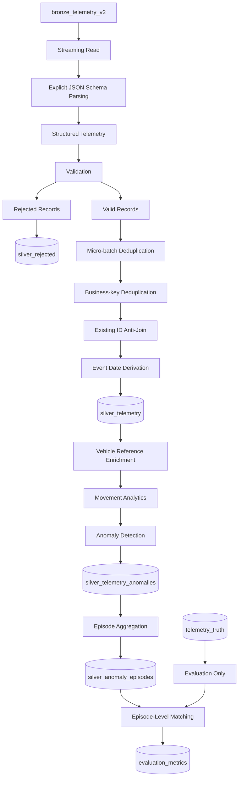

# Person 2 — Silver Layer Processing & Anomaly Detection

**Project:** Fleet Telematics Lakehouse  
**Platform:** Microsoft Fabric  
**Processing Engine:** PySpark  
**Storage Format:** Delta Lake  
**Owner:** Person 2 — Silver Processing and Anomaly Detection

---

## Table of Contents

1. [Overview](#1-overview)
2. [Responsibilities](#2-responsibilities)
3. [Architecture and Data Flow](#3-architecture-and-data-flow)
4. [Bronze Source and Schema Parsing](#4-bronze-source-and-schema-parsing)
5. [Data Validation and Rejected Records](#5-data-validation-and-rejected-records)
6. [Deduplication and Date Partitioning](#6-deduplication-and-date-partitioning)
7. [Vehicle Reference Enrichment](#7-vehicle-reference-enrichment)
8. [Vehicle Movement Analytics](#8-vehicle-movement-analytics)
9. [Rule-Based Anomaly Detection](#9-rule-based-anomaly-detection)
10. [Anomaly Episode Aggregation](#10-anomaly-episode-aggregation)
11. [Incremental Streaming Ingestion](#11-incremental-streaming-ingestion)
12. [SQL Output Verification](#12-sql-output-verification)
13. [Ground Truth and Evaluation Methodology](#13-ground-truth-and-evaluation-methodology)
14. [Evaluation Results](#14-evaluation-results)
15. [Evidence Screenshots](#15-evidence-screenshots)
16. [Data Quality and Engineering Considerations](#16-data-quality-and-engineering-considerations)
17. [Limitations and Future Improvements](#17-limitations-and-future-improvements)
18. [Conclusion](#18-conclusion)

---

## 1. Overview

Person 2 implements the Silver processing and anomaly detection stage of the Fleet Telematics Lakehouse.

The objective is to transform raw vehicle telemetry from the Bronze layer into structured, validated, deduplicated, and enriched data that can be used for operational analytics and downstream reporting.

The implementation uses PySpark in Microsoft Fabric and stores the transformed datasets as Delta tables.

The processing pipeline covers:

- Parsing raw JSON telemetry using an explicit schema.
- Validating required fields and separating invalid records.
- Preserving rejected records for investigation.
- Removing duplicate records using record identifiers and telemetry business keys.
- Deriving event dates and partitioning Silver data.
- Enriching telemetry with vehicle reference attributes.
- Calculating GPS distance, time gaps, and estimated vehicle speed.
- Detecting operational anomalies using predefined rules.
- Grouping related anomaly readings into episodes.
- Processing new Bronze arrivals incrementally.
- Preventing insertion of records whose identifiers already exist in Silver.
- Comparing detected episodes with ground-truth anomaly groups.
- Calculating Precision, Recall, and F1-score.

The final outputs provide a structured foundation for investigating fleet behavior, vehicle movement anomalies, engine conditions, cold-chain compliance, and prolonged idling.

### Silver Layer objectives

The Silver Layer is responsible for improving the usability and reliability of raw telemetry data before it reaches downstream analytical workloads.

Its main goals are to:

1. Convert semi-structured payloads into typed, structured records.
2. Prevent invalid records from silently entering the curated dataset.
3. Preserve rejected records for troubleshooting and data quality analysis.
4. Reduce duplicate records before performing sequential calculations.
5. Add derived attributes required for analytical processing.
6. Enrich telemetry with vehicle reference information.
7. Identify suspicious telemetry patterns through rule-based detection.
8. Aggregate related anomaly readings into episode-level records.
9. Support incremental ingestion of new data.
10. Provide evaluation outputs that can be inspected through SQL.

## 2. Responsibilities

| Component | Description |
|---|---|
| Schema parsing | Converts raw JSON payloads into structured telemetry fields. |
| Data validation | Checks required fields and upstream validation status. |
| Rejected records | Preserves invalid records and their rejection reasons. |
| Deduplication | Removes repeated records using configured identifiers and business keys. |
| Silver storage | Persists cleaned telemetry in Delta format. |
| Reference enrichment | Joins telemetry with vehicle reference data. |
| Movement analytics | Calculates distance, elapsed time, and estimated speed. |
| Anomaly detection | Identifies suspicious readings using business rules. |
| Episode aggregation | Groups related anomalous readings into episodes. |
| Incremental ingestion | Processes new data while filtering previously inserted IDs. |
| Evaluation | Compares detected episodes with ground-truth episodes. |

### Processing outputs

| Output table | Purpose |
|---|---|
| `silver_telemetry` | Stores cleaned and structured telemetry. |
| `silver_rejected` | Stores records that fail validation. |
| `silver_telemetry_anomalies` | Stores telemetry records identified as anomalous. |
| `silver_anomaly_episodes` | Stores grouped anomaly episodes and their summary attributes. |
| `evaluation_metrics` | Stores calculated evaluation metrics. |

An individual anomaly reading is not equivalent to an aggregated anomaly episode. The distinction is important when evaluating the detection system.

---

## 3. Architecture and Data Flow

The Silver Layer follows a medallion-style processing architecture in which raw Bronze data is transformed into curated Silver datasets.



### Processing flow

1. Read Bronze telemetry from the Delta source.
2. Process available input using a streaming query.
3. Parse JSON payloads using an explicit schema.
4. Convert event timestamps into timestamp values.
5. Validate mandatory telemetry fields and upstream validity status.
6. Persist rejected records separately.
7. Remove duplicate record IDs within each micro-batch.
8. Remove repeated vehicle and event-time combinations within the valid records.
9. Identify records whose `db_id` does not already exist in Silver.
10. Derive `event_date` and append new records to the Silver Delta table.
11. Enrich telemetry with vehicle reference attributes.
12. Calculate movement-related metrics.
13. Apply anomaly detection rules.
14. Aggregate related detections into episodes.
15. Compare detected episodes with ground truth.
16. Persist evaluation metrics for SQL inspection.

### Separation of detection and evaluation

The `telemetry_truth` dataset is used for evaluation only.

It must not be used by the anomaly detection rules to determine which records should be flagged. Otherwise, the evaluation would no longer provide an independent assessment of the detection process.

- **Detection:** uses telemetry measurements and implemented business rules.
- **Episode aggregation:** groups related detections using the configured grouping conditions.
- **Evaluation:** compares detected episodes with ground-truth episode groups.

---

## 4. Bronze Source and Schema Parsing

### 4.1 Source table

The incremental streaming implementation reads from `bronze_telemetry_v2`.

The Bronze layer contains raw telemetry payloads and ingestion metadata. Keeping the original payload allows malformed JSON and invalid records to be investigated without modifying the source data.

Relevant source fields include:

| Field | Purpose |
|---|---|
| `raw` | Original telemetry payload as text. |
| `db_id` | Record identifier used by deduplication and existing-ID checks. |
| `source` | Ingestion source. |
| `is_valid` | Upstream validation status. |
| `reject_reason` | Upstream rejection reason, when available. |
| `EventEnqueuedUtcTime` | Source arrival timestamp. |
| `event_id` | Telemetry event identifier. |
| `vehicle_id` | Vehicle identifier. |
| `trip_id` | Trip identifier. |
| `event_time` | Time when the telemetry reading was recorded. |

### 4.2 Explicit schema

The implementation defines the expected telemetry structure using PySpark's `StructType` and `StructField`.

```python
from delta.tables import DeltaTable
from pyspark.sql import functions as F
from pyspark.sql.types import (
    StructType,
    StructField,
    StringType,
    DoubleType,
    TimestampType,
    IntegerType,
    BooleanType
)

telemetry_schema = StructType([
    StructField("event_id", StringType(), True),
    StructField("vehicle_id", StringType(), True),
    StructField("trip_id", StringType(), True),
    StructField("event_time", StringType(), True),
    StructField("latitude", DoubleType(), True),
    StructField("longitude", DoubleType(), True),
    StructField("speed_kmh", DoubleType(), True),
    StructField("rpm", IntegerType(), True),
    StructField("engine_temp_c", DoubleType(), True),
    StructField("fuel_rate_lph", DoubleType(), True),
    StructField("odometer_km", DoubleType(), True),
    StructField("cargo_temp_c", DoubleType(), True)
])
```

### 4.3 Schema field definitions

| Field | Data type | Description |
|---|---|---|
| `event_id` | String | Telemetry event identifier. |
| `vehicle_id` | String | Vehicle identifier. |
| `trip_id` | String | Associated trip. |
| `event_time` | String before conversion | Original event timestamp. |
| `latitude` | Double | GPS latitude. |
| `longitude` | Double | GPS longitude. |
| `speed_kmh` | Double | Reported speed in km/h. |
| `rpm` | Integer | Engine revolutions per minute. |
| `engine_temp_c` | Double | Engine temperature in Celsius. |
| `fuel_rate_lph` | Double | Fuel consumption rate in liters per hour. |
| `odometer_km` | Double | Odometer reading in kilometers. |
| `cargo_temp_c` | Double | Cargo temperature, when applicable. |

The third argument of each `StructField` is set to `True`, meaning that the schema permits null values for the field. Mandatory-field validation is performed separately.

### 4.4 Why explicit schema parsing is important

Telemetry arrives as semi-structured JSON. JSON fields are not automatically guaranteed to have the expected data types or contain all required values.

An explicit schema:

- Defines the expected structure of the payload.
- Specifies the data types used by downstream transformations.
- Makes telemetry fields available as structured Spark columns.
- Avoids relying entirely on automatic schema inference.
- Helps separate parsing from validation.

### 4.5 Reading the Bronze streaming source

```python
df_bronze_stream = (
    spark.readStream
    .format("delta")
    .option("ignoreChanges", "true")
    .table("bronze_telemetry_v2")
)
```

The code creates a streaming DataFrame from the Bronze Delta table.

| Operation | Purpose |
|---|---|
| `spark.readStream` | Creates a streaming read. |
| `format("delta")` | Reads from a Delta source. |
| `ignoreChanges` | Configures how changes to existing source data are handled. |
| `table()` | Specifies the source table. |

The option `ignoreChanges` should not be interpreted as a universal guarantee that all modifications to existing records will be emitted as new telemetry events.

### 4.6 Parsing JSON inside each micro-batch

The parsing takes place inside the `foreachBatch` processing function:

```python
df_parsed = microBatchDF.withColumn(
    "parsed_data",
    F.from_json(F.col("raw"), telemetry_schema)
).select(
    F.col("db_id"),
    F.col("source"),
    F.col("is_valid"),
    F.col("reject_reason"),
    F.col("EventEnqueuedUtcTime"),
    F.col("parsed_data.*")
).withColumn(
    "event_time",
    F.col("event_time").cast(TimestampType())
)
```

The processing sequence is:

1. Read the current micro-batch DataFrame.
2. Parse the `raw` JSON payload using `F.from_json()`.
3. Store the structured result in `parsed_data`.
4. Select the ingestion metadata needed by downstream processing.
5. Expand the parsed telemetry fields into individual columns.
6. Convert `event_time` from its original string representation to a timestamp.

The expanded DataFrame contains both source metadata and parsed telemetry fields.

### 4.7 Parsing and validation are separate

A record can be valid JSON but still have a missing `vehicle_id`, null coordinates, or an unusable timestamp.

Conversely, malformed JSON can prevent the expected telemetry fields from being extracted correctly.

Therefore, schema parsing is followed by explicit validation rather than treating successful parsing as proof of data quality.

### Evidence — Schema Parsing


*Figure 1 — Explicit schema definition, incremental source reading, and JSON parsing.*

---

## 5. Data Validation and Rejected Records

### 5.1 Validation objective

The validation stage prevents records that fail mandatory-field checks or upstream validation from entering the valid-record processing path.

The implemented validation checks:

- `event_id`
- `vehicle_id`
- `event_time`
- `latitude`
- `longitude`
- `speed_kmh`

These fields support event identification, vehicle grouping, timestamp ordering, GPS calculations, and movement analysis.

### 5.2 Validation condition

```python
validation_condition = (
    F.col("event_id").isNotNull() &
    F.col("vehicle_id").isNotNull() &
    F.col("event_time").isNotNull() &
    F.col("latitude").isNotNull() &
    F.col("longitude").isNotNull() &
    F.col("speed_kmh").isNotNull()
)
```

The logical AND operator requires every listed field to be non-null for the condition to evaluate as true.

| Condition | Outcome |
|---|---|
| All required fields are non-null | Passes the required-field check. |
| `event_id` is null | Fails validation. |
| `vehicle_id` is null | Fails validation. |
| `event_time` is null | Fails validation. |
| `latitude` is null | Fails validation. |
| `longitude` is null | Fails validation. |
| `speed_kmh` is null | Fails validation. |

This condition checks for null values. It does not independently verify that coordinates are within geographic bounds or that speed values are physically plausible.

### 5.3 Deduplication before validation output

The micro-batch records are deduplicated by `db_id` before the valid and rejected datasets are created:

```python
df_deduplicated_mb = df_parsed.dropDuplicates(["db_id"])
```

This means that the rejected-record path and valid-record path both operate on the micro-batch DataFrame after this `db_id` deduplication step.

### 5.4 Rejected-record condition

```python
df_rejected = df_deduplicated_mb.filter(
    (F.col("is_valid") == False) |
    (~validation_condition)
).withColumn(
    "rejection_reason",
    F.coalesce(
        F.col("reject_reason"),
        F.lit(
            "missing mandatory fields (null keys/coords/speed)"
        )
    )
).withColumn(
    "rejected_at",
    F.current_timestamp()
)
```

The rejection condition uses logical OR.

A record enters the rejected dataset when either:

1. Its upstream `is_valid` flag is explicitly false.
2. The required-field validation condition fails.

The rejection reason is constructed using `F.coalesce()`.

`coalesce()` returns the first non-null expression. In this implementation, the original `reject_reason` is preserved when available; otherwise, the fallback text is used.

The `rejected_at` field records the timestamp at which the rejection transformation is evaluated.

### 5.5 Persisting rejected records

```python
if not df_rejected.isEmpty():
    df_rejected.write.format("delta") \
        .mode("append") \
        .option("mergeSchema", "true") \
        .saveAsTable("silver_rejected")
```

The write is performed only when the rejected DataFrame is not empty.

The dataset is written in Delta format using append mode, so rejected records from the current micro-batch are added to the target table rather than replacing its existing data.

The `mergeSchema` option permits schema evolution according to the applicable Delta write behavior.

### 5.6 Valid-record condition

```python
df_valid = df_deduplicated_mb.filter(
    (F.col("is_valid") == True) & validation_condition
)
```

A record enters `df_valid` only when:

- The upstream validity flag is explicitly true.
- Every mandatory field passes the required-field condition.

A record with an upstream validity flag of null is not selected by this expression because null is not equal to `True`.

### 5.7 Rejected-record table

The target table is `silver_rejected`.

Its purpose is to preserve records that fail validation for further investigation.

The rejected output includes source metadata, parsed telemetry fields, a rejection reason, and a rejection timestamp.

Preserving rejected data supports:

- Data quality investigations.
- Identification of recurring missing fields.
- Analysis of upstream validation failures.
- Review of malformed or incomplete telemetry.
- Troubleshooting without silently discarding source records.

### 5.8 Validation count reconciliation

The captured notebook output reports:

|| Metric | Record Count | Percentage |
|---|---:|---:|
| **Total Parsed Records** | **8,272,514** | **100.00%** |
| **Total Valid Records** | **8,146,714** | **98.48%** |
| **Total Rejected Records** | **113,475** | **1.37%** |
| **Deduplicated / Unmatched Variance** | **12,325** | **0.15%** |

These values do not reconcile arithmetically because the reported valid and rejected counts sum to more than the reported parsed count.

The counts should be rechecked against the corresponding DataFrames and filters before being presented as a reconciled data-quality summary.

### Evidence — Validation


*Figure 2 — Required-field validation, rejection reasons, and persistence of rejected records.*

---

## 6. Deduplication and Date Partitioning

### 6.1 Why deduplication matters

Duplicate telemetry records can inflate row counts and distort analytical calculations.

Duplicates may occur because of repeated delivery, retries, replay operations, or overlapping ingestion windows.

The streaming implementation uses two different deduplication operations, each with a different purpose.

### 6.2 First level: micro-batch record ID deduplication

```python
df_deduplicated_mb = df_parsed.dropDuplicates(["db_id"])
```

This removes repeated `db_id` values within the current micro-batch.

The operation ensures that multiple rows with the same selected ID do not proceed separately through the subsequent valid and rejected record paths.

It does not, by itself, eliminate repeated IDs across different micro-batches.

### 6.3 Second level: vehicle and event-time deduplication

```python
df_valid_clean = (
    df_valid
    .dropDuplicates(["vehicle_id", "event_time"])
    .withColumn(
        "event_date",
        F.to_date(F.col("event_time"))
    )
)
```

This operation removes duplicate combinations of `vehicle_id` and `event_time` from the valid records in the current micro-batch.

The two deduplication keys serve different purposes:

| Key | Purpose |
|---|---|
| `db_id` | Removes repeated record IDs within a micro-batch. |
| `vehicle_id`, `event_time` | Removes repeated vehicle/time combinations within the valid micro-batch records. |

The second operation is applied after the first validation filter.

Because `dropDuplicates()` does not specify a rule for choosing between conflicting rows with the same key, it should not be assumed to retain a particular version when the other columns differ.

### 6.4 Event date derivation

```python
.withColumn(
    "event_date",
    F.to_date(F.col("event_time"))
)
```

The event timestamp is converted into a date column.

The resulting `event_date` is used as the partitioning column when new records are written to the Silver table.

### 6.5 Checking whether the Silver table exists

```python
if spark.catalog.tableExists("silver_telemetry"):
    silver_existing = (
        spark.read.table("silver_telemetry")
        .select("db_id")
    )
```

Before attempting the existing-ID comparison, the notebook checks whether `silver_telemetry` exists in the Spark catalog.

When the table exists, it reads the existing `db_id` values.

This provides the set of identifiers used to determine whether a valid record has already been inserted into Silver.

### 6.6 Left-anti join

```python
new_valid_records = df_valid_clean.join(
    silver_existing,
    on="db_id",
    how="left_anti"
)
```

A left-anti join returns rows from the left DataFrame that have no matching join key in the right DataFrame.

In this case:

- The left DataFrame contains valid, deduplicated records from the current micro-batch.
- The right DataFrame contains IDs already present in `silver_telemetry`.
- The join key is `db_id`.
- The result contains records whose `db_id` does not already exist in the Silver table.

If the Silver table does not exist, the notebook uses `df_valid_clean` directly as `new_valid_records`.

### 6.7 Appending new records

```python
if not new_valid_records.isEmpty():
    new_valid_records.write \
        .format("delta") \
        .mode("append") \
        .option("mergeSchema", "true") \
        .partitionBy("event_date") \
        .saveAsTable("silver_telemetry")
```

The output is appended only when the new-record DataFrame is not empty.

| Operation | Purpose |
|---|---|
| `isEmpty()` | Checks whether there are records to write. |
| `format("delta")` | Writes the output in Delta format. |
| `mode("append")` | Adds new records without intentionally replacing existing table data. |
| `mergeSchema` | Allows supported schema evolution during the write. |
| `partitionBy("event_date")` | Organizes the output by event date. |
| `saveAsTable()` | Writes to the named Silver table. |

### 6.8 Incremental deduplication limitations

The two `dropDuplicates()` calls operate on the current micro-batch. The left-anti join then checks whether each candidate `db_id` already exists in Silver.

This prevents existing IDs from being selected by the anti-join under the normal single-writer assumptions.

However, the approach is not a universal exactly-once guarantee. Concurrent writers, retries, changes to existing records, or differences between the deduplication keys can affect the result.

The `vehicle_id` and `event_time` deduplication is also applied within the current micro-batch; the existing-table comparison checks `db_id`, not the vehicle/time business key.

### 6.9 Why partition by event date?

Date-based partitioning organizes the Silver dataset for historical analysis.

Queries that filter on `event_date` may benefit because Spark can potentially skip partitions that do not match the query filter.

Actual performance depends on data volume, partition sizes, file sizes, and query patterns.

### Evidence — Deduplication and Partitioning


*Figure 3 — Deduplication, event date derivation, and Delta table persistence.*

---

## 7. Vehicle Reference Enrichment

### 7.1 Objective

The telemetry dataset contains vehicle measurements, while `ref_vehicles` provides additional information about each vehicle.

Enrichment combines telemetry with vehicle reference attributes so that downstream processing can use the available vehicle metadata.

The join is performed using `vehicle_id`.

### 7.2 Broadcast left join

```python
df_ref_vehicle = spark.read.table("ref_vehicles")

df_enriched = df_silver.join(
    F.broadcast(df_ref_vehicle),
    on="vehicle_id",
    how="left"
)
```

The implementation:

1. Reads the vehicle reference table.
2. Applies a broadcast hint to the reference DataFrame.
3. Joins the telemetry and reference DataFrames on `vehicle_id`.
4. Uses a left join to preserve telemetry records without a matching reference row.

### 7.3 Why use a broadcast join?

A broadcast join can reduce shuffle overhead when the reference dataset is sufficiently small to be distributed efficiently to Spark executors.

Without broadcasting, Spark may need to redistribute data across workers to perform the join. Broadcasting can make the reference data available to executors without the same type of shuffle for the join.

The reference dataset must fit comfortably within available executor memory. A broadcast hint does not make an oversized dataset safe to broadcast.

### 7.4 Why use a left join?

A left join preserves telemetry records even when their `vehicle_id` has no matching entry in `ref_vehicles`.

In such cases, the reference-side attributes can be null rather than causing the telemetry record to disappear from the result.

### 7.5 Fallback behavior

The notebook includes exception handling that falls back to the original Silver DataFrame if the reference read or join fails.

This allows processing to continue, but the resulting DataFrame may lack reference attributes.

In production, the fallback should be logged and monitored rather than treated as a fully successful enrichment.

### Evidence — Broadcast Join


*Figure 4 — Enriching Silver telemetry using a broadcast left join with vehicle reference data.*

---

## 8. Vehicle Movement Analytics

### 8.1 Objective

Vehicle movement analytics derives information from sequential telemetry readings.

The notebook compares consecutive GPS observations for each vehicle to calculate distance, elapsed time, and estimated speed.

These derived measurements support the identification of suspicious GPS jumps and other movement-related conditions.

### 8.2 Window specification

```python
window_spec = (
    Window
    .partitionBy("vehicle_id")
    .orderBy("event_time")
)
```

The window partitions events by `vehicle_id` and orders them by `event_time`.

This establishes a chronological event sequence for each vehicle.

Partitioning by vehicle prevents the previous reading of one vehicle from being treated as the previous reading of another vehicle.

### 8.3 Retrieve previous reading values

```python
df_windowed = (
    df_enriched
    .withColumn(
        "prev_latitude",
        F.lag("latitude").over(window_spec)
    )
    .withColumn(
        "prev_longitude",
        F.lag("longitude").over(window_spec)
    )
    .withColumn(
        "prev_event_time",
        F.lag("event_time").over(window_spec)
    )
)
```

The `lag()` function retrieves a value from a preceding row in the ordered window.

| Column | Purpose |
|---|---|
| `prev_latitude` | Latitude of the previous reading for the vehicle. |
| `prev_longitude` | Longitude of the previous reading for the vehicle. |
| `prev_event_time` | Timestamp of the previous reading for the vehicle. |

The first reading for each vehicle has no preceding reading, so the previous values are null.

### 8.4 Calculate the time gap

```python
df_windowed = df_windowed.withColumn(
    "time_gap_sec",
    F.unix_timestamp("event_time")
    - F.unix_timestamp("prev_event_time")
)
```

The current and previous timestamps are converted to Unix timestamps and subtracted.

The resulting `time_gap_sec` represents the elapsed time between consecutive readings in seconds.

A positive time gap is required for a meaningful speed calculation. Repeated timestamps or out-of-order readings can produce zero or negative gaps and require explicit handling.

### 8.5 Haversine distance

The Haversine formula calculates the approximate great-circle distance between two GPS coordinates on a spherical Earth.

\[
a =
\sin^2\left(\frac{\Delta\phi}{2}\right)
+
\cos(\phi_1)\cos(\phi_2)
\sin^2\left(\frac{\Delta\lambda}{2}\right)
\]

\[
d = 2R\arcsin(\sqrt{a})
\]

Where:

- \(\phi_1\) and \(\phi_2\) are latitudes in radians.
- \(\lambda_1\) and \(\lambda_2\) are longitudes in radians.
- \(\Delta\phi\) is the latitude difference in radians.
- \(\Delta\lambda\) is the longitude difference in radians.
- \(R\) is the assumed Earth radius, approximately 6,371 km.
- \(d\) is the approximate distance between consecutive GPS positions in kilometers.

The notebook uses the calculated distance to derive `distance_km`.

### 8.6 Calculated speed

\[
\text{Speed (km/h)}
=
\frac{\text{Distance (km)}}{\text{Time Gap (seconds)}/3600}
\]

The time gap is converted from seconds to hours before calculating the average speed.

The implementation calculates speed when the time gap is valid and positive. Otherwise, it uses a zero fallback.

A zero fallback does not necessarily mean that the vehicle was physically stationary; it may indicate that a valid calculation was unavailable.

### 8.7 Excessive idling

The implemented idling indicator combines:

- `speed_kmh < 2`
- `rpm > 0`

This identifies a low-speed reading while the engine is running, assuming the telemetry measurements are reliable.

Low speed alone does not establish that the engine is idling. The RPM condition provides additional information about engine activity.

### 8.8 Cold-chain monitoring

Cargo temperature is compared with the configured acceptable range to identify potential cold-chain violations.

The supplied project documentation describes a 2°C–8°C range in the movement analytics section and a broader -2°C–12°C range in the anomaly detection section. The exact threshold used by the executed implementation should be confirmed before treating these ranges as equivalent.

Null cargo temperatures must also be interpreted according to vehicle type because some vehicles may legitimately lack cargo-temperature readings.

### Evidence — Movement Analytics


*Figure 5 — Window functions, Haversine distance, calculated speed, idling detection, and cold-chain validation.*

---

## 9. Rule-Based Anomaly Detection

The notebook identifies suspicious readings using deterministic rules.

| Anomaly | Implemented condition | Purpose |
|---|---|---|
| GPS teleportation | `calculated_speed_kmh > 200` | Identifies implausibly high GPS-derived speed. |
| Engine overheating | `engine_temp_c > 105` | Flags high engine temperatures. |
| RPM spike | `rpm > 4500` | Flags unusually high engine RPM. |
| Cold-chain breach | `is_cold_chain_violation` | Flags cargo temperatures outside the configured range. |
| Excessive idling | `is_idling` | Flags low speed while the engine is running. |

### 9.1 GPS teleportation

A calculated speed above 200 km/h can indicate incorrect coordinates, corrupted timestamps, out-of-order readings, or implausible movement.

The rule uses GPS-derived speed rather than only the reported vehicle speed.

### 9.2 Engine overheating

The notebook flags an engine temperature above 105°C.

This is a configured detection threshold and does not independently prove mechanical failure.

### 9.3 RPM spike

The notebook flags readings where RPM exceeds 4,500.

### 9.4 Cold-chain breach

The rule identifies cargo-temperature readings outside the configured range.

The precise range should be verified against the executed notebook because the supplied documentation describes different temperature intervals in different sections.

### 9.5 Excessive idling

The notebook uses the combination of reported speed below 2 km/h and positive RPM to identify an idling reading.

### 9.6 Combined anomaly flag

The notebook combines individual Boolean conditions into an overall `is_anomaly` flag and assigns an `anomaly_type`.

When multiple conditions are true for the same reading, the order of conditional branches determines which category is assigned if the output stores only one anomaly type.

### 9.7 Anomaly persistence

Detected anomaly records are saved in `silver_telemetry_anomalies`.

This table provides the input for SQL inspection and subsequent episode aggregation.

### Evidence — Anomaly Detection


*Figure 6 — Anomaly flags, anomaly classification, and the subsequent episode aggregation logic.*

---

## 10. Anomaly Episode Aggregation

### 10.1 Why aggregate readings into episodes?

A single operational anomaly may produce multiple consecutive readings.

For example, a vehicle may remain idling across several telemetry events. Counting every reading as an independent incident would inflate the number of operational events.

Episode aggregation groups related detections into an event-level representation.

This is important because the evaluation uses episode-level ground-truth groups rather than treating every reading as an independent incident.

### 10.2 Episode window

```python
episodes_window = (
    Window
    .partitionBy("vehicle_id", "anomaly_type")
    .orderBy("event_time")
)
```

This window groups readings by vehicle and anomaly type, then orders them by event time.

### 10.3 Episode boundaries

The implementation calculates the gap between consecutive anomalous readings.

A new episode begins when the preceding anomaly timestamp is null or the gap exceeds five minutes.

```python
new_episode_flag = (
    gap_minutes.isNull()
    | (gap_minutes > 5)
)
```

A cumulative sum of the episode-start flag is then used to generate episode identifiers.

The logic groups nearby anomalous readings of the same type into a single episode.

The five-minute threshold directly affects the episode count. Increasing or decreasing the threshold can merge or split episodes even if the underlying anomaly flags remain unchanged.

### 10.4 Episode summary fields

| Field | Meaning |
|---|---|
| `vehicle_id` | Vehicle associated with the anomaly. |
| `anomaly_type` | Type of anomaly detected. |
| `episode_id` | Identifier assigned to the grouped episode. |
| `start_time` | First event timestamp in the episode. |
| `end_time` | Last event timestamp in the episode. |
| `reading_count` | Number of readings in the episode. |
| `max_calculated_speed` | Maximum calculated speed within the episode. |
| `duration_seconds` | Difference between the episode end and start timestamps. |

\[
\text{Duration Seconds}
=
\text{End Timestamp}
-
\text{Start Timestamp}
\]

A single-reading episode can have a calculated duration of zero seconds even if the real-world anomaly lasted longer. The recorded duration reflects the timestamps represented in the data.

### 10.5 Episode persistence

The episode-level output is persisted in `silver_anomaly_episodes`.

This table is used for SQL inspection and downstream evaluation.

### Evidence — Episode Aggregation


*Figure 7 — Grouping anomaly readings into episodes and generating episode-level summaries.*

---

## 11. Incremental Streaming Ingestion

### 11.1 Objective

The incremental streaming implementation processes available records from `bronze_telemetry_v2` and appends new valid records to `silver_telemetry`.

It also preserves rejected records in `silver_rejected`.

The implementation uses `foreachBatch` so that each streaming micro-batch can be processed using regular PySpark DataFrame transformations and Delta table writes.

The main objectives are to:

- Process available Bronze data incrementally.
- Parse JSON payloads using the explicit telemetry schema.
- Apply mandatory-field validation.
- Preserve rejected records.
- Deduplicate record IDs within each micro-batch.
- Remove repeated vehicle and event-time combinations within valid records.
- Exclude IDs that already exist in Silver.
- Append new records using Delta Lake.
- Record streaming progress through a checkpoint.

### 11.2 Complete streaming implementation

The following code is the streaming implementation used for the documented processing flow.

```python
from delta.tables import DeltaTable
from pyspark.sql import functions as F
from pyspark.sql.types import (
    StructType,
    StructField,
    StringType,
    DoubleType,
    TimestampType,
    IntegerType,
    BooleanType
)

# ---------------------------------------------------------
# 1. Define the expected telemetry JSON schema
# ---------------------------------------------------------

telemetry_schema = StructType([
    StructField("event_id", StringType(), True),
    StructField("vehicle_id", StringType(), True),
    StructField("trip_id", StringType(), True),
    StructField("event_time", StringType(), True),
    StructField("latitude", DoubleType(), True),
    StructField("longitude", DoubleType(), True),
    StructField("speed_kmh", DoubleType(), True),
    StructField("rpm", IntegerType(), True),
    StructField("engine_temp_c", DoubleType(), True),
    StructField("fuel_rate_lph", DoubleType(), True),
    StructField("odometer_km", DoubleType(), True),
    StructField("cargo_temp_c", DoubleType(), True)
])

# ---------------------------------------------------------
# 2. Read the Bronze Delta table as a streaming source
# ---------------------------------------------------------

df_bronze_stream = (
    spark.readStream
    .format("delta")
    .option("ignoreChanges", "true")
    .table("bronze_telemetry_v2")
)

# ---------------------------------------------------------
# 3. Process each streaming micro-batch
# ---------------------------------------------------------

def process_silver_streaming_microbatch(microBatchDF, batchId):

    # Skip empty micro-batches
    if microBatchDF.isEmpty():
        return

    # -----------------------------------------------------
    # 3.1 Parse the raw JSON payload
    # -----------------------------------------------------

    df_parsed = (
        microBatchDF
        .withColumn(
            "parsed_data",
            F.from_json(
                F.col("raw"),
                telemetry_schema
            )
        )
        .select(
            F.col("db_id"),
            F.col("source"),
            F.col("is_valid"),
            F.col("reject_reason"),
            F.col("EventEnqueuedUtcTime"),
            F.col("parsed_data.*")
        )
        .withColumn(
            "event_time",
            F.col("event_time").cast(TimestampType())
        )
    )

    # -----------------------------------------------------
    # 3.2 Define mandatory-field validation
    # -----------------------------------------------------

    validation_condition = (
        F.col("event_id").isNotNull() &
        F.col("vehicle_id").isNotNull() &
        F.col("event_time").isNotNull() &
        F.col("latitude").isNotNull() &
        F.col("longitude").isNotNull() &
        F.col("speed_kmh").isNotNull()
    )

    # -----------------------------------------------------
    # 3.3 Remove repeated record IDs within the micro-batch
    # -----------------------------------------------------

    df_deduplicated_mb = (
        df_parsed.dropDuplicates(["db_id"])
    )

    # -----------------------------------------------------
    # 3.4 Identify and persist rejected records
    # -----------------------------------------------------

    df_rejected = (
        df_deduplicated_mb
        .filter(
            (F.col("is_valid") == False) |
            (~validation_condition)
        )
        .withColumn(
            "rejection_reason",
            F.coalesce(
                F.col("reject_reason"),
                F.lit(
                    "missing mandatory fields "
                    "(null keys/coords/speed)"
                )
            )
        )
        .withColumn(
            "rejected_at",
            F.current_timestamp()
        )
    )

    if not df_rejected.isEmpty():
        (
            df_rejected.write
            .format("delta")
            .mode("append")
            .option("mergeSchema", "true")
            .saveAsTable("silver_rejected")
        )

    # -----------------------------------------------------
    # 3.5 Select valid records
    # -----------------------------------------------------

    df_valid = df_deduplicated_mb.filter(
        (F.col("is_valid") == True) &
        validation_condition
    )

    # -----------------------------------------------------
    # 3.6 Apply business-key deduplication and derive date
    # -----------------------------------------------------

    df_valid_clean = (
        df_valid
        .dropDuplicates(["vehicle_id", "event_time"])
        .withColumn(
            "event_date",
            F.to_date(F.col("event_time"))
        )
    )

    # -----------------------------------------------------
    # 3.7 Exclude IDs already present in Silver
    # -----------------------------------------------------

    if spark.catalog.tableExists("silver_telemetry"):

        silver_existing = (
            spark.read.table("silver_telemetry")
            .select("db_id")
        )

        new_valid_records = df_valid_clean.join(
            silver_existing,
            on="db_id",
            how="left_anti"
        )

    else:
        new_valid_records = df_valid_clean

    # -----------------------------------------------------
    # 3.8 Append new records to the Silver Delta table
    # -----------------------------------------------------

    if not new_valid_records.isEmpty():
        (
            new_valid_records.write
            .format("delta")
            .mode("append")
            .option("mergeSchema", "true")
            .partitionBy("event_date")
            .saveAsTable("silver_telemetry")
        )

# ---------------------------------------------------------
# 4. Configure and start the streaming query
# ---------------------------------------------------------

query = (
    df_bronze_stream.writeStream
    .format("delta")
    .foreachBatch(process_silver_streaming_microbatch)
    .option(
        "checkpointLocation",
        "Files/checkpoints/silver_streaming_full_rules"
    )
    .trigger(availableNow=True)
    .start()
)

# Wait for all available input to finish processing
query.awaitTermination()

print("write new stream only")
```

### 11.3 Step 1 — Schema definition

The `telemetry_schema` object defines the expected structure of each raw JSON payload.

The schema includes identifiers, timestamps, GPS coordinates, speed, engine measurements, fuel consumption, odometer readings, and cargo temperature.

The fields are nullable in the schema, while mandatory-field validation is handled separately.

### 11.4 Step 2 — Streaming source

```python
df_bronze_stream = (
    spark.readStream
    .format("delta")
    .option("ignoreChanges", "true")
    .table("bronze_telemetry_v2")
)
```

This creates a streaming DataFrame from the Bronze Delta table.

The streaming source supplies records to the micro-batch processing function. The actual amount of data processed depends on the source state and the streaming checkpoint.

### 11.5 Step 3 — The `foreachBatch` processing function

```python
def process_silver_streaming_microbatch(microBatchDF, batchId):
```

`foreachBatch` invokes this function for each micro-batch processed by the streaming query.

The function receives:

- `microBatchDF`: the DataFrame containing the current batch.
- `batchId`: the identifier associated with the micro-batch.

The function performs parsing, validation, rejected-record handling, deduplication, existing-ID filtering, and Delta writes.

The `batchId` parameter is available for logging or batch-specific control, although the supplied implementation does not use it directly.

### 11.6 Step 4 — Empty micro-batch handling

```python
if microBatchDF.isEmpty():
    return
```

An empty micro-batch has no records to process.

The function returns immediately instead of executing the remaining transformations and writes.

### 11.7 Step 5 — JSON parsing and timestamp conversion

```python
df_parsed = microBatchDF.withColumn(
    "parsed_data",
    F.from_json(F.col("raw"), telemetry_schema)
).select(
    F.col("db_id"),
    F.col("source"),
    F.col("is_valid"),
    F.col("reject_reason"),
    F.col("EventEnqueuedUtcTime"),
    F.col("parsed_data.*")
).withColumn(
    "event_time",
    F.col("event_time").cast(TimestampType())
)
```

The transformation parses the raw payload and expands the resulting structured fields.

The original source metadata is retained alongside the parsed telemetry fields.

The `event_time` cast prepares the event timestamp for time-based processing. If parsing or conversion produces null values, the mandatory-field validation can reject the affected records.

### 11.8 Step 6 — Mandatory-field validation

The validation condition requires non-null values for:

- `event_id`
- `vehicle_id`
- `event_time`
- `latitude`
- `longitude`
- `speed_kmh`

The condition is used by both the valid and rejected record paths.

The code checks nullability rather than all possible data quality constraints. For example, coordinate range validation and physical plausibility checks are separate concerns.

### 11.9 Step 7 — Micro-batch deduplication

```python
df_deduplicated_mb = df_parsed.dropDuplicates(["db_id"])
```

This removes repeated `db_id` values within the current micro-batch.

The result is used to derive both rejected and valid records.

This operation does not, by itself, prevent a duplicate ID from appearing in a later micro-batch. The existing Silver ID check provides the subsequent filtering step for valid records.

### 11.10 Step 8 — Rejected records

```python
df_rejected = df_deduplicated_mb.filter(
    (F.col("is_valid") == False) |
    (~validation_condition)
)
```

A record is rejected when the upstream flag is explicitly false or when one or more mandatory fields are null.

The code assigns a rejection reason using the original `reject_reason` when available. If that field is null, a fallback message is provided.

The `rejected_at` column records the current processing timestamp.

Non-empty rejected records are appended to `silver_rejected` in Delta format.

### 11.11 Step 9 — Valid records

```python
df_valid = df_deduplicated_mb.filter(
    (F.col("is_valid") == True) &
    validation_condition
)
```

The valid-record path requires both a true upstream validity flag and successful mandatory-field validation.

Records with an upstream validity flag of null are not selected by this condition.

### 11.12 Step 10 — Business-key deduplication

```python
df_valid_clean = (
    df_valid
    .dropDuplicates(["vehicle_id", "event_time"])
    .withColumn(
        "event_date",
        F.to_date(F.col("event_time"))
    )
)
```

This performs a second deduplication operation using `vehicle_id` and `event_time`.

It removes repeated combinations of these columns within the valid DataFrame for the current micro-batch.

The same transformation derives `event_date`, which is required by the partitioned write.

The business-key deduplication is separate from the `db_id` deduplication. They identify duplicates according to different definitions.

### 11.13 Step 11 — Existing-ID filtering

```python
if spark.catalog.tableExists("silver_telemetry"):
    silver_existing = (
        spark.read.table("silver_telemetry")
        .select("db_id")
    )

    new_valid_records = df_valid_clean.join(
        silver_existing,
        on="db_id",
        how="left_anti"
    )
else:
    new_valid_records = df_valid_clean
```

The code checks whether the Silver table exists.

If it exists, the notebook reads its `db_id` values and uses a left-anti join to select valid records with IDs not already stored in Silver.

If the table does not exist, all records remaining in `df_valid_clean` are selected as candidates for insertion.

This filtering is based on `db_id`. It does not check whether an existing Silver record already has the same `vehicle_id` and `event_time` combination under a different `db_id`.

### 11.14 Step 12 — Append-only Silver writes

```python
if not new_valid_records.isEmpty():
    (
        new_valid_records.write
        .format("delta")
        .mode("append")
        .option("mergeSchema", "true")
        .partitionBy("event_date")
        .saveAsTable("silver_telemetry")
    )
```

The code writes only when the candidate DataFrame is non-empty.

The write:

- Uses Delta format.
- Appends records instead of replacing the target table.
- Allows supported schema evolution.
- Partitions the output by `event_date`.
- Saves the output to `silver_telemetry`.

### 11.15 Step 13 — Checkpointing

```python
.option(
    "checkpointLocation",
    "Files/checkpoints/silver_streaming_full_rules"
)
```

The checkpoint location stores streaming progress and supports recovery after interruption.

The checkpoint must remain consistent with the streaming query it belongs to. Reusing a checkpoint with a materially different source or processing plan can create compatibility issues.

### 11.16 Step 14 — Available-now trigger

```python
.trigger(availableNow=True)
```

The available-now trigger processes the available input and terminates after the available data has been processed.

It is useful for incremental scheduled processing because the query can process new data and then finish instead of running continuously.

The query waits for termination using:

```python
query.awaitTermination()
```

The final print statement:

```python
print("write new stream only")
```

prints a message after the streaming query finishes. The message itself is not an independent verification of record counts or exactly-once processing.

### 11.17 Streaming implementation considerations

The supplied code implements several layers of duplicate prevention, but the exact guarantees depend on the source, checkpoint, and write behavior.

Important considerations include:

1. `dropDuplicates(["db_id"])` operates within the current micro-batch.
2. `dropDuplicates(["vehicle_id", "event_time"])` also operates on the current valid micro-batch.
3. The left-anti join checks `db_id` against the existing Silver table.
4. The rejected-record write uses append mode and has no equivalent existing-ID check.
5. Concurrent writers can affect the behavior of read-before-write duplicate checks.
6. Source updates and deletions need to be handled according to the source's change semantics.
7. The batch ID is available but is not used for explicit batch-level idempotency.
8. The full-refresh overwrite path and incremental append path should be coordinated.

The implementation should not be described as providing an unconditional exactly-once guarantee without further testing under retry, replay, and concurrent-write scenarios.

---

## 12. SQL Output Verification

SQL queries are used to inspect the persisted datasets and verify the outputs of the Silver processing pipeline.

### 12.1 Silver telemetry

The `silver_telemetry` table contains the cleaned telemetry records and relevant metadata.

SQL inspection can be used to review the output schema and confirm that the expected processed fields are available.


*Figure 8 — SQL inspection of persisted Silver telemetry records.*

### 12.2 Rejected records

The `silver_rejected` table retains records that failed validation.

Inspecting these records helps identify data quality issues and understand why particular records did not proceed through the valid-record processing path.


*Figure 9 — Rejected telemetry records and their recorded validation reasons.*

### 12.3 Detected anomalies

The `silver_telemetry_anomalies` table contains the persisted anomaly-related records.

SQL queries can be used to inspect the available anomaly attributes and review which records were flagged by the detection rules.


*Figure 10 — SQL inspection of detected telemetry anomalies.*

### 12.4 Aggregated episodes

The `silver_anomaly_episodes` table contains grouped episode records and summary attributes.

This output is especially important for evaluation because the ground truth is also evaluated at the episode level.


*Figure 11 — SQL inspection of the aggregated anomaly episodes.*

---

## 13. Ground Truth and Evaluation Methodology

### 13.1 Purpose of the ground truth

The upstream project provides a `telemetry_truth` table that records the injected anomalies used to evaluate the detection process.

The truth dataset includes an event identifier, an anomaly type, and an anomaly group identifier representing an injected episode.

The ground truth is used only during evaluation. It must not influence the production anomaly detection logic.

### 13.2 Readings versus episodes

The ground-truth dataset contains approximately **90 reading-level records** associated with the anomalies.

These records do not represent 90 independent anomaly episodes. Multiple readings can belong to the same injected anomaly group.

When the truth records are grouped to match the episode-level evaluation, they produce **6 ground-truth episode groups** in the captured evaluation scope.

| Concept | Meaning |
|---|---|
| Truth reading | One ground-truth record associated with an anomaly. |
| Truth episode group | One injected anomaly episode represented by a group identifier. |
| Detected anomaly reading | One telemetry reading flagged by the detection rules. |
| Detected episode | A group of related anomalous readings produced by episode aggregation. |
| True positive | A detected episode counted as matching a truth episode under the implemented matching conditions. |

Therefore, 90 truth readings and 6 truth episodes are not contradictory. They represent different levels of aggregation.

The evaluation uses the episode-level count of 6 as its ground-truth denominator, rather than treating all 90 readings as independent anomaly events.

### 13.3 Evaluation matching

The evaluation notebook prepares the ground-truth data and detected episodes for matching.

The implemented logic includes:

1. Extracting the vehicle identifier from the truth anomaly group identifier.
2. Restricting detected episodes to vehicles represented in the truth data.
3. Applying a minimum reading-count condition to the primary matching scope.
4. Matching candidates using vehicle identity and anomaly type.
5. Counting matched candidates and calculating evaluation metrics.

### 13.4 Matching limitations

Matching by vehicle and anomaly type does not necessarily prove that the detected episode corresponds to the exact time interval of the injected event.

If a vehicle has multiple episodes of the same anomaly type, a stronger matching strategy should use the ground-truth episode identity and temporal overlap or event-level correspondence.

### 13.5 Evaluation formulas

**Precision**

\[
\text{Precision} =
\frac{TP}{\text{Detected Episodes}}
\]

Precision measures the fraction of detected episodes counted as true positives.

**Recall**

\[
\text{Recall} =
\frac{TP}{\text{Ground-Truth Episodes}}
\]

Recall measures the fraction of ground-truth episodes matched by the detection system.

**F1-score**

\[
F1 =
2 \times
\frac{\text{Precision}\times\text{Recall}}
{\text{Precision}+\text{Recall}}
\]

F1-score combines precision and recall into a single metric.

### Evidence — Evaluation Logic


*Figure 12 — Ground-truth preparation, episode matching, and calculation of Precision, Recall, and F1-score.*

---

## 14. Evaluation Results

### 14.1 Reported results

The captured SQL query returns the following persisted evaluation metrics.


*Figure 13 — Evaluation metrics retrieved from the `evaluation_metrics` table.*

| Metric | Reported value |
|---|---:|
| Precision | 0.16666666666666666 |
| Recall | 0.3333333333333333 |
| F1-score | 0.2222222222222222 |
| True positives | 2 |
| Total detected in scope | 12 |
| Total ground-truth episodes | 6 |

### 14.2 Rounded values

| Metric | Rounded value |
|---|---:|
| Precision | 0.1667 |
| Recall | 0.3333 |
| F1-score | 0.2222 |
| True positives | 2 |
| Detected episodes in scope | 12 |
| Ground-truth episodes | 6 |

### 14.3 Precision calculation

\[
\text{Precision} = \frac{2}{12} = 0.1667
\]

Two of the twelve detected episodes in the evaluation scope were counted as true positives under the implemented matching logic.

The other ten detections were not counted as true positives by that logic. They should not automatically be described as physically false anomalies without investigating their individual matches and the evaluation scope.

### 14.4 Recall calculation

\[
\text{Recall} = \frac{2}{6} = 0.3333
\]

Two of the six ground-truth episodes were matched. Four ground-truth episodes were not counted as matched under the implemented method.

### 14.5 F1-score calculation

\[
F1 =
2 \times
\frac{0.1667 \times 0.3333}
{0.1667 + 0.3333}
\approx 0.2222
\]

The displayed F1-score is consistent with the reported Precision and Recall, subject to rounding.

### 14.6 Interpretation

The ground-truth table contains approximately 90 readings, but the evaluation groups them into 6 anomaly episodes.

The reported scores must therefore be interpreted against the six episode-level ground-truth groups, not against 90 independent truth events.

In this execution:

- 12 detected episodes were included in the evaluation scope.
- 6 ground-truth episodes were included.
- 2 matches were counted as true positives.
- Precision was calculated as 2/12.
- Recall was calculated as 2/6.

These values describe the output of the current evaluation logic. They do not independently establish whether the primary problem lies in the anomaly detection rules, episode boundaries, or the matching implementation.

### 14.7 Recommended evaluation improvements

Before adjusting anomaly thresholds, investigate:

1. Whether the six ground-truth groups are constructed correctly.
2. Whether the same vehicles are included on both sides.
3. Whether anomaly types are normalized consistently.
4. Whether detected episodes overlap the correct truth time intervals.
5. Whether the minimum two-reading condition excludes valid events.
6. Whether episode boundaries split or merge events unexpectedly.
7. Whether the current matching method can match the same truth episode more than once.
8. Whether unmatched detections are false positives or valid events outside the truth scope.

A more robust evaluation should produce an explicit match table containing matched episodes, unmatched detections, and unmatched ground-truth episodes.

---

## 15. Evidence Screenshots

All screenshots are stored in `evidence/person2/`.

### 15.1 Bronze sample data


### 15.2 Schema parsing


### 15.3 Data validation


### 15.4 Deduplication and partitioning


### 15.5 Vehicle reference enrichment


### 15.6 Movement analytics


### 15.7 Anomaly detection and episode aggregation


### 15.8 Evaluation code


### 15.9 Silver telemetry query


### 15.10 Rejected records query


### 15.11 Anomaly query


### 15.12 Episode query


### 15.13 Evaluation results


*The previous standalone streaming-code screenshot is intentionally omitted because the implementation is documented directly in Section 11.*

---

## 16. Data Quality and Engineering Considerations

### 16.1 Schema and nullability

Mandatory telemetry fields must be validated before calculations.

Nullable fields must be interpreted according to their business meaning, particularly cargo temperature for vehicles that do not require temperature monitoring.

### 16.2 Malformed JSON

Malformed JSON should be distinguished from valid JSON containing null values.

The original payload should be preserved, and parsing failures should receive explicit rejection reasons.

### 16.3 Deduplication identity

The implementation uses `db_id` for micro-batch deduplication and existing-ID filtering, and `vehicle_id + event_time` for an additional deduplication step within valid micro-batches.

The intended duplicate semantics should be documented and applied consistently across streaming, batch, and replay paths.

### 16.4 Timestamp consistency

Movement analytics and episode grouping depend on correctly ordered timestamps.

Time zones, duplicate timestamps, and out-of-order events should be handled explicitly because they can affect previous-reading calculations, time gaps, calculated speeds, and episode boundaries.

### 16.5 GPS calculations

Invalid coordinates, zero or negative time gaps, and implausible distances should be addressed before calculated speeds are used for anomaly detection.

### 16.6 Anomaly thresholds

Threshold-based detection is interpretable but can produce false positives and false negatives.

The rules should be validated against known injected anomaly behavior.

### 16.7 Episode aggregation

The five-minute episode gap threshold directly affects the number of detected episodes.

Changes to this threshold can alter evaluation metrics even when the underlying reading-level anomaly flags do not change.

### 16.8 Incremental processing

Checkpoint recovery, stable identifiers, consistent schemas, and coordinated writes are necessary for reliable incremental ingestion.

The streaming and full-refresh paths should not conflict with each other.

### 16.9 Rejected-record idempotency

The streaming code appends rejected records to `silver_rejected`, but does not check existing rejected IDs before writing.

If the same source records are replayed, rejected records could be appended again. A production implementation should define and enforce the intended idempotency policy for rejected data as well.

### 16.10 Evaluation integrity

Ground truth must remain separate from production detection.

Evaluation should retain enough detail to explain which episodes matched and why.

---

## 17. Limitations and Future Improvements

The following improvements are recommended:

1. **Episode matching:** Match using vehicle, anomaly type, and temporal overlap.
2. **Ground-truth verification:** Confirm that the six groups correctly represent the intended injected episodes.
3. **Validation count reconciliation:** Recalculate captured counts using consistent DataFrames and filters.
4. **Deduplication policy:** Document the distinct roles of `db_id` and `vehicle_id + event_time`.
5. **Incremental safety:** Coordinate overwrite and append processing paths.
6. **Rejected-record idempotency:** Prevent repeated rejected records from accumulating during replay.
7. **Data quality:** Add range checks for coordinates, speed, fuel, engine temperature, and time gaps.
8. **Anomaly explainability:** Preserve individual Boolean anomaly flags alongside the assigned anomaly type.
9. **Evaluation diagnostics:** Generate a detailed list of matched and unmatched episodes.
10. **Performance monitoring:** Record processing duration, input counts, rejected counts, and output counts for each execution.
11. **Reproducibility:** Store evaluation scope and matching configuration alongside the resulting metrics.
12. **Streaming recovery tests:** Verify behavior after retries, checkpoint recovery, and repeated source input.

These are recommendations for further improvement, not claims that all of these features are already implemented.

---

## 18. Conclusion

Person 2 implements the Silver processing and anomaly analytics stage of the Fleet Telematics Lakehouse.

The implementation demonstrates structured JSON parsing, mandatory-field validation, rejected-record preservation, two levels of micro-batch deduplication, existing-ID filtering, date-based Delta storage, broadcast joins, GPS movement analytics, rule-based anomaly detection, episode aggregation, incremental streaming ingestion, and SQL-based output verification.

The incremental streaming path processes available records from `bronze_telemetry_v2` through `foreachBatch`. It parses telemetry, separates valid and rejected records, filters existing Silver IDs, and appends new valid records to `silver_telemetry`.

The captured evaluation reports:

- **12 detected episodes** in the evaluation scope.
- **6 ground-truth episodes**.
- **2 true-positive matches**.
- **Precision:** 0.1667.
- **Recall:** 0.3333.
- **F1-score:** 0.2222.

Approximately 90 reading-level truth records are grouped into six episode-level evaluation units. The reported metrics use the six episode groups rather than treating all 90 readings as independent events.

The current metrics provide a baseline for the implemented matching procedure. The next priority is to verify episode grouping and matching, investigate unmatched detections, reconcile validation counts, and test incremental idempotency before making conclusions about the anomaly detection thresholds.

This Silver stage provides the structured and enriched telemetry foundation required for downstream Gold-layer modeling, fleet KPIs, and operational analytics.

---

**Related documentation:** [Person 1 — Data Generation and Ingestion](../person1/README.md)
