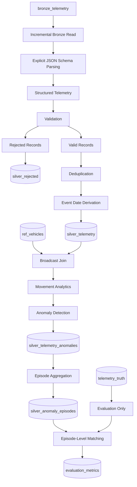

# Person 2 — Silver Layer Processing & Anomaly Detection

**Project:** Fleet Telematics Lakehouse  
**Platform:** Microsoft Fabric  
**Processing Engine:** PySpark  
**Storage Format:** Delta Lake  
**Owner:** Person 2 — Silver Processing and Anomaly Detection

---

## Table of Contents

1. [Overview](#1-overview)
2. [Responsibilities](#2-responsibilities)
3. [Architecture and Data Flow](#3-architecture-and-data-flow)
4. [Bronze Source and Schema Parsing](#4-bronze-source-and-schema-parsing)
5. [Data Validation and Rejected Records](#5-data-validation-and-rejected-records)
6. [Deduplication and Date Partitioning](#6-deduplication-and-date-partitioning)
7. [Vehicle Reference Enrichment](#7-vehicle-reference-enrichment)
8. [Vehicle Movement Analytics](#8-vehicle-movement-analytics)
9. [Rule-Based Anomaly Detection](#9-rule-based-anomaly-detection)
10. [Anomaly Episode Aggregation](#10-anomaly-episode-aggregation)
11. [Incremental Streaming Ingestion](#11-incremental-streaming-ingestion)
12. [SQL Output Verification](#12-sql-output-verification)
13. [Ground Truth and Evaluation Methodology](#13-ground-truth-and-evaluation-methodology)
14. [Evaluation Results](#14-evaluation-results)
15. [Evidence Screenshots](#15-evidence-screenshots)
16. [Data Quality and Engineering Considerations](#16-data-quality-and-engineering-considerations)
17. [Limitations and Future Improvements](#17-limitations-and-future-improvements)
18. [Conclusion](#18-conclusion)

---

## 1. Overview

Person 2 implements the Silver processing and anomaly detection stage of the Fleet Telematics Lakehouse.

The objective is to transform raw vehicle telemetry from the Bronze layer into structured, validated, deduplicated, and enriched data that can be used for operational analytics and downstream reporting.

The implementation uses PySpark in Microsoft Fabric and stores the transformed datasets as Delta tables.

The processing pipeline covers:

- Parsing raw JSON telemetry using an explicit schema.
- Validating required fields and separating invalid records.
- Preserving rejected records for investigation.
- Removing duplicate records.
- Deriving event dates and partitioning Silver data.
- Enriching telemetry with vehicle reference attributes.
- Calculating GPS distance, time gaps, and estimated vehicle speed.
- Detecting operational anomalies using predefined rules.
- Grouping related anomaly readings into episodes.
- Processing new Bronze arrivals incrementally.
- Comparing detected episodes with ground-truth anomaly groups.
- Calculating precision, recall, and F1-score.

The final outputs provide a structured foundation for investigating fleet behavior, vehicle movement anomalies, engine conditions, cold-chain compliance, and prolonged idling.

## 2. Responsibilities

| Component | Description |
|---|---|
| Schema parsing | Converts raw JSON payloads into structured telemetry fields. |
| Data validation | Checks required fields and upstream validation status. |
| Rejected records | Preserves invalid records and their rejection reasons. |
| Deduplication | Removes repeated records using the configured identifier. |
| Silver storage | Persists cleaned telemetry in Delta format. |
| Reference enrichment | Joins telemetry with vehicle reference data. |
| Movement analytics | Calculates distance, elapsed time, and estimated speed. |
| Anomaly detection | Identifies suspicious readings using business rules. |
| Episode aggregation | Groups related anomalous readings into episodes. |
| Incremental ingestion | Processes new data while avoiding previously inserted IDs. |
| Evaluation | Compares detected episodes with ground-truth episodes. |

## 3. Architecture and Data Flow



### Processing flow

1. Read raw telemetry from Bronze.
2. Parse JSON records using an explicit schema.
3. Validate required telemetry fields.
4. Persist rejected records separately.
5. Deduplicate accepted records.
6. Derive event dates and write the Silver table.
7. Enrich telemetry with vehicle reference attributes.
8. Calculate movement-related metrics.
9. Apply anomaly detection rules.
10. Aggregate related detections into episodes.
11. Compare detected episodes with ground truth.
12. Persist evaluation metrics for SQL inspection.

**Evaluation separation:** `telemetry_truth` is used only for evaluation. It must not be used by the anomaly detection logic itself.

## 4. Bronze Source and Schema Parsing

### 4.1 Source table

The primary input table is `bronze_telemetry`.

The Bronze layer contains raw telemetry payloads and ingestion metadata. Keeping the original payload allows malformed JSON and invalid records to be investigated without modifying the source data.

Relevant source fields include:

| Field | Purpose |
|---|---|
| `raw` | Original telemetry payload as text. |
| `db_id` | Record identifier used by the implemented deduplication logic. |
| `source` | Ingestion source. |
| `is_valid` | Upstream validation status, when available. |
| `reject_reason` | Upstream rejection reason, when available. |
| `EventEnqueuedUtcTime` | Arrival timestamp used by the incremental processing logic. |
| `event_id` | Telemetry event identifier. |
| `vehicle_id` | Vehicle identifier. |
| `trip_id` | Trip identifier. |
| `event_time` | Time when the telemetry reading was recorded. |

### 4.2 Explicit schema

The parsing stage defines expected data types using PySpark's `StructType` and `StructField`.

| Field | Data type | Description |
|---|---|---|
| `event_id` | String | Unique event identifier. |
| `vehicle_id` | String | Vehicle identifier. |
| `trip_id` | String | Associated trip. |
| `event_time` | String before conversion | Original event timestamp. |
| `latitude` | Double | GPS latitude. |
| `longitude` | Double | GPS longitude. |
| `speed_kmh` | Double | Reported speed in km/h. |
| `rpm` | Integer | Engine revolutions per minute. |
| `engine_temp_c` | Double | Engine temperature in Celsius. |
| `fuel_rate_lph` | Double | Fuel consumption rate in liters per hour. |
| `odometer_km` | Double | Odometer reading in kilometers. |
| `cargo_temp_c` | Double | Cargo temperature, when applicable. |

### 4.3 Parsing approach

The notebook uses `from_json()` to convert the raw payload into a structured column.

```python
df_parsed = df_bronze.withColumn(
    "parsed_data",
    from_json(col("raw"), telemetry_schema)
)
```

The resulting structured fields are selected alongside the required ingestion metadata. The event timestamp is subsequently converted to a timestamp type for time-based calculations.

### 4.4 Incremental source filtering

The notebook checks whether the Silver table exists and, when applicable, retrieves the latest processed arrival timestamp.

Incoming Bronze records can then be filtered to arrivals newer than the stored watermark.

This reduces unnecessary reprocessing. However, a strict timestamp comparison can skip records that share the exact same arrival timestamp as the watermark. A production implementation should use a deterministic composite watermark or an overlapping read window with idempotent deduplication.

### Evidence — Schema Parsing


*Figure 1 — Explicit schema definition, incremental source filtering, and JSON parsing.*

## 5. Data Validation and Rejected Records

### 5.1 Validation objective

A record being valid JSON does not guarantee that it contains the required telemetry values.

The validation stage checks mandatory fields before the records are used for analytical processing.

The implemented condition checks:

- `event_id`
- `vehicle_id`
- `event_time`
- `latitude`
- `longitude`
- `speed_kmh`

### 5.2 Validation condition

```python
validation_condition = (
    col("event_id").isNotNull()
    & col("vehicle_id").isNotNull()
    & col("event_time").isNotNull()
    & col("latitude").isNotNull()
    & col("longitude").isNotNull()
    & col("speed_kmh").isNotNull()
)
```

Accepted records must satisfy the required-field condition and the upstream validation status used by the notebook.

Rejected records are selected when the upstream validity flag is false or the required-field condition fails.

### 5.3 Rejection reason handling

The notebook assigns a rejection reason using the existing reason when available. Otherwise, it supplies a fallback reason indicating that mandatory fields are missing or null.

A rejection timestamp is also recorded to support auditing and investigation.

### 5.4 Rejected records table

Invalid records are persisted to `silver_rejected`.

The table retains the relevant telemetry fields and rejection metadata, including the record ID, source, validation status, reason, event timestamps, vehicle information, and rejected timestamp.

This approach preserves rejected data instead of silently discarding it.

### 5.5 Validation output

The captured notebook output shows:

| Metric | Reported count |
|---|---:|
| Total parsed | 8,272,514 |
| Total rejected | 1,134,475 |
| Total valid | 8,146,714 |

**Count reconciliation note:** these values do not reconcile arithmetically. The valid and rejected counts sum to more than the reported parsed count. The counts should be rechecked against the corresponding DataFrames and filters before being presented as a reconciled data-quality summary.

### Evidence — Validation


*Figure 2 — Required-field validation, rejection reasons, and persistence of rejected records.*

## 6. Deduplication and Date Partitioning

### 6.1 Why deduplication matters

Duplicate telemetry records can inflate row counts and distort analytical calculations.

Duplicates may occur because of repeated delivery, retries, replay operations, or overlapping ingestion windows.

The implemented notebook removes repeated `db_id` values:

```python
df_deduplicated = df_valid.dropDuplicates(["db_id"])
```

### 6.2 Deduplication counts

```python
valid_count = df_valid.count()
deduped_count = df_deduplicated.count()

duplicates_removed = valid_count - deduped_count
```

The captured output reports:

| Metric | Value |
|---|---:|
| Valid records before deduplication | 8,146,714 |
| Duplicates removed | 0 |
| Clean deduplicated records | 8,146,714 |

These values are reported for the captured execution. Zero removed duplicates means that no repeated `db_id` values were removed by this operation. It does not prove that there are no duplicates under every possible business key.

### 6.3 Business-key consideration

The upstream project documentation identifies `vehicle_id + event_time` as the telemetry business key, whereas the implemented Silver notebook uses `db_id`.

These identifiers should not be treated as interchangeable without verification. The deduplication policy should define how repeated deliveries, replayed events, and repeated business measurements are distinguished.

### 6.4 Event date derivation

```python
df_silver_clean = df_deduplicated.withColumn(
    "event_date",
    to_date(col("event_time"))
)
```

### 6.5 Delta table persistence

```python
(
    df_silver_clean.write
    .format("delta")
    .mode("overwrite")
    .option("overwriteSchema", "true")
    .partitionBy("event_date")
    .saveAsTable("silver_telemetry")
)
```

The captured execution confirms that `silver_telemetry` was rewritten and updated.

The use of `overwrite` represents a full-refresh write. It is distinct from the append-based incremental streaming implementation described later.

### 6.6 Why partition by event date?

Date-based partitioning can improve queries that filter by event date and helps organize telemetry for historical analysis.

The actual performance benefit depends on data volume, partition cardinality, file sizes, and query patterns.

### Evidence — Deduplication and Partitioning


*Figure 3 — Duplicate-count calculation, event date derivation, and Delta table persistence.*

## 7. Vehicle Reference Enrichment

### 7.1 Objective

The telemetry table contains vehicle measurements, while `ref_vehicles` provides additional information about each vehicle.

The notebook joins the datasets using `vehicle_id`.

### 7.2 Broadcast left join

```python
df_ref_vehicle = spark.read.table("ref_vehicles")

df_enriched = df_silver.join(
    F.broadcast(df_ref_vehicle),
    on="vehicle_id",
    how="left"
)
```

The broadcast hint distributes the reference DataFrame to the workers and can reduce shuffle overhead when the reference table is sufficiently small.

The left join preserves telemetry records even when a corresponding vehicle reference record is missing.

### 7.3 Fallback behavior

The notebook includes exception handling that falls back to the original Silver DataFrame if the reference read or join fails.

This allows processing to continue, but the output may lack reference attributes. In production, this condition should be logged and monitored rather than treated as a fully successful enrichment.

### Evidence — Broadcast Join


*Figure 4 — Enriching Silver telemetry using a broadcast left join with vehicle reference data.*

## 8. Vehicle Movement Analytics

### 8.1 Window specification

Movement calculations compare consecutive telemetry readings for the same vehicle.

```python
window_spec = (
    Window
    .partitionBy("vehicle_id")
    .orderBy("event_time")
)
```

This separates each vehicle's event sequence and orders its readings by event time.

### 8.2 Previous reading values

```python
df_windowed = (
    df_enriched
    .withColumn(
        "prev_latitude",
        F.lag("latitude").over(window_spec)
    )
    .withColumn(
        "prev_longitude",
        F.lag("longitude").over(window_spec)
    )
    .withColumn(
        "prev_event_time",
        F.lag("event_time").over(window_spec)
    )
)
```

The first reading for each vehicle does not have a previous reading, so the previous values are null.

### 8.3 Time gap

```python
df_windowed = df_windowed.withColumn(
    "time_gap_sec",
    F.unix_timestamp("event_time")
    - F.unix_timestamp("prev_event_time")
)
```

A valid positive time gap is required for a meaningful speed calculation.

### 8.4 Haversine distance

The Haversine formula calculates the approximate great-circle distance between two GPS coordinates.

\[
a =
\sin^2\left(\frac{\Delta\phi}{2}\right)
+
\cos(\phi_1)\cos(\phi_2)
\sin^2\left(\frac{\Delta\lambda}{2}\right)
\]

\[
d = 2R\arcsin(\sqrt{a})
\]

Where:

- \(\phi_1\) and \(\phi_2\) are latitudes in radians.
- \(\lambda_1\) and \(\lambda_2\) are longitudes in radians.
- \(R\) is the assumed Earth radius, approximately 6,371 km.
- \(d\) is the distance between consecutive GPS positions in kilometers.

The notebook uses the calculated distance to derive `distance_km`.

### 8.5 Calculated speed

\[
\text{Speed (km/h)}
=
\frac{\text{Distance (km)}}{\text{Time Gap (seconds)}/3600}
\]

The implementation calculates speed when the time gap is valid and positive. Otherwise, it uses a zero fallback.

A zero fallback does not necessarily mean that the vehicle was physically stationary; it may indicate that a valid calculation was unavailable.

### 8.6 Excessive idling

The implemented idling indicator combines:

- `speed_kmh < 2`
- `rpm > 0`

This distinguishes a low-speed reading with the engine running from a planned stop where the engine is off, assuming the telemetry measurements are reliable.

### 8.7 Cold-chain violation

The notebook flags cargo temperatures outside the allowed range of 2°C–8°C.

Null cargo temperatures must be interpreted according to vehicle type because dry vans can legitimately have no cargo-temperature reading.

### Evidence — Movement Analytics


*Figure 5 — Window functions, Haversine distance, calculated speed, idling detection, and cold-chain validation.*

## 9. Rule-Based Anomaly Detection

The notebook identifies suspicious readings using deterministic rules.

| Anomaly | Implemented condition | Purpose |
|---|---|---|
| GPS teleportation | `calculated_speed_kmh > 200` | Identifies implausibly high GPS-derived speed. |
| Engine overheating | `engine_temp_c > 105` | Flags high engine temperatures. |
| RPM spike | `rpm > 4500` | Flags unusually high engine RPM. |
| Cold-chain breach | `is_cold_chain_violation` | Flags cargo temperatures outside the allowed range. |
| Excessive idling | `is_idling` | Flags low speed while the engine is running. |

### 9.1 GPS teleportation

A calculated speed above 200 km/h can indicate incorrect coordinates, corrupted timestamps, out-of-order readings, or implausible movement.

The rule uses GPS-derived speed rather than only the reported vehicle speed.

### 9.2 Engine overheating

The notebook flags an engine temperature above 105°C.

This threshold is a configured detection rule and does not independently prove mechanical failure.

### 9.3 RPM spike

The notebook flags readings where RPM exceeds 4,500.

### 9.4 Cold-chain breach

The rule identifies cargo-temperature readings outside the allowed -2°C–12°C range.

### 9.5 Excessive idling

The notebook uses the combination of reported speed below 2 km/h and positive RPM to identify an idling reading.

Episode aggregation is then used to group related readings into longer events.

### 9.6 Combined anomaly flag

The notebook combines the individual Boolean conditions into an overall `is_anomaly` flag and assigns an `anomaly_type`.

When multiple conditions are true for the same reading, the order of the conditional branches determines which category is assigned if the output stores only one anomaly type.

### 9.7 Anomaly persistence

Detected anomaly records are saved in `silver_telemetry_anomalies`.

### Evidence — Anomaly Detection


*Figure 6 — Anomaly flags, anomaly classification, and the subsequent episode aggregation logic.*

## 10. Anomaly Episode Aggregation

### 10.1 Why aggregate readings into episodes?

A single operational anomaly may produce multiple consecutive readings.

For example, a vehicle may remain idling across several telemetry events. Counting each reading as an independent incident would inflate the number of operational events.

Episode aggregation groups related detections into a more meaningful event-level representation.

### 10.2 Episode window

```python
episodes_window = (
    Window
    .partitionBy("vehicle_id", "anomaly_type")
    .orderBy("event_time")
)
```

### 10.3 Episode boundaries

The implementation calculates the gap between consecutive anomalous readings.

A new episode begins when the preceding anomaly timestamp is null or the gap exceeds five minutes.

```python
new_episode_flag = (
    gap_minutes.isNull()
    | (gap_minutes > 5)
)
```

A cumulative sum of the episode-start flag is then used to generate episode identifiers.

This approach groups nearby anomalous readings of the same type into a single episode.

### 10.4 Episode summary fields

| Field | Meaning |
|---|---|
| `vehicle_id` | Vehicle associated with the anomaly. |
| `anomaly_type` | Type of anomaly detected. |
| `episode_id` | Identifier assigned to the grouped episode. |
| `start_time` | First event timestamp in the episode. |
| `end_time` | Last event timestamp in the episode. |
| `reading_count` | Number of readings in the episode. |
| `max_calculated_speed` | Maximum calculated speed within the episode. |
| `duration_seconds` | Difference between the episode end and start timestamps. |

\[
\text{Duration Seconds}
=
\text{End Timestamp}
-
\text{Start Timestamp}
\]

A single-reading episode can have a calculated duration of zero seconds even if the actual real-world anomaly lasted longer.

### 10.5 Episode persistence

The episode-level output is persisted in `silver_anomaly_episodes`.

This table is used for SQL inspection and downstream evaluation.

### Evidence — Episode Aggregation


*Figure 7 — Grouping anomaly readings into episodes and generating episode-level summaries.*

## 11. Incremental Streaming Ingestion

### 11.1 Objective

The streaming notebook reads new Bronze records and appends only records whose identifiers do not already exist in Silver.

This processing path is separate from the full-refresh overwrite operation described earlier.

### 11.2 Streaming source

```python
df_bronze_stream = (
    spark.readStream
    .format("delta")
    .option("ignoreChanges", "true")
    .table("bronze_telemetry")
)
```

The streaming DataFrame is filtered using the upstream validation flag.

```python
df_silver_stream = df_bronze_stream.filter(
    F.col("is_valid") == True
)
```

This assumes that `is_valid` exists in the streaming source schema.

### 11.3 Micro-batch deduplication

The `foreachBatch` function removes duplicate `db_id` values within each micro-batch.

```python
clean_micro_batch = (
    microBatchDF.dropDuplicates(["db_id"])
)
```

### 11.4 Existing Silver IDs

The notebook reads existing Silver IDs and uses a left-anti join to select records that are not already present.

```python
silver_existing = (
    spark.read.table("silver_telemetry")
    .select("db_id")
)

new_records_only = clean_micro_batch.join(
    silver_existing,
    on="db_id",
    how="left_anti"
)
```

### 11.5 Appending new records

When new records exist, the notebook appends them to the Silver Delta table.

```python
if not new_records_only.isEmpty():
    (
        new_records_only.write
        .format("delta")
        .mode("append")
        .option("mergeSchema", "true")
        .saveAsTable("silver_telemetry")
    )
```

### 11.6 Checkpoint and execution

```python
query = (
    df_silver_stream.writeStream
    .format("delta")
    .foreachBatch(insert_only_new)
    .option(
        "checkpointLocation",
        "Files/checkpoints/silver_insert_new_only"
    )
    .trigger(availableNow=True)
    .start()
)

query.awaitTermination()
```

The checkpoint records streaming progress and supports recovery after interruption.

The available-now trigger processes available input and terminates after processing the available data. It is not a continuously running streaming job.

### 11.7 Execution evidence

The captured output reports:

`Only new records were inserted into Silver successfully!`

This confirms that the displayed notebook execution completed and printed the expected message. It does not by itself prove exactly-once processing under every possible failure scenario.

### Evidence — Incremental Streaming


*Figure 8 — Streaming ingestion, micro-batch deduplication, anti-join filtering, checkpointing, and append-based writes.*

## 12. SQL Output Verification

### 12.1 Silver telemetry

The `silver_telemetry` table contains the cleaned telemetry records and relevant metadata.


*Figure 9 — SQL inspection of persisted Silver telemetry records.*

### 12.2 Rejected records

The `silver_rejected` table retains records that failed validation, including examples of malformed JSON, missing fields, incorrect data types, and null required values.


*Figure 10 — Rejected telemetry records and their recorded validation reasons.*

### 12.3 Detected anomalies

The `silver_telemetry_anomalies` table contains the persisted anomaly-related records.


*Figure 11 — SQL inspection of detected telemetry anomalies.*

### 12.4 Aggregated episodes

The `silver_anomaly_episodes` table contains the grouped episode records and summary attributes.


*Figure 12 — SQL inspection of the aggregated anomaly episodes.*

## 13. Ground Truth and Evaluation Methodology

### 13.1 Purpose of the ground truth

The upstream project provides a `telemetry_truth` table that records the injected anomalies used to evaluate the detection process.

The truth dataset includes an event identifier, an anomaly type, and an anomaly group identifier representing an injected episode.

The ground truth is used only during evaluation. It must not influence the production anomaly detection logic.

### 13.2 The critical distinction: readings versus episodes

The evaluation results must be interpreted using the correct level of granularity.

The ground-truth dataset contains approximately **90 reading-level records** associated with the anomalies.

However, those 90 records do not represent 90 independent anomaly episodes. Multiple readings can belong to the same injected anomaly group.

When the truth records are grouped to match the episode-level evaluation, they produce **6 ground-truth episode groups** in the captured evaluation scope.

| Concept | Meaning |
|---|---|
| Truth reading | One ground-truth record associated with an anomaly. |
| Truth episode group | One injected anomaly episode represented by a group identifier. |
| Detected anomaly reading | One telemetry reading flagged by the detection rules. |
| Detected episode | A group of related anomalous readings produced by the episode aggregation logic. |
| True positive | A detected episode counted as matching a truth episode under the implemented matching conditions. |

**Therefore, 90 truth readings and 6 truth episodes are not contradictory. They represent different levels of aggregation.**

The evaluation uses the episode-level count of 6 as its ground-truth denominator, rather than treating all 90 readings as independent anomaly events.

### 13.3 Evaluation matching

The evaluation notebook prepares the ground-truth data and detected episodes for matching.

The implemented logic includes:

1. Extracting the vehicle identifier from the truth anomaly group identifier.
2. Restricting detected episodes to vehicles represented in the truth data.
3. Applying a minimum reading-count condition to the primary matching scope.
4. Matching candidates using vehicle identity and anomaly type.
5. Counting matched candidates and calculating the evaluation metrics.

### 13.4 Important matching limitation

Matching by vehicle and anomaly type does not necessarily prove that the detected episode corresponds to the exact time interval of the injected event.

If a vehicle has multiple episodes of the same anomaly type, a stronger matching strategy should use the ground-truth episode identity and temporal overlap or event-level correspondence.

### 13.5 Evaluation formulas

**Precision**

\[
\text{Precision} =
\frac{TP}{\text{Detected Episodes}}
\]

Precision measures the fraction of detected episodes counted as true positives.

**Recall**

\[
\text{Recall} =
\frac{TP}{\text{Ground-Truth Episodes}}
\]

Recall measures the fraction of ground-truth episodes matched by the detection system.

**F1-score**

\[
F1 =
2 \times
\frac{\text{Precision}\times\text{Recall}}
{\text{Precision}+\text{Recall}}
\]

F1-score combines precision and recall into a single metric.

### Evidence — Evaluation Logic


*Figure 13 — Ground-truth preparation, episode matching, and calculation of precision, recall, and F1-score.*

## 14. Evaluation Results

### 14.1 Reported results

The captured SQL query returns the following persisted evaluation metrics.


*Figure 14 — Evaluation metrics retrieved from the `evaluation_metrics` table.*

| Metric | Reported value |
|---|---:|
| Precision | 0.16666666666666666 |
| Recall | 0.3333333333333333 |
| F1-score | 0.2222222222222222 |
| True positives | 2 |
| Total detected in scope | 12 |
| Total ground-truth episodes | 6 |

Rounded values:

| Metric | Rounded value |
|---|---:|
| Precision | 0.1667 |
| Recall | 0.3333 |
| F1-score | 0.2222 |
| True positives | 2 |
| Detected episodes in scope | 12 |
| Ground-truth episodes | 6 |

### 14.2 Precision calculation

\[
\text{Precision} = \frac{2}{12} = 0.1667
\]

Two of the twelve detected episodes in the evaluation scope were counted as true positives under the implemented matching logic.

The other ten detections were not counted as true positives by that logic. They should not automatically be described as physically false anomalies without investigating their individual matches and the evaluation scope.

### 14.3 Recall calculation

\[
\text{Recall} = \frac{2}{6} = 0.3333
\]

Two of the six ground-truth episodes were matched. Four ground-truth episodes were not counted as matched under the implemented method.

### 14.4 F1-score calculation

\[
F1 =
2 \times
\frac{0.1667 \times 0.3333}
{0.1667 + 0.3333}
\approx 0.2222
\]

The displayed F1-score is consistent with the reported precision and recall, subject to rounding.

### 14.5 Why the metrics are relatively low

The ground-truth table contains approximately 90 readings, but the evaluation groups them into 6 anomaly episodes.

This grouping is necessary because several truth readings may belong to the same continuous injected event.

The low reported scores must therefore be interpreted against the **6 episode-level ground-truth groups**, not against 90 independent truth events.

The number of truth readings alone does not explain the score. The score depends on the number of true-positive episode matches, the number of detected episodes, the episode grouping rules, and the evaluation matching method.

In this execution:

- 12 detected episodes were included in the evaluation scope.
- 6 ground-truth episodes were included.
- 2 matches were counted as true positives.
- Precision was calculated as 2/12.
- Recall was calculated as 2/6.

These values describe the output of the current evaluation logic. They do not independently establish whether the primary problem lies in the anomaly detection rules, episode boundaries, or the matching implementation.

### 14.6 Recommended evaluation improvements

Before adjusting the anomaly thresholds, investigate:

1. Whether the six ground-truth groups are constructed correctly.
2. Whether the same vehicles are included on both sides.
3. Whether the anomaly types are normalized consistently.
4. Whether detected episodes overlap the correct truth time intervals.
5. Whether the minimum two-reading condition excludes valid events.
6. Whether episode boundaries split or merge events unexpectedly.
7. Whether the current matching method can match the same truth episode more than once.
8. Whether unmatched detections are false positives or valid events outside the truth scope.

A more robust evaluation should produce an explicit match table containing matched episodes, unmatched detections, and unmatched ground-truth episodes.

### 14.7 Important distinction

The 90 truth records represent reading-level observations, while the six groups represent episode-level evaluation units.

Consequently, the reported recall of 0.3333 means that two of the six ground-truth episodes were matched by the current method. It does not mean that only two of the 90 truth readings were detected.

## 15. Evidence Screenshots

All screenshots are stored in `evidence/person2/`.

### 15.1 Bronze sample data


### 15.2 Schema parsing


### 15.3 Data validation


### 15.4 Deduplication and partitioning


### 15.5 Vehicle reference enrichment


### 15.6 Movement analytics


### 15.7 Anomaly detection and episode aggregation


### 15.8 Evaluation code


### 15.9 Incremental streaming


### 15.10 Silver telemetry query


### 15.11 Rejected records query


### 15.12 Anomaly query


### 15.13 Episode query


### 15.14 Evaluation results


## 16. Data Quality and Engineering Considerations

### Schema and nullability

Mandatory telemetry fields must be validated before calculations. Nullable fields must be interpreted according to their business meaning, particularly cargo temperature for dry vans.

### Malformed JSON

Malformed JSON should be distinguished from valid JSON containing null values. The original payload should be preserved, and parsing failures should receive explicit rejection reasons.

### Deduplication identity

The current implementation uses `db_id`, while the upstream documentation identifies `vehicle_id + event_time` as the business key. The intended duplicate semantics should be documented and applied consistently across streaming, batch, and replay paths.

### Timestamp consistency

Movement analytics and episode grouping depend on correctly ordered timestamps. Time zones, duplicate timestamps, and out-of-order events should be handled explicitly.

### GPS calculations

Invalid coordinates, zero or negative time gaps, and implausible distances should be addressed before calculated speeds are used for anomaly detection.

### Anomaly thresholds

Threshold-based detection is interpretable but can produce false positives and false negatives. The rules should be validated against the known injected anomaly behavior.

### Episode aggregation

The five-minute episode gap threshold directly affects the number of detected episodes. Changes to this threshold can alter the evaluation metrics even when the underlying reading-level flags do not change.

### Incremental processing

Checkpoint recovery, stable identifiers, consistent schemas, and coordinated writes are necessary for reliable incremental ingestion. The streaming and full-refresh paths should not conflict with each other.

### Evaluation integrity

Ground truth must remain separate from production detection. Evaluation should retain enough detail to explain which episodes matched and why.

## 17. Limitations and Future Improvements

The following improvements are recommended:

1. **Episode matching:** Match using vehicle, anomaly type, and temporal overlap.
2. **Ground-truth verification:** Confirm the six groups correctly represent the intended injected episodes.
3. **Validation count reconciliation:** Recalculate the captured counts using the same DataFrame and filters.
4. **Deduplication policy:** Reconcile `db_id`, `event_id`, and the documented business key.
5. **Incremental safety:** Coordinate overwrite and append processing paths.
6. **Data quality:** Add range checks for coordinates, speed, fuel, engine temperature, and time gaps.
7. **Anomaly explainability:** Preserve individual Boolean anomaly flags alongside the assigned anomaly type.
8. **Evaluation diagnostics:** Generate a detailed list of matched and unmatched episodes.
9. **Performance monitoring:** Record processing duration, input counts, rejected counts, and output counts for each execution.
10. **Reproducibility:** Store the evaluation scope and matching configuration alongside the resulting metrics.

## 18. Conclusion

Person 2 implements the Silver processing and anomaly analytics stage of the Fleet Telematics Lakehouse.

The implementation demonstrates structured JSON parsing, validation, rejected-record preservation, deduplication, date-based Delta storage, broadcast joins, GPS movement analytics, rule-based anomaly detection, episode aggregation, incremental streaming ingestion, and SQL-based output verification.

The captured evaluation reports:

- **12 detected episodes** in the evaluation scope.
- **6 ground-truth episodes**.
- **2 true-positive matches**.
- **Precision:** 0.1667.
- **Recall:** 0.3333.
- **F1-score:** 0.2222.

The ground-truth distinction is essential: approximately 90 reading-level truth records are grouped into six episode-level evaluation units. The evaluation metrics are calculated using the six episode groups, not the 90 individual readings.

The current metrics provide a baseline for the implemented matching procedure. The next priority is to verify episode grouping and matching, investigate unmatched detections, and reconcile validation counts before making conclusions about the anomaly detection thresholds.

This Silver stage provides the structured and enriched telemetry foundation required for downstream Gold-layer modeling, fleet KPIs, and operational analytics.

---

**Related documentation:** [Person 1 — Data Generation and Ingestion](../person1/README.md)
